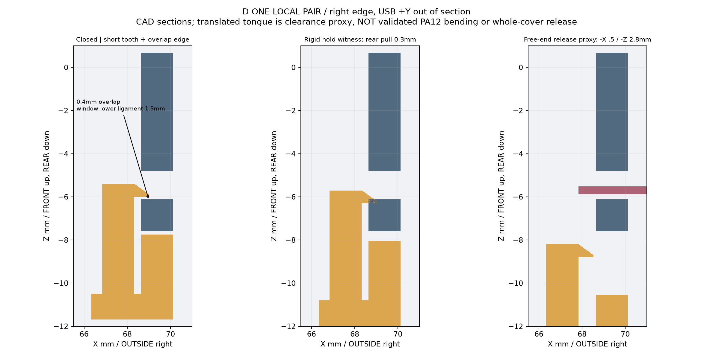
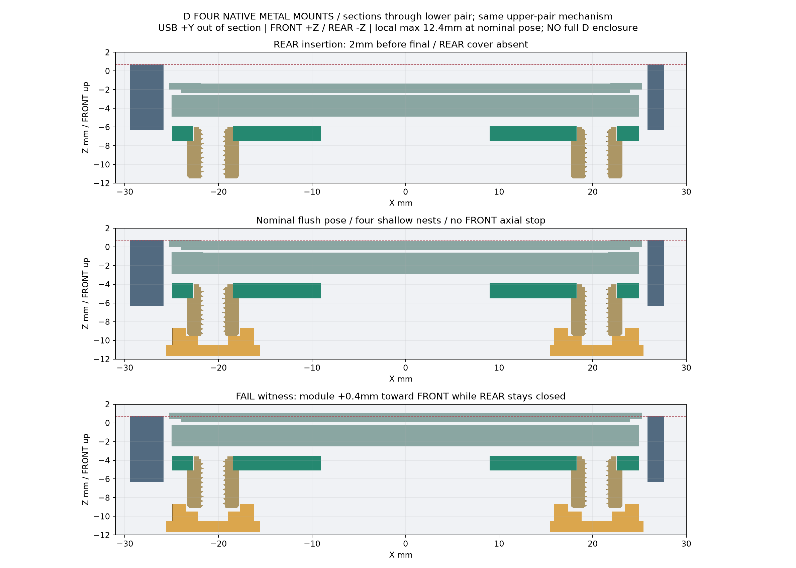

# T0 D 局部研究：BLOCKED

主要阻断：四浅窝能从后方托住原厂金属件，但不能限制 PCB 向 FRONT +Z 移动。保留原 A/B/C；没有完整 D 外壳，没有打印批准。

- [证据、尺寸、自由度与退出报告](../../docs/16_t0_d_local_passport_study.md)
- [一处短齿/接收窗局部 STEP](D_one_short_tooth_pair_LOCAL.step)
- [四安装位/开放前框局部 STEP](D_four_nests_open_frame_BLOCKED.step)
- [检查报告](checks.json)

上述 STEP 是局部研究上下文，不是打印文件。短齿的自由端平移只是净空代理，材料弯曲及完整盖板逐个释放未验证。
