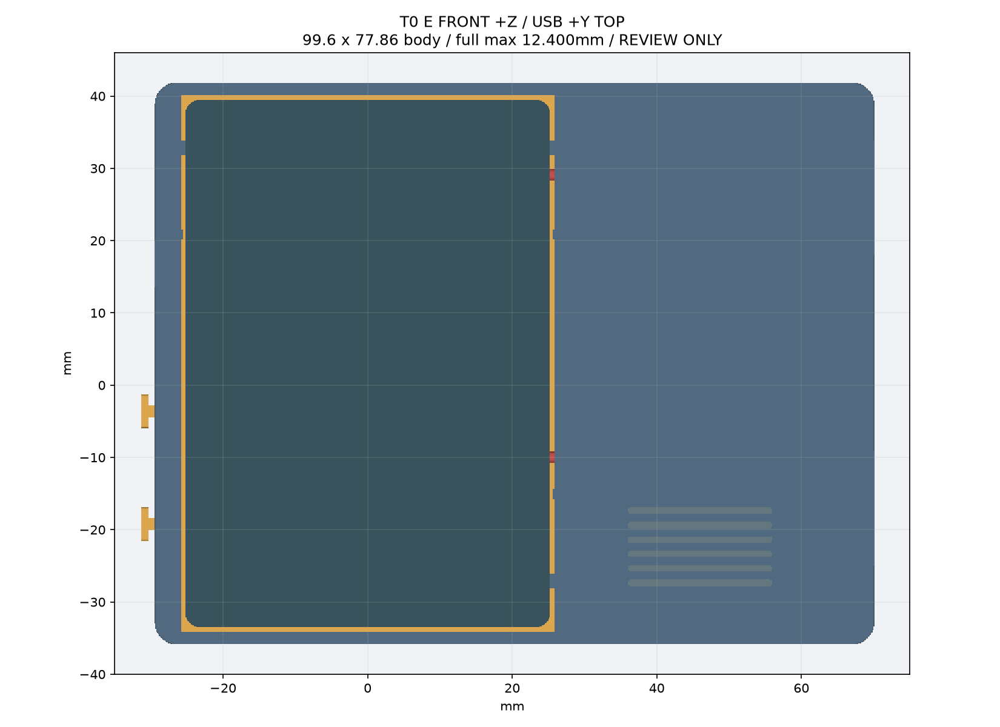
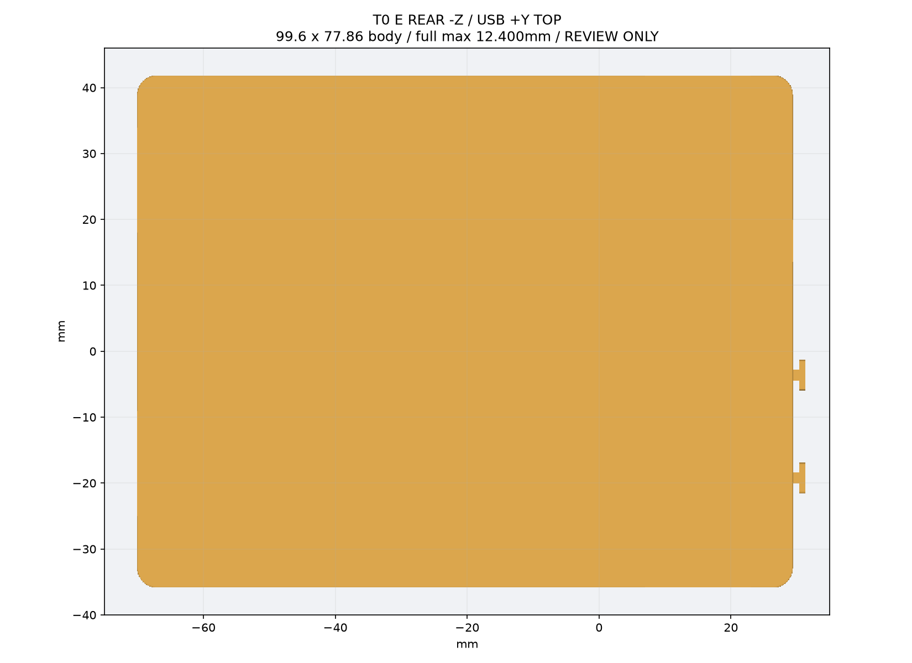
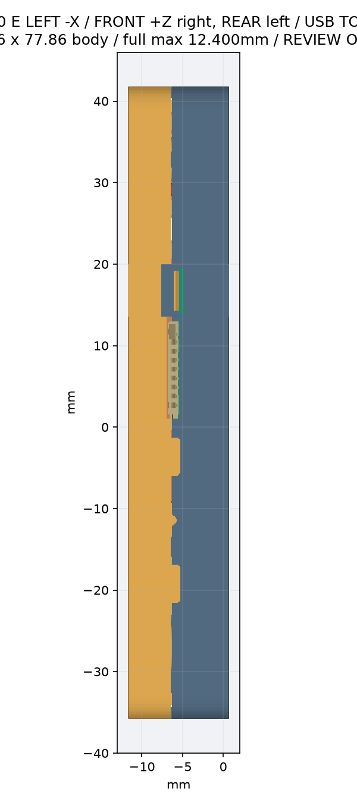
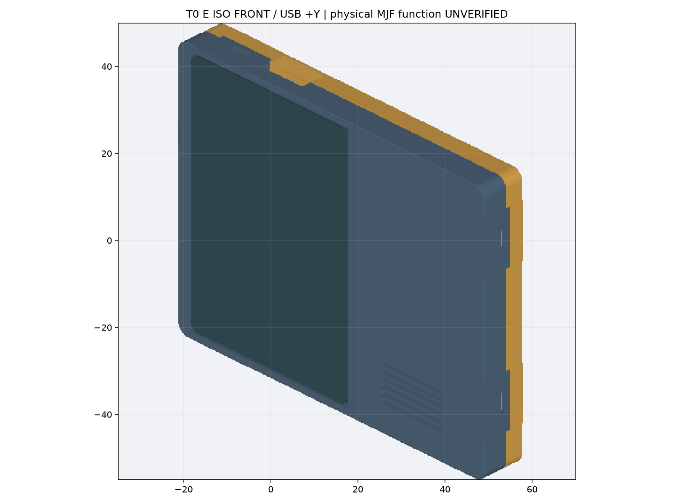
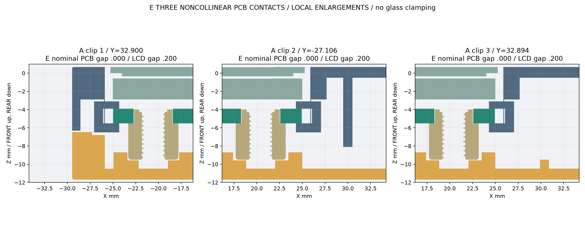
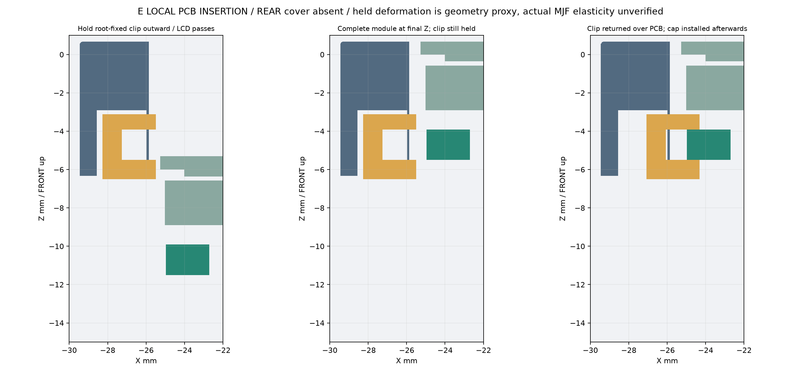
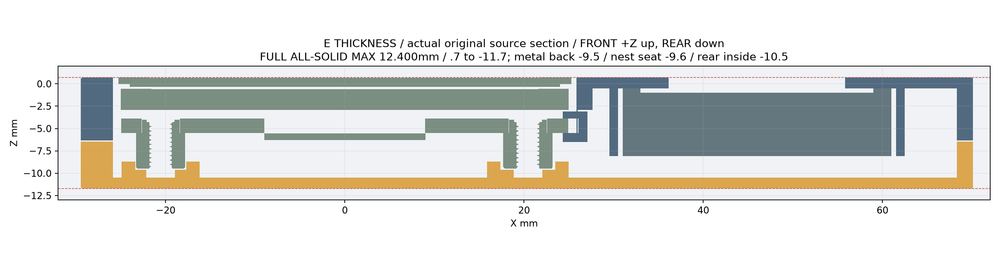
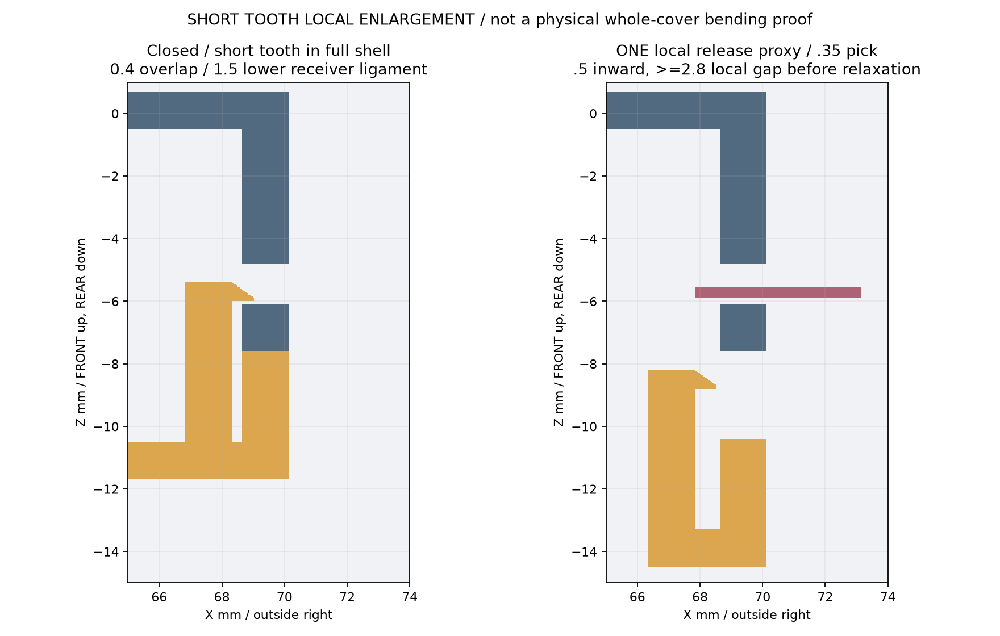
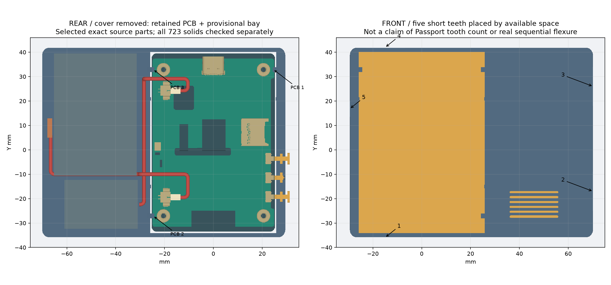

# T0 E：完整名义几何，Review only

三处 A PCB 弹性夹位 + 四处 D 浅窝；五处短壳齿。最大名义厚度12.400mm；**不是制造/功能放行，不打印**。

STL 单位为 mm，保留装配坐标，一文件一实体；STEP/STL 的有效性、闭合性、尺寸及体积比对见检查报告。

[研究、装配顺序与制造风险](../../docs/17_t0_e_three_clip_assembly.md) · [检查报告](checks.json)

- 前壳：[STEP](front_shell.step) / [STL](front_shell.stl)
- 后盖：[STEP](rear_shell.step) / [STL](rear_shell.stl)
- 原有三独立帽：[KEY1 STEP](key1_cap.step) / [STL](key1_cap.stl)、[KEY2 STEP](key2_cap.step) / [STL](key2_cap.stl)、[RESET STEP](key3_cap.step) / [STL](key3_cap.stl)
- 轻量装配：[STEP](assembly_light.step) / [GLB](assembly_light.glb)。部分原板器件使用明确标记的包络，仅用于轻量查看，不能替代精确干涉证据。
- 完整原板 STEP 的取得方式见上方研究报告；未将完整官方模型提交 Git。

短齿自由端移动、PCB 梁形变均为几何代理，真实 MJF 弹性和逐扣拆盖未验证。零名义 PCB 轴向间隙不能当作制造公差已闭环；MIC、开关行程、实际插头/电池/扬声器仍有实物门槛。

轻量模型的显示包络填充原始空腔；查看 PCB 定位时可隐藏 `DISPLAY_REFERENCE_ENVELOPE`，精确接触以剖面或完整 STEP 为准。
