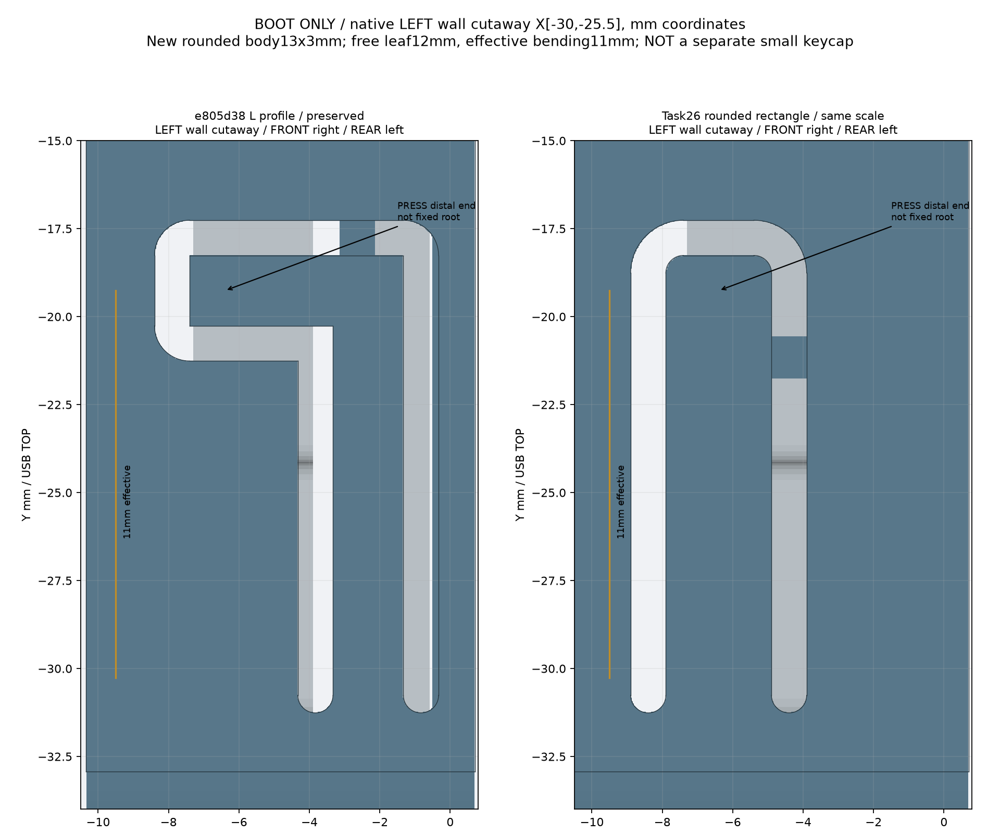
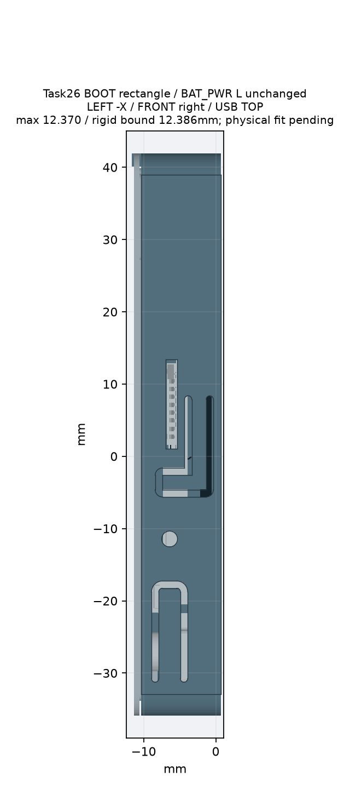
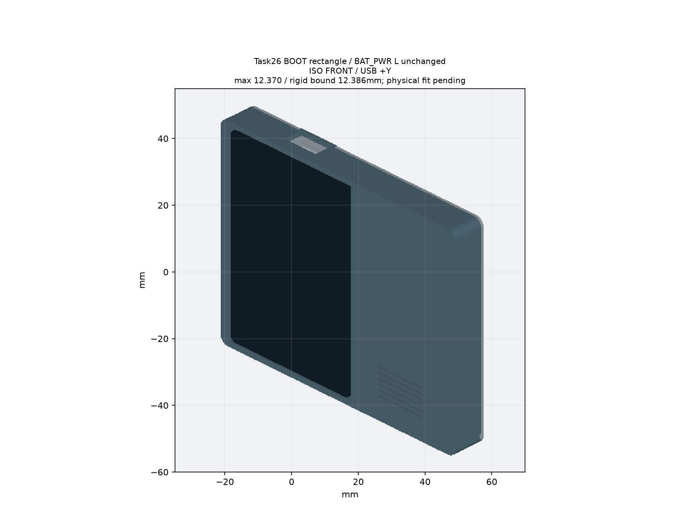
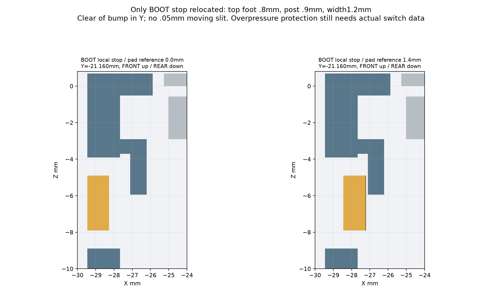

# G-V1 Task26：仅BOOT改圆角矩形

BAT_PWR保留L形，其他结构不变。旧版 [e805d38交付](../t0-g-v1/README.md) 保留。

- [任务27报告](../../docs/27_t0_g_v1_boot_rectangular_key_revision.md)：尺寸、局部/整壳检查与刚度风险。
- [完整STEP下载及FreeCAD操作](../../docs/28_g_v1_private_download_freecad.md)：用已验证的授权命令，替代404的Draft标签网页。
- `front_shell.step` / `.stl`：新前壳，单实体；单位mm，保留装配坐标。**不批准打印**。
- 后盖不变，继续使用[旧后盖STEP](../t0-g-v1/rear_shell.step) / [STL](../t0-g-v1/rear_shell.stl)。新精确查看包也包含该同坐标后盖。
- `assembly_light.step` / `.glb`：新版轻量查看，部分元件为proxy；不能代替完整原板检查。
- `front_local_GATE_ONLY.step`：首阶段局部闸门的前壳，不是最终整壳版本。
- `local_checks.json` / `checks.json`：完整723原板实体、限定改动范围、候选姿态、厚度、导出回读和未关闭风险。
- `download_verification.json`：旧/新Draft资产的实际授权下载与STEP回读记录，无SHA校验。

`1.4mm`是模型按压区参考位移，不是原生开关行程。3mm高新梁相对旧2mm梁的名义刚度约1.5倍；材料回弹、按力、寿命、真实触发/过压仍未验证。既有累计公差下约0.054–0.056mm触达缺口保留为 `BLOCKED_CONDITIONAL_PRINT_FIT`。

