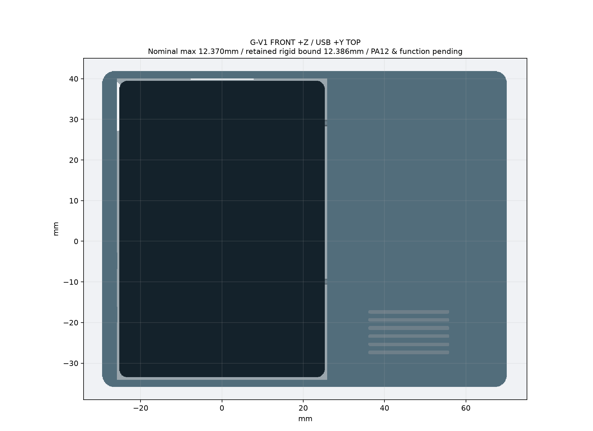
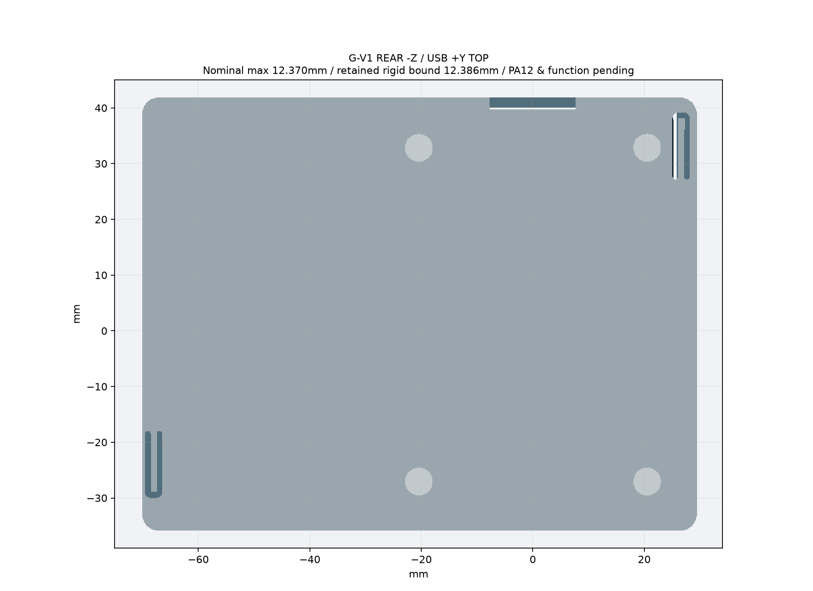
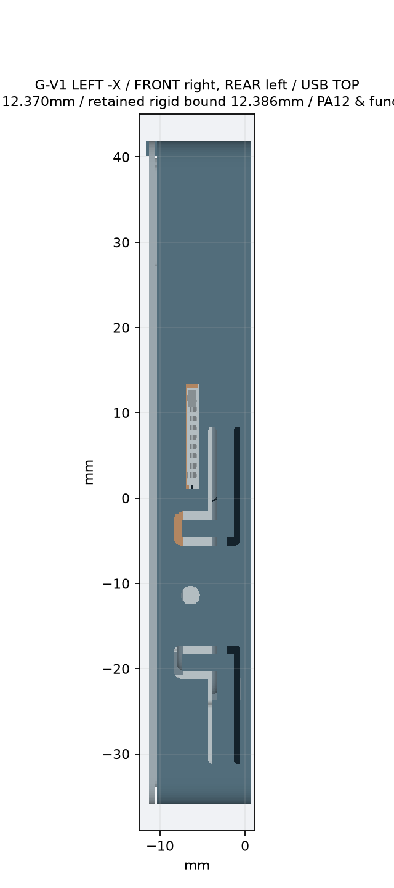
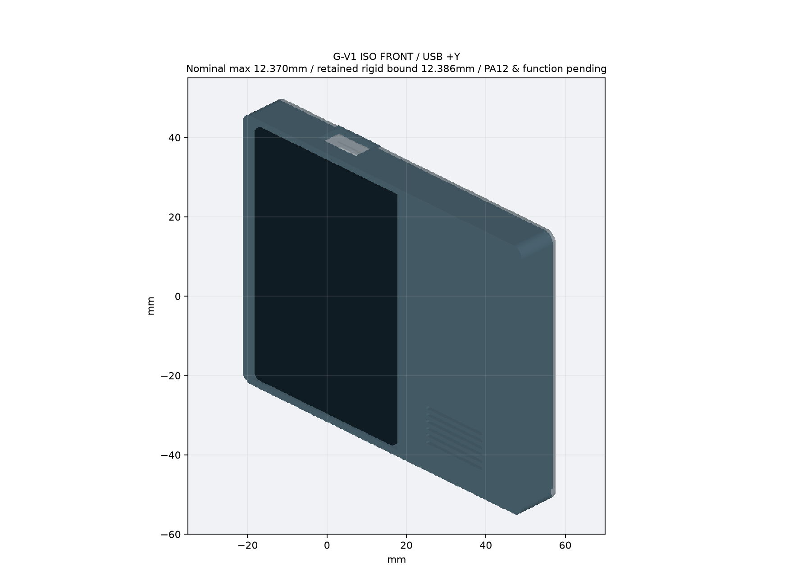
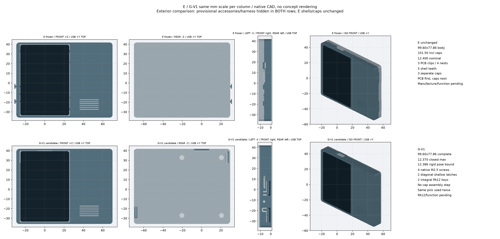

# G-V1 一体 PA12 侧键整壳候选

**名义CAD/装拆路径完成；累计公差下按键触达 BLOCKED（约0.054–0.056mm正间隙）。不是可靠按键或制造通过。**

完整复现、装拆顺序及制造风险见 [报告24](../../docs/24_t0_g_v1_integrated_pa12_assembly.md)。不打印、不下单；实物按键/PA12/接线/MIC仍未验证。

所有尺寸按mm解释；STL本身无单位，零件保留装配坐标。

- `front_shell.step` / `.stl`：含两处一体侧键的深前壳，单实体。
- `rear_shell.step` / `.stl`：两处对角浅扣的后盖，单实体。
- `assembly_light.step` / `.glb`：轻量查看；元件包络不是净空证据。
- `checks.json`：全723官方实体、连续装拆、偏移见证、负向测试、导出回读与完整厚度。
- 四向、按钮、厚度/螺丝/卡扣剖面、接口/线束和E对照 PNG：均从实际CAD生成，FRONT/REAR明确。

包含全部原板几何的装配：私有 Draft release `t0-cad-review-20261016-9ec1022` 的新资产 `t0-g-v1-review-complete.zip`。用 `gh release download` 取得；资产含 `assembly_complete_12_4mm.step` 和相同检查报告。旧资产不替换。

名义几何通过不等于厂商加工合格。尤其1mm承座、0.15mm扣间隙、0.8mm凸点等偏离通用PA12建议，须专项确认。两键1.4mm为模型按压区限位位移，不是开关行程。后盖止口与螺孔的累计浮动另与打印偏差叠加；见 `combined_register_bore_print_reach`，名义装拆PASS不覆盖该条件下的触达阻断。

