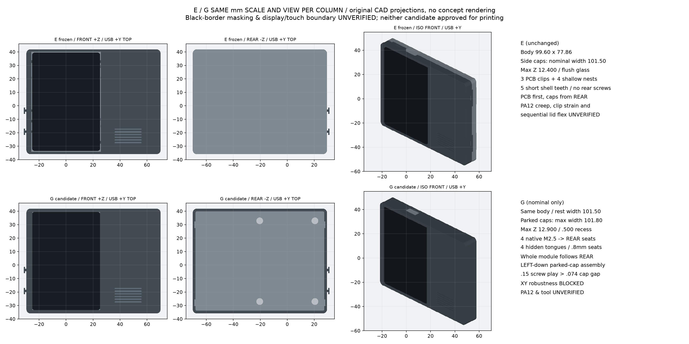
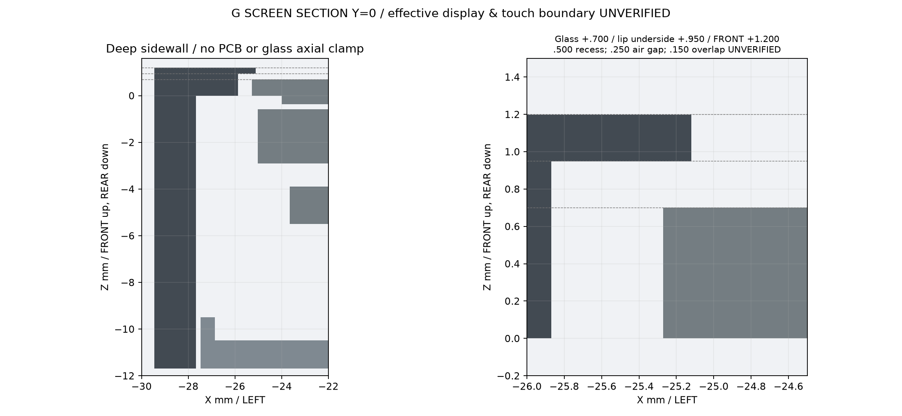
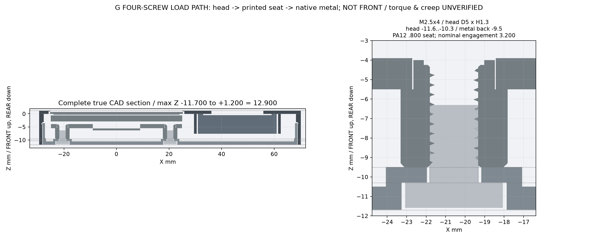
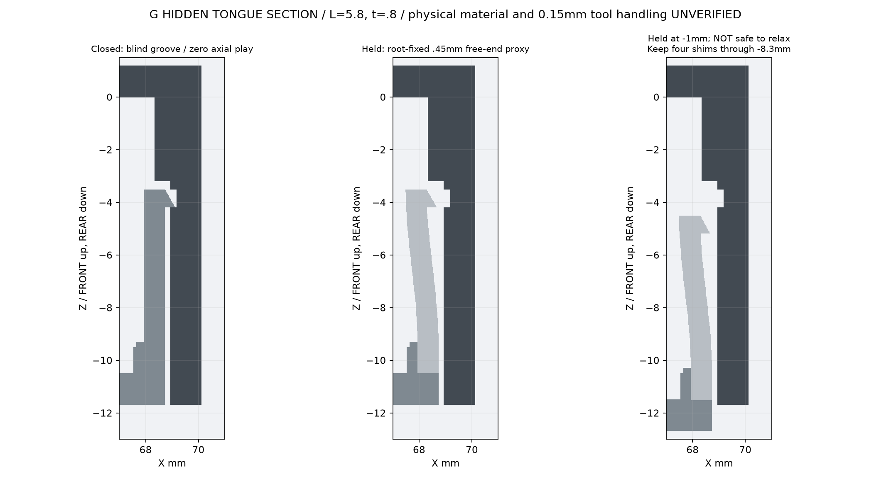

# T0 G — nominal CAD / review only

深 FRONT 壳、下沉0.5mm玻璃、四颗原厂 M2.5 位锁 REAR、四隐藏短舌。**完整名义最大厚度12.900mm，制造/功能待验证，不批准打印。** E 及 A/B/C/D 保留。

**定位容差 BLOCKED**：螺孔许可横移可导致LCD碰停靠帽；当前只证明指定XY位置的名义装入，详见报告的负向反例。完整STEP为742/742有效实体，五个独立零件STL均闭合。

[装配、尺寸链和风险](../../docs/19_t0_g_recessed_assembly.md) · [参数](../../cad/t0/t0-g-parameters.json) · [机器检查报告](checks.json)

```bash
./scripts/generate-t0-g.sh
```

| 文件 | 用途 |
|---|---|
| [assembly_light.step](assembly_light.step) / [GLB](assembly_light.glb) | 低内存查看；明确标注的原厂简化参考件，不用于干涉证据 |
| [front_shell.step](front_shell.step) / [STL](front_shell.stl) | 一体深前壳，单实体 |
| [rear_shell.step](rear_shell.step) / [STL](rear_shell.stl) | 嵌入后盖、四承座/短舌、配件支承，单实体 |
| [key1_cap.step](key1_cap.step) / [STL](key1_cap.stl) | 原 BAT_PWR 候选帽，功能/行程待实物 |
| [key2_cap.step](key2_cap.step) / [STL](key2_cap.stl) | 原 BOOT 候选帽，功能/行程待实物 |
| [key3_cap.step](key3_cap.step) / [STL](key3_cap.stl) | 原 RESET 候选内缩推帽，维护孔/薄面料待实物 |
| [four_NBK_SSH_M2_5_4_envelopes.step](four_NBK_SSH_M2_5_4_envelopes.step) | 四可购螺钉的外包络；无精细螺纹或驱动穴，不打印 |

完整装配使用官方原始全部723 solids，不进入Git历史；下载现有私有草稿附件：

```bash
gh release download t0-cad-review-20261016-9ec1022 \
  --repo Gadil123/esp32-design --pattern t0-g-review-complete.zip
```

解压得 `assembly_complete_12_9mm.step` 与对应报告。附件不是正式发布或打印批准。

## 原生 CAD 图纸

所有图由真实 BRep/导出STEP生成。**FRONT +Z / REAR −Z / USB +Y**；FRONT看键与TF在左。有效显示/触控边界未知，不把整块玻璃当成已确认的像素窗口。



[FRONT](front.png) · [REAR](rear.png) · [LEFT](left.png) · [ISO FRONT](iso_front.png)







[根部旁释放片通道](rear_shim_lane.png) · [整组装入顺序](assembly_sequence.png) · [REAR 连接器/配件条件布局](connector_and_bay_layout.png)

## 复审重点

- 三帽朝下外停靠0.3再水平装板，最小玻璃间隙仅约0.074；外停靠总宽101.8。RESET局部面料0.5、停靠时鼻部内缩约0.05。PA12公差、重力/摩擦、防误触和固定框偏心风险仍开放。
- 螺孔允许0.15径向定位游隙，大于帽/玻璃余量；朝帽方向偏0.10的原板装入反例仍碰LCD。名义路径通过不等于定位容差通过，拧紧前XY对位及保持方法待验证。
- 四 M2.5 头 Ø5×1.3；塑料头下承压座仍约0.8。实际螺纹深度、扭矩、压溃/蠕变未验证，不得套用金属件扭矩。
- 卡钩与闭合肩面为零名义轴向游隙，后拉0.01即触发保持；0.1游隙会使外包络达到13.0，已取消。零轴向配合仍未获PA12制造放行。
- 四隐藏舌有效长5.8、厚0.8；根部固定让位几何简估3.21%应变，不是材料许可。0.15外部保持片的刚度/可操作性待实物；四处保持至整组退8.3后才能松开。开缝1mm即松扣的负向情况仍被检测。
- 局部薄压边0.25、盲槽外壁约0.95、USB下边约0.88；尺寸由导出STEP局部截面复核，未做全模型最小壁厚证明或制造合格声明。
- 电池/扬声器、泡棉/阻尼、真实 MX 插头及线端仍 unverified；MIC1进声方向和裸板/装壳录音、TF弹出、真实键行程/回弹均待实物。不得据此下单整机。
