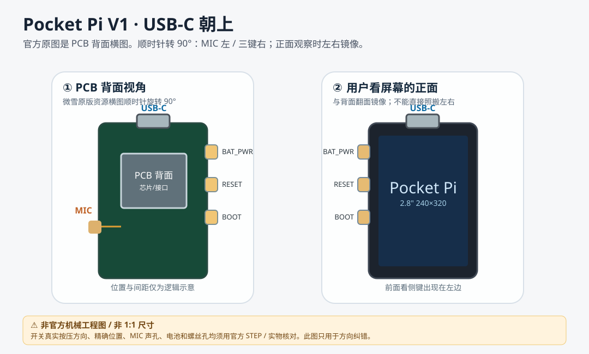

# 02 · Waveshare C5 官方硬件事实与方向基准

**强制先读：本文件解决此前最严重的“前后视角混用”问题。**
查看时应以 [官方产品资料](https://docs.waveshare.net/ESP32-C5-Touch-LCD-2.8/) 和 [Waveshare 官方 PCB / STEP](https://github.com/waveshareteam/ESP32-C5-Touch-LCD-2.8) 为第一来源。

## 方向定义（设计基准，不是未经核准的外壳孔位）

从**官方横向板载资源图片的观察视角**进行**顺时针 90° 旋转**，取此为 USB-C 顶部的布置：

- 上：**原生 USB-C**
- 左：**板载麦克风**
- 右：**原生三颗按键（BAT_PWR / RESET / BOOT）**

这是用户指认的正确方向，之前“旋转后按键跑到左侧”的图文应标记为错误，不得复用。

**严禁**把官方 PCB **背面**的左/右，直接当作用户手持设备、观看屏幕**正面**的左/右。两者会镜像；在正式 CAD 中必须给每张图标注 VIEW: FRONT SCREEN / REAR PCB，并用 USB-C、开关、拾音孔逐一匹配，做一次翻面交叉核验。此阶段“机身屏幕正面侧键在左还是右”标记为**待 STEP 实体校核**，不靠聊天猜测。

**原始图纸 / 官方图片入口**：
- [官方页面：板载资源图 + 产品尺寸图](https://docs.waveshare.net/ESP32-C5-Touch-LCD-2.8/)
- [官方机械图 STEP / DXF / PDF 文件目录](https://github.com/waveshareteam/ESP32-C5-Touch-LCD-2.8/tree/main/dimensions)
- [官方电路原理图](https://github.com/waveshareteam/ESP32-C5-Touch-LCD-2.8/tree/main/schematic)

> 上方 SVG 为我们自己画的方向逻辑图，**不是**微雪官方照片或精确装配图。任何毫米级孔位必须从原始 STEP / 实物测量取得。

## 官方明确证实的能力

| 硬件 | 官方确认内容 | 当前设计含义 |
| --- | --- | --- |
| MCU | ESP32-C5-WROOM-1, RISC-V 主频最高 240 MHz | 作为 UI / 音频 / 网络微控制器 |
| 内存 | 8MB PSRAM / 32MB Flash | 只跑终端固件，不运行完整 Pi Agent |
| 无线 | 2.4/5GHz Wi-Fi + BLE 5 + 802.15.4 | 访问家用服务器 |
| 显示 | 2.8in LCD，240×320，电容触摸 | 正面全屏，固件旋转 180° 需校准触摸坐标 |
| 音频 | 板载麦克风、ES8311、NS4150B、配套独立喇叭 | 麦克风直孔，扬声器背面固定 |
| 电池 | 板载充电管理 / 3.7V MX1.25 接口 | 电芯尺寸/极性/是否含电池未定 |
| USB | Type-C 用于供电/下载调试 | V1 原生接口朝上，需为插头预留空间 |
| 按键 | BOOT(GPIO28)、BAT_PWR、RESET | 原生功能各异，不是三个等价用户键 |
| 其他 | 6轴 QMI8658、RTC、温湿度、MicroSD | V1 不要求特殊开孔或独立 UI |

引用：[官方参数及引脚表](https://docs.waveshare.net/ESP32-C5-Touch-LCD-2.8/)。

## 三颗板载按钮：必须保留其电气语义

**BOOT**
- 官方接口表：GPIO28 / 下载模式 / 用户按键。
- 官方出厂固件：小智 AI 内长按 BOOT 返回主界面，示例中单击可复位重力球。
- 进入下载模式有按住 BOOT 并连接 USB 的流程；作为录音/开始键使用时需测试启动误操作。

**BAT_PWR**
- 官方出厂固件文档：电池模式长按约 2 秒关机，关机后再按开机；受硬件电路控制。
- 不要试图将它在固件中视作可自由重定义的 GPIO。

**RESET**
- 原生硬件复位。日常正常使用应避免误触；外壳允许针孔或凹陷式触发。
- 具体按钮规格、装配方向和键帽行程须用实物/STEP 校验。

来源：[官方出厂固件说明](https://docs.waveshare.net/ESP32-C5-Touch-LCD-2.8/Instructions-For-Use/)。

## 官方机械文件已经存在，但参数仍须设计确认

官方提供以下原始资料：
- dimensions/ESP32-C5-Touch-LCD-2.8.stp
- dimensions/ESP32-C5-Touch-LCD-2.8.dxf
- dimensions/ESP32-C5-Touch-LCD-2.8.pdf
- schematic/ESP32-C5-Touch-LCD-2.8.pdf

前期聊天曾引用屏幕总外形约 50.54×73.06mm、PCB 约 49.9×69mm、可视区域约 43.2×57.6mm；**这些值尚未在本仓库从原始工程图逐个核定，不作为加工标注**。正式设计应直接提取官方 DXF/STEP 坐标，不以此处估算值建模。

## 禁止复用的错误信息

- 错误：对官方图顺时针旋转 90° 后，麦克风右侧/按键左侧。
- 错误：AI 概念图中“顶端麦克风格栅”、“侧边 USB-C”、“正面绿色状态 LED”的位置可用于开孔。
- 错误：三颗按键都可以重定义为独立软件功能键。
- 错误：正背视图翻转时坐标/左右关系不变。

## 待下一轮验证

1. 用官方 STEP 打开正确背视图和正视图，生成同一坐标系的定位图。
2. 量测各开关开口/本体/行程、原装音频件及电池尺寸，标注定位误差。
3. 验证原生 USB-C 顶部插头不会被壳体遮挡。
4. 确认麦克风器件的声孔面及适合直接开孔的壳面。
