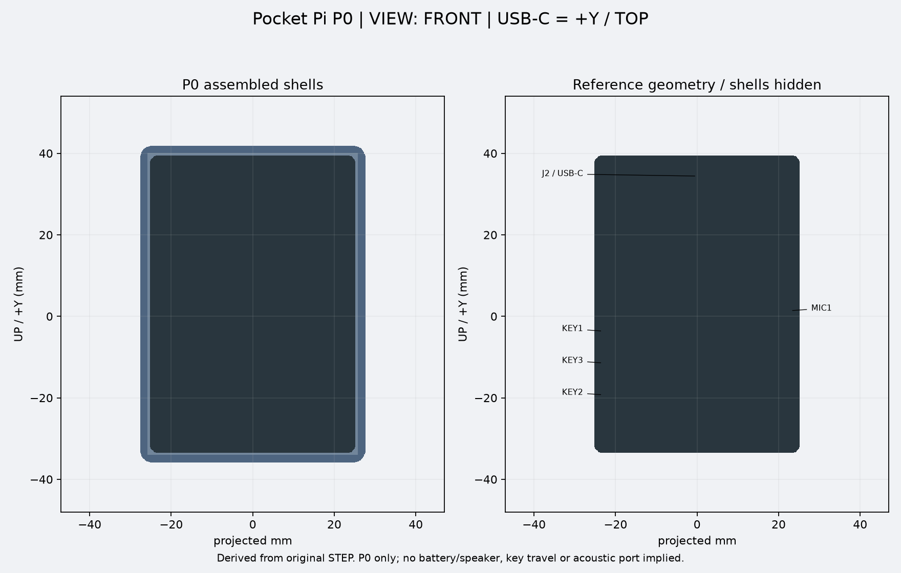
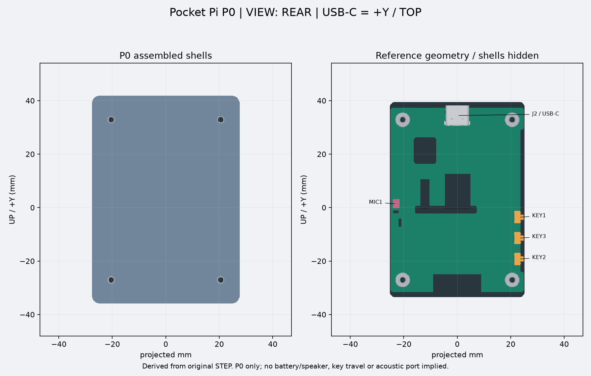
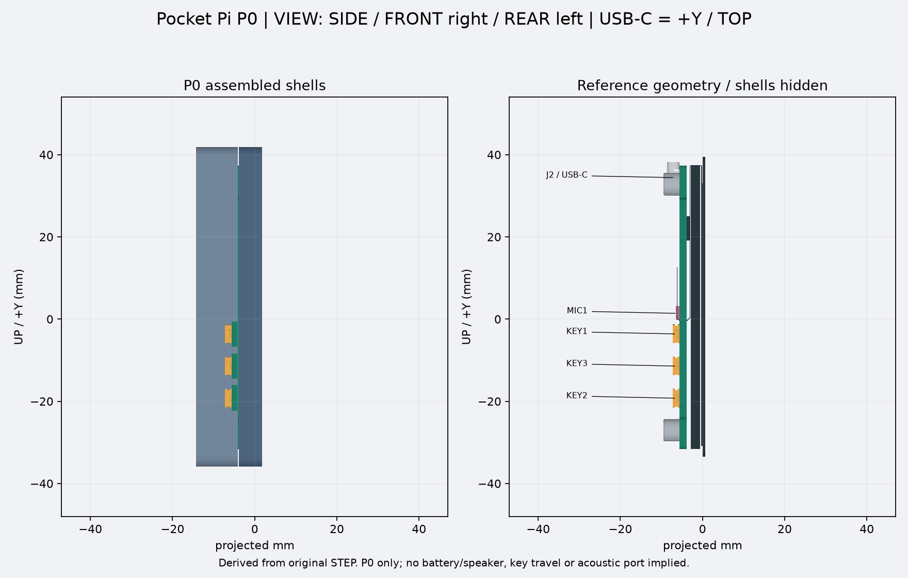
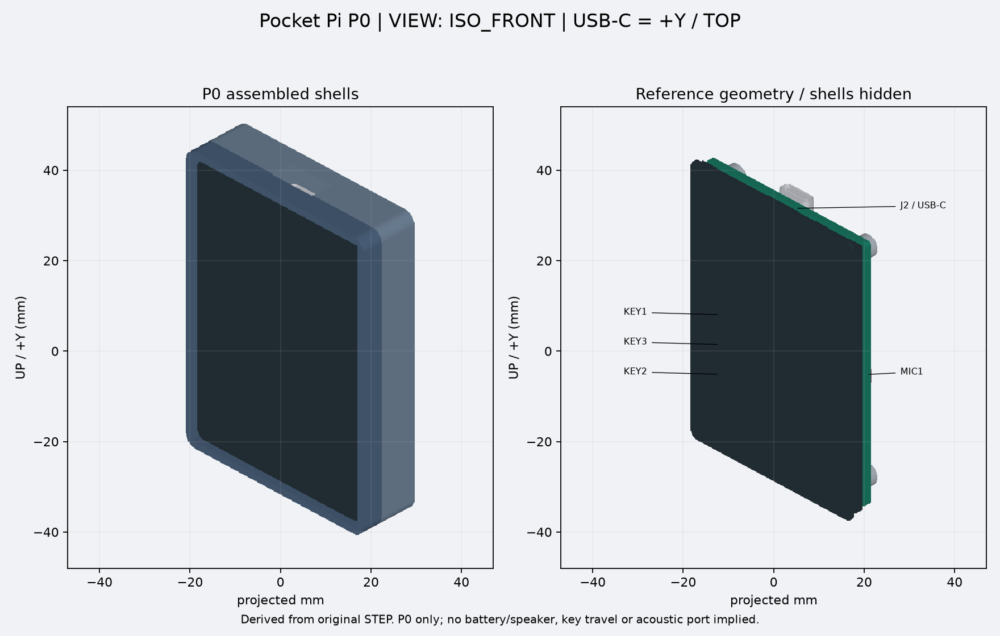

# Pocket Pi V1 — P0 参数化 CAD

P0 建立可追溯的静态机械基线，**不是可直接打印或采购的成品**。Python/build123d 无界面生成，未使用 Computer Use、FreeCAD MCP 或 Text2CAD。依据为本仓库 01/02/03/05/06/07 文档、既有 CSV 和微雪原始 STEP；图片只用于检查观察方向，不用于定尺寸。

## 环境及一条命令生成

已验证 Linux x86_64、Python 3.13.2；直接依赖 build123d 0.13.0、matplotlib 3.11.2，OCP 8.0.1.1.0。完整依赖版本见根目录 `requirements.lock.txt`。依赖环境占用约 1.1GB；完整原板装配导出约 155MB，仅留在本地。生成时的峰值内存尚未测量。Mac 可先查看轻量导出，无需安装 Python/CAD 内核。Mac 直接生成需对应 Python/OCP wheel，当前尚未在 Mac 运行验证。

```bash
# 在同一父目录中克隆；官方参考绝不能嵌套进 esp32-design。
git clone https://github.com/Gadil123/esp32-design.git
cd esp32-design
git switch codex/cad-p0
./scripts/setup-reference.sh
python3.13 -m venv .venv
.venv/bin/python -m pip install -r requirements.lock.txt
./scripts/generate-p0.sh
```

安装仅首次执行；之后最后一行重新从原始 STEP 生成全部输出和检查报告。若有现成官方克隆，setup 脚本保留它不动；可用 `--reference /absolute/path/to/reference` 指定。输出默认 `build/p0`，可用 `--output` 改写。所有尺寸单位 mm。关键设计参数集中于 `cad/parameters.json`，可通过 `--parameters` 传入另一份配置。几何检查失败以非零退出。

官方浅克隆 + sparse 仅获取 `dimensions`、`schematic` 和 `docs`（Git sparse 默认同时保留少量根文档）。来源 Git revision 记录于 `cad/official-reference.json` 和生成报告，不做文件 SHA 校验。官方工作树只读使用，无修改。完整原板 STEP、完整装配导出与环境均不提交。

## 坐标、观察方向与变换

Pocket 坐标为原始 STEP 绕 Z 轴旋转 180°：

```text
[xp, yp, zp, 1]ᵀ = diag(-1, -1, 1, 1) × [xs, ys, zs, 1]ᵀ
+X = FRONT 观察者右方；+Y = 顶部 / USB-C；+Z = 屏幕朝外
原点沿用原始 STEP，未为外壳另做平移。
FRONT：从 +Z 看向 -Z，画面右 = +X，上 = +Y。
REAR：从 -Z 看向 +Z，画面右 = -X，上 = +Y。
SIDE：从 -X 看向 +X（按键侧），画面右 = +Z，上 = +Y。
ISO_FRONT：从 (+X,+Y,+Z) 看向原点，包含屏幕 FRONT 面。
```

必须累计所有父装配 placement 才能得到全局坐标。不能把 STEP 子装配局部边界当成整板坐标。导入时保留原始父子几何关系，再做整体刚体旋转，不做镜像。

每次运行检查：全部选中实体与已有 CSV 的边界差≤0.05mm；旋转后逆变换还原；关键元件两两距离不变；USB-C 在 +Y；KEY 在 -X、MIC 在 +X。因此 FRONT 按键左、MIC 右；REAR 按键右、MIC 左。

## 测量与结构

以 `checks.json` 为本次精确提取值，历史 CSV 保留不覆盖。既有 CSV 使用的包围盒包含内核容差，当前 build123d 边界可能相差约 0.01–0.02mm，不能解释成制造公差。PCB 原始曲线/孔从 BOARD 实体保留；轻量装配同样保留精确 BOARD 和原厂四个贴片螺母。

- 屏幕总成包络约 50.54 × 73.06mm；带屏幕整板静态厚度约 10.20mm（旧记录 10.22mm，包围盒算法差异）。
- PCB 约 49.91 × 69.01 × 1.60mm；四孔轴与孔距从原始 BOARD 几何提取并与官方 41 × 60mm 标注比对。**BOARD 四孔实际直径约 4.30mm，是原厂贴片螺母的安装开孔；M2.5 是螺母的螺纹规格，两者不可混淆。**
- 屏幕开口使用完整触摸面板包络 + 每边 0.6mm，未猜有效显示区的起始坐标；P0 暂无压屏唇边/密封结构，支承与保持依赖背部安装点。
- 前后基本轮廓为圆角矩形，壁厚 1.8mm，分型面 z=-4.0，缝隙 0.2mm。设计参数是 P0 初始建议值，非厂家保证公差。
- 后壳设置四个与原厂安装轴同心的空心支承柱和通孔；原厂贴片螺母保留。支承顶距原厂螺母背面 0.05mm，是 P0 防干涉间隙，未验证螺钉拧紧后的压紧状态。
- 顶部 USB 开口沿 +Y 连通外部，以 J2 实体包络增加 X/Z 净空。原理图已明确 J2 为 USB Type-C。此处只验证所建通道无壳体实体，尚不等于选定插头外壳、插入深度和线缆弯折通过。
- 三个侧键开口按 KEY1/KEY3/KEY2 各自静态包络加 Y/Z 间隙，从 -X 侧贯穿。没有精细键帽、功能映射或行程假设。
- 麦克风保留封装定位，不开最终声孔；声孔面与孔心仍缺证据。
- 后部额外深度为可调 **3mm 演示余量**，不是电池/扬声器尺寸；未建立假想电池或扬声器实体，最终厚度字段为 `null`。

当前默认外形为 **55.34 × 77.86 × 16.20mm**；其中深度仅为此参数实例的结果，不是最终规格。Pocket 坐标的孔轴如下（r=2.15mm 是 BOARD 安装开孔半径，不是螺纹半径）：

| 孔 | X mm | Y mm |
| --- | ---: | ---: |
| 左下（FRONT） | -20.56818 | -27.10044 |
| 左上（FRONT） | -20.56045 | 32.89956 |
| 右下（FRONT） | 20.43182 | -27.10572 |
| 右上（FRONT） | 20.43955 | 32.89428 |

原始模型的 PCB/孔阵列相对整体轴存在极小转角，因此不强制把实测轴心改成理想的 ±20.5/±30；41×60mm 名义孔距用 0.02mm 阈值复核。这不代表厂家制造公差。

## 导出与预览

`deliverables/p0` 保存 Reviewer 可直接下载的首版文件。每次生成完整输出到 `build/p0` 后，可用 `scripts/package-p0.sh` 更新这组小型交付物。

| 文件 | 用途 |
| --- | --- |
| `front_shell.step`, `rear_shell.step` | 可编辑几何轮廓，包含当前开口和后部支承 |
| `front_shell.stl`, `rear_shell.stl` | mm 单位 P0 检查网格，**不批准打印** |
| `assembly_light.step` | 精确 PCB/螺母 + 屏幕/USB/按键/MIC 包络 + 壳体；供 8GB Mac 轻量查看 |
| `assembly_light.glb` | 轻量三角网格装配，需支持 glTF 的查看器；STEP 使用 mm，glTF 按格式转换单位/轴 |
| `front.png`, `rear.png`, `side.png`, `iso_front.png` | CAD 三角化正交投影；左为合壳、右隐藏壳体显示原始选中组件，不是渲染概念图 |
| `checks.json` | 原始和 Pocket 边界、孔轴、参数、内核版本、几何和干涉检查 |
| `assembly_full_local.step` | 仅本地生成，含完整官方原板；不提交 Git；Reviewer 可自行重建 |

图片中 SCREEN / FRONT 与 PCB / REAR 的观察方向按上文定义。轻量 STEP 中标记 `ENVELOPE_NOT_DETAIL` 的组件是静态外包络，不可用于精细接触面或声孔设计；所有壳体干涉检查均使用完整官方实体，不以这些简化块替代。

## 检查边界及未决风险

自动检查包括：壳体几何有效、各为一个正体积 solid；全部原板 solids 与前后壳的体积交集；前后壳交集；USB/侧键预留通道与壳体交集；方向/逆变换/距离/孔距。另将壳体 STEP 重新导入，独立检查 STL 的所有边恰好连接两个三角形、STEP/STL 边界误差 <0.05mm、体积相对误差 <0.5%。报告记录阈值，体积交集超过 0.001mm³ 判失败。螺钉/电池/扬声器不在检测集合中。原始 STEP 可能有非 solid 的电子器件曲面，报告不把这些曲面宣称为通过实体干涉验收。

P0 后仍需验证：KEY 功能映射、活动接触面与行程、MIC 声孔方向、插头外壳/实际插入空间、电池与扬声器/走线、螺钉长度及头部/支承受力、前后壳螺钉连接及定位、触摸边缘可达性、装入路径、打印公差与原厂模型/实物版本差异。当前前后壳只定义分型面，无最终锁紧或定位结构。禁止据此下单整机打印。

本阶段结束于 P0 PR 等待 Review；不进入 P1/P2、不合并 PR。

## 四向 CAD 预览








