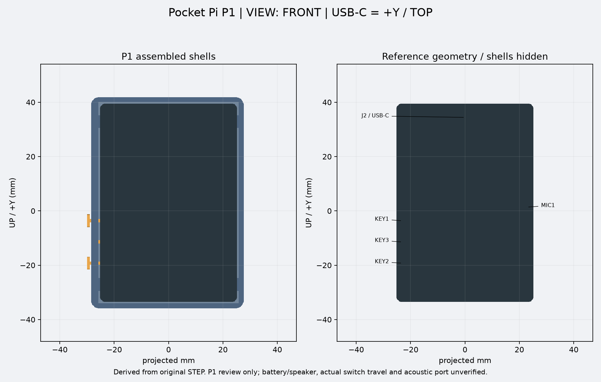
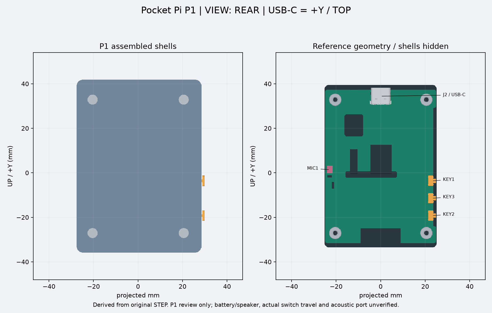
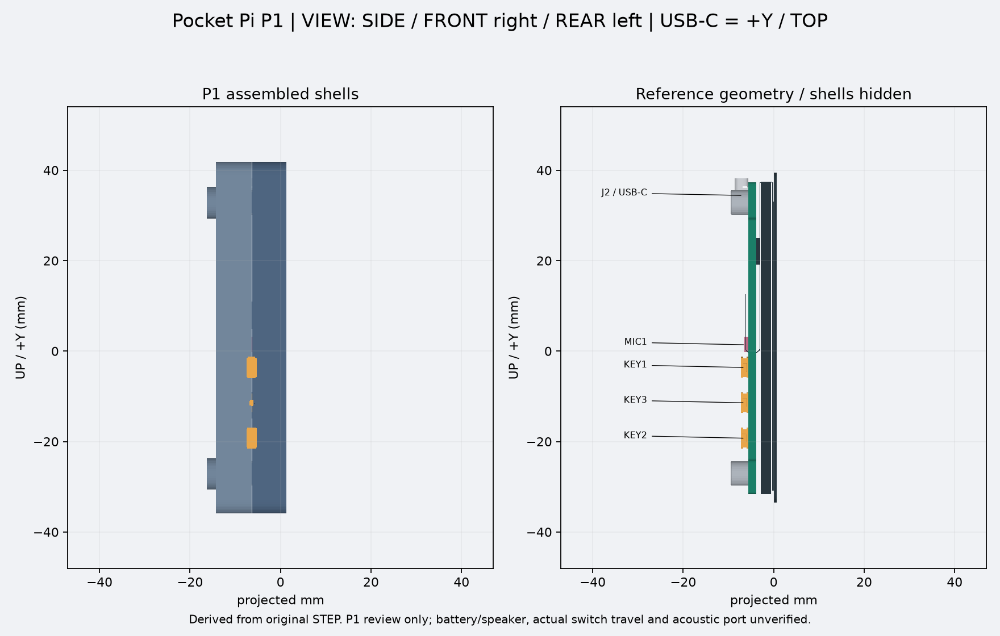
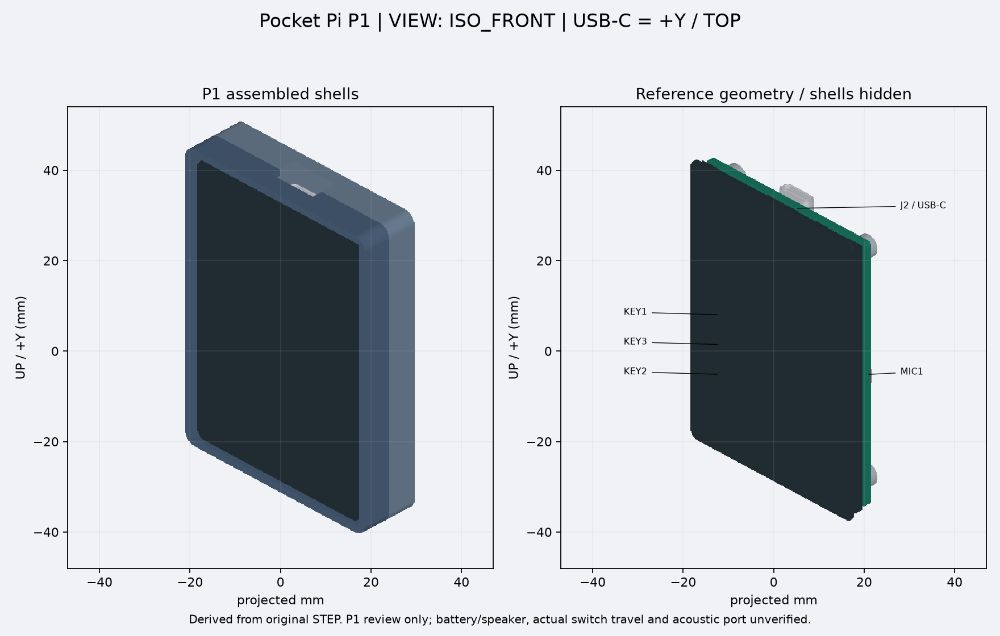
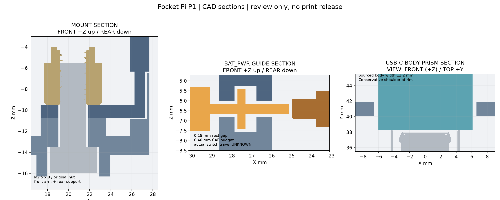
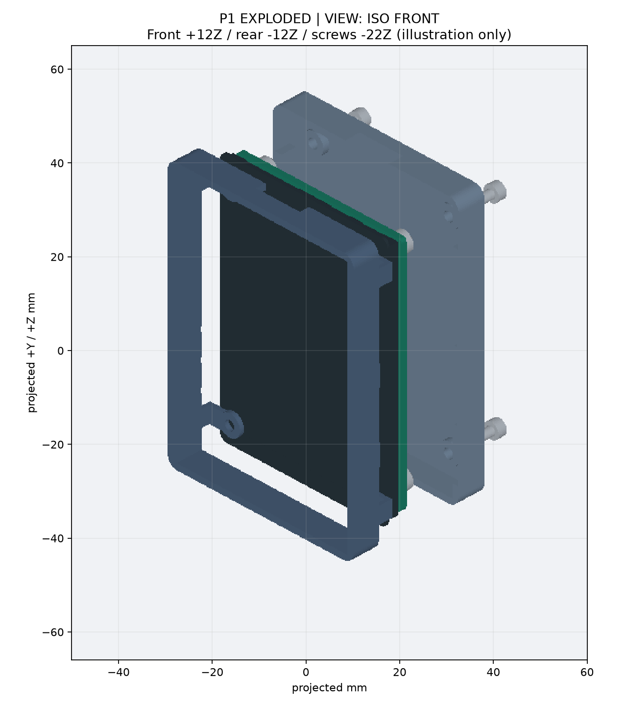

# Pocket Pi V1 — P1 外壳机械结构（Review 用）

P1 延续 P0 原始 STEP、统一坐标和 build123d 环境，建立可拆连接、独立键帽、装配路径与独立 USB 空间检查。**未批准打印、未做实装测试、未进入 P2。** 电池/扬声器不建假想实体，最终整机厚度仍为 `null`。

## 基线与 P0 Review

基于 `codex/cad-p0`。P0 PR 尚未合并，因此 P1 PR 以该分支为 base，只展示 P1 增量，不替用户合并 P0 或 P1。

[P0 Review](https://github.com/Gadil123/esp32-design/pull/1#pullrequestreview-5536812712)
确认静态基线通过，并要求在 P1 增加：① 独立于 cutter 的插头/键帽运动验证；② USB 封堵、安装柱错位和壳体侵入原板的负向测试；③ 螺钉/连接/装入路径/接触面验证。P1 报告将 `usb_boolean_cut_only` 与独立 `usb_body_insertion_prism` 分开命名。负向测试还覆盖键帽导向错位、整板装入路径被横杆阻挡。

负向夹具也暴露了 P0 干涉分支对 build123d 0.13 `intersect()` 返回值的错误假设：非空结果为 ShapeList，不能直接读取 `.volume`。P1 修正 P0 调用并将 P1 求交结果显式归为 Compound；故意碰撞现在能被检测并产生失败结果，而不会因错误的返回值访问崩溃。

## 安装和复现

沿用 [P0 安装说明](08_cad_p0.md) 和 `requirements.lock.txt`，无需额外依赖，不使用 Computer Use 或 FreeCAD MCP。两个仓库保持并列、官方工作树仅供读取。

```bash
# 已克隆工程后，首次安装：
git switch codex/cad-p1
./scripts/setup-reference.sh
python3.13 -m venv .venv
.venv/bin/python -m pip install -r requirements.lock.txt
# 后续只需以下生成命令：
./scripts/generate-p1.sh
# 需要刷新 Git 中的交付文件时：
./scripts/package-p1.sh
```

第一条生成命令从原始 STEP 重建全部 P1 模型、图片和检查报告（含负向夹具）；输出 `build/p1`。支持 `--parameters`、`--reference`、`--output`。检查失败非零退出，失败报告会保留；只有完整成功的报告才能打包。P0 的生成命令与交付目录继续保留。

关键尺寸集中于 `cad/p1-parameters.json`。外部证据摘要及来源在 `cad/p1-evidence.json`。原始参考 Git revision 继续记录，不进行文件 SHA 校验。开发期间的本地 BREP 缓存不纳入 Git，也不是正式生成入口的输入。

## 坐标与外观

坐标完全沿用 P0：原始 STEP 绕 Z 旋转 180°，+Y 为 USB-C 顶部，+Z 为屏幕 FRONT，−Z 为 PCB REAR。FRONT 观察者的左侧是原生三键；REAR 观察者的右侧是三键。安装孔保留原始微小转角，未理想化成矩形坐标。

壳体长宽为 **56.24 × 77.86mm**；机械连接复用原有螺母，不增加外置螺钉耳。按键侧壁比 P0 加厚 0.9mm，为捕获腔留出两侧各约 0.8mm 的实心挡壁；这是必要的机械增量，高度不变。外圆角 3mm、玻璃周边净空每侧 0.6mm、前缘高出玻璃 0.6mm、接缝 0.15mm。键帽圆角和低凸起只服务于操作，不添加装饰面或额外正面按键。主壳深度实例 15.6mm；局部螺钉脚计入后约 17.6mm，均随参数变化，**不是最终厚度**。

屏幕开口仍按完整触摸面板包络建立，不猜有效显示区起点、不加压屏唇边。无压屏/压 PCB 的直接夹紧结构；自动报告验证静态无体积干涉，不能据此推断螺钉拧紧后的实际应力。

## 共用四螺钉连接和受力路径

- 从 REAR 装入四颗 M2.5×8 内六角圆柱头螺钉，使用原板 `SMTSO-M2_5-4ET` 螺母，不改板、不加接线。
- 前框有四条壁内垂轨、1.2mm 厚托臂及同轴环形托垫，托垫接触原厂螺母的 REAR 平面；后盖有同轴支承柱支承托垫下表面。夹紧链：**螺钉头 → 后盖座/支承 → 前框托垫 → 原厂螺母**。
- 与 P0 的名义 0.05mm 松间隙不同，P1 明确这两个接触界面，自动量测接触距离。螺钉退出会同时释放后盖及板卡夹紧，拆卸时需托住板卡；不是独立抽换后盖的结构。
- 原板孔轴来自 BOARD Ø4.30mm 安装开孔。后盖/托垫通孔 Ø2.80mm，非把板孔当作螺纹尺寸。报告从实际支承通孔圆弧重新提取轴心，对照 BOARD 孔轴，不信任设计变量恰好一致。
- 参考 [Accu SSCF-M2.5-8-A2-BL](https://www.accu.co.uk/metric-cap-head-screws/152186-SSCF-M2-5-8-A2-BL)：M2.5×8、DIN 912/ISO 4762、头 Ø4.5×2.5mm、粗牙距 0.45mm、2mm 六角。CAD 螺钉为外包络，无螺旋牙；与四个原厂螺母的预期螺纹重叠单独列为接口，不把它误报为碰撞。
- 局部脚厚 3.8mm、头部凹孔 Ø5×2.8mm，座下至内腔留 1mm 实体；头部相对脚底凹入 0.3mm。默认螺钉尖端 z≈−5.50mm、进入螺母名义轴向重叠约 4mm。报告记录轴向余量及工具路径。
- 长度、头部、工具及与其他原板实体的空间已检查；真实螺纹可旋入深度、扭矩、托臂/支承强度、塑料压溃/蠕变和板卡应力仍需实物/材料验证。尺寸相容不等于强度合格。

## 侧键：两颗日常键与隐藏 RESET

原理图的 Keyn 位号可与 STEP 的 KEYn 装配名对应。已读取官方 PDF 第 1 页：

| STEP 名称 | 原理图连接证据 | P1 结构 |
| --- | --- | --- |
| KEY1 | U2 ECJ23001 的 KEY 经 Key1 接 GND | BAT_PWR 独立短键帽 |
| KEY3 | Key3 经 R41 接 CHIP_PU，并标 RESET | 凹入式独立推杆 + Ø1.30mm 维护孔 |
| KEY2 | Key2 接 BOOT0 / GPIO28，并标 BOOT | BOOT 独立短键帽 |

[官方原理图固定版本](https://github.com/waveshareteam/ESP32-C5-Touch-LCD-2.8/blob/77a7dceac38a1bd491173b3906205217a382c08c/schematic/ESP32-C5-Touch-LCD-2.8.pdf)。此结论是同一官方设计文件的对应关系，尚未核对到手板卡批次。

三个原厂静态开关各有一个朝 −X 的平面接触面，名义外接矩形约 1.8×0.8mm、面积约 1.4314mm²、z 中心约 −6.40mm。程序按实际面法向/位置提取，不再使用整个开关的 z 中心（约 −6.20mm）当接触中心。模型中的极小转角保留在证据中，推杆与外壳轴采用 +X 方向，净空覆盖这项微小差异。

每个键帽使用矩形推杆防旋转，壁内大法兰防脱，前后壳在接触面高度附近分型，合壳后共同围成导向腔。BAT_PWR/BOOT 的头部约 4.6×2.2mm、圆角 0.35mm；RESET 无外凸头，推杆凹入外壁 0.35mm，用独立圆孔让工具触达。

静态无预压间隙 0.15mm、导向每侧 0.15mm。法兰捕获腔外挡壁/内止挡壁各约 0.8mm；用独立小体积见证块验证这些位置确有壳体材料。两颗日常键在 0.40mm 候选预算末端，头肩到壳体的最小距离为 0.05mm；这项小余量必须经公差样件核实，不能作为打印批准。**0.40mm 是本版键帽导向的候选运动预算，不是原厂开关行程。** 静态 STEP 没有动态状态；接触后的有效触发行程、回弹、操作力和过行程余量均未知。正常两键的外侧头肩、RESET 的内部法兰与腔壁承担硬止挡；程序用越界位置的实际碰撞确认止挡确实存在。

报告分别给出：静态无碰撞/无预压、导向中的连续保守扫掠、外拉防脱止挡、内推止挡、与板卡的局部虚拟运动检查。后者仅允许穿入静态接触面的狭小预期区域，**不表示已模拟或验证真实开关压缩**。BOOT/BAT_PWR 的可按压结构已建模，真实可操作/正常回弹仍必须实物确认。不得把所有几何 PASS 改写成“功能验证通过”。

## USB-C：真实线缆体积与独立检验

P1 按原始 J2 **+Y 金属口沿面**定位，排除后方焊脚对整件包围盒的影响；该口沿 z 中心约 −7.17mm，比整件 J2 包围盒中心低约 0.5mm。记录口沿面的全部边界，避免沿用不适合插头定位的中心。

[StarTech USB2CC1MNC 官方资料第 3 页](https://media.startech.com/cms/pdfs/usb2cc1mnc_datasheet.pdf) 给出线缆外包络宽 12.2mm、高 6.3mm。采用这一真实产品尺寸作为空间基准，不代表已选定或采购该线缆。资料未给金属鼻长度与包胶肩台偏移，P1 不臆测它们，使用从口沿开始向 +Y 延伸 30mm 的等截面保守体积，不利用窄金属鼻带来的有利间隙。

开口另由 `usb_opening_xz_mm`=13.2×7.3mm 建立；**独立探针读取 `usb_plug_body_xz_mm`=12.2×6.3mm，不复用 cutter 实体或尺寸**。检测与两片壳及完整原板 solids 的碰撞、壳体最小距离，以及插入方向连通性。30mm 棱柱是连续扫掠空间，不只是若干离散插头姿态。封堵负向夹具会让这个独立检测失败，即使原先 cutter 自检通过。

这一结果只覆盖该资料包络的刚性直线可达性；不是 USB 电气/机械配合认证，也不保证任意大包胶线缆可用。插头真正坐到底、插拔手感、线缆弯折及接头偏心仍须实测。

## 装配顺序与检查覆盖

1. 前框独立放置，将整板从 FRONT（+Z）沿 −Z 放入完整玻璃开口，直至四个螺母落在托垫上。禁止从 REAR 硬塞屏幕越过固定托臂。程序用整板总包围盒沿 25mm 路径的连续保守体积检查前框；不会依赖仅末态无碰撞。
2. 托住板卡，将三个键帽从 REAR（−Z）沿 +Z 放入前框开放的半导向腔，法兰朝捕获腔。按每个键帽各个几何段分别用包围盒连续扫掠检查前框及原板，避免整个异形帽用大盒产生误判。
3. 将后盖从 REAR 沿 +Z 合拢。后盖为前框壁内垂轨及定位舌留槽，闭合后捕获法兰。自动检查 9 个刚性姿态；这是明确标注的**离散检查**，没有声称任意中间姿态均已严格证明无碰撞。
4. 从 REAR 将四颗螺钉沿 +Z 装入并交叉轻拧。验证头部、孔轴、轴向叠层、工具空间；检查 5 个螺钉插入姿态。螺纹结合为预期接口，其余实体不能碰撞。具体扭矩/装配手持操作待实物验证。

自动检查还包含全部原板 solid 有效性、壳体/键帽/螺钉单 solid、零件对间干涉、原板干涉、静态接触间隙、几何导出回读、STL 闭合和 STEP/STL 尺寸/体积一致性。原板非 solid 曲面单独计数，不列为体积碰撞验收通过。接触面零距离是预期装配接触，不以负体积或切掉实体掩盖碰撞。

负向夹具：USB 加实心堵块、将一个实际支承平移 0.6mm、壳体加入侵入 PCB 的实体、键帽偏移 0.6mm、在整板插入路径上加横杆。使用与正向检查相同的几何检测器，全部必须被检出，才允许最终报告 PASS。

## 交付与边界

见 [P1 查看目录](../deliverables/p1)。两片壳和三颗独立键帽分别提供 STEP/STL；轻量 STEP/GLB 保留精确 PCB/原厂螺母，其他原板元件用明确标记的包络简化；检查始终使用完整原始 solids。另附 FRONT、REAR、SIDE、ISO FRONT、三处结构剖视及爆炸图。所有剖视/爆炸图都写明 FRONT/REAR 方向，图示平移不写回工程坐标。

报告 `status=PASS` 仅表示所列几何检查通过；`functional_actuation_status=UNVERIFIED`、`release_status=REVIEW_ONLY_NOT_PRINTABLE`。电池/扬声器、MIC 声孔、真实开关行程、打印公差、紧固强度和实际装配必须继续保留为未验证项。当前阶段结束于独立 P1 PR 等待 Reviewer，不合并、不进入 P2、不批准正式打印。

## 模型与结构预览













## 本次生成结果

从未修改的官方原始 STEP 完整生成：723/723 原板 solids 有效，102 组几何检查通过，5 个负向夹具的变异几何检查均得到预期 FAIL。两片壳和三个键帽 STEP 回读有效、STL 闭合；具体误差见交付报告。独立 USB 探针至两片壳均为 0.50mm；三个捕获腔的外/内挡壁见证检查均为 0.80mm。真实功能、夹紧强度与打印验收仍未完成。
