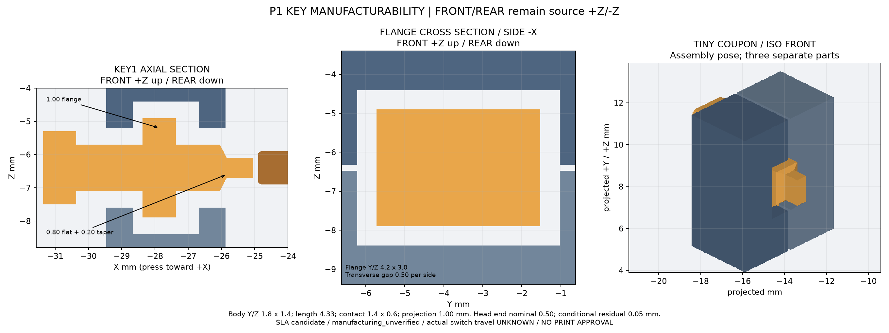

# P1 Review 修订：键帽特征与候选工艺

本页回应 [PR #2 Reviewer](https://github.com/Gadil123/esp32-design/pull/2#pullrequestreview-5539315144) 的键帽可制造性问题及 [后续分支说明](https://github.com/Gadil123/esp32-design/pull/2#issuecomment-6206781600)。当前仅为 P1 复审：`manufacturing_status=manufacturing_unverified`，`functional_actuation_status=UNVERIFIED`，`release_status=REVIEW_ONLY_NOT_PRINTABLE`。**未选择供应商、未订购材料或试样、未批准任何打印，不进入 P2。**

## 几何修改与原厂接触约束

原始 STEP 及坐标变换不变：+Z FRONT、−Z REAR、USB 顶部 +Y；三键在 FRONT 左侧 −X，按压方向 +X。仍用原板三开关、四原厂螺母、原生 USB，不增加电子件/接线。电池、扬声器未设实体或最终尺寸，最终整机厚度仍为 `null`。

| 键帽结构（mm） | Review 前 | 修订后 |
| --- | --- | --- |
| 日常键长杆 | 约 3.98 长，Y/Z 1.2×0.5 | 主体约 4.33 长，Y/Z 1.8×1.4 |
| 局部触头 | 整根均细薄 | Y/Z 1.4×0.6；直段 0.80 + 渐变 0.20，总突出 1.00 |
| 法兰 | 0.4 厚，Y/Z 3.8×2.0 | 1.0 厚，Y/Z 4.2×3.0 |
| 导向/法兰横向间隙 | 每侧 0.15 | 每侧 0.50 |
| 法兰轴向装配间隙 | 与横向共用 0.15 | 独立配置，每端 0.30，加 0.40 候选运动空间 |
| 日常键头肩到壳外壁 | 静止 0.45，候选末端 0.05 | 静止 0.90，候选末端 0.50 |
| 捕获腔内/外挡壁 | 各约 0.80 | 各约 0.80，独立实体见证检查 |
| 壳体宽×高（不含凸键） | 56.24×77.86 | 57.14×77.86，按键侧再增宽 0.90 |

三颗键使用相同的厚主体/短触头/厚法兰截面；RESET 仍是凹入外壁 0.35 的无外凸头推杆，Ø1.30 维护孔不变。触头比原厂约 1.8×0.8 静态平面小；厚主体在候选运动中留在原板包络之外。所有静态碰撞和路径检查重新读取完整原始 STEP solids；轻量代理不参与验收。连续路径按头、主体、法兰、渐变、触头的区段保守包围盒检查。

候选 0.40mm 仅是 CAD 轴向运动预算。越界碰撞只证明捕获腔的边界存在，**不能证明止挡在真实开关允许压缩范围内**。原板接触间隙 0.15 是名义几何值，不能承诺打印/装配后没有预压。真实行程、过行程、触发点、操作力与回弹仍未知，不从静态 STEP 推断。

## 工艺依据和有条件预算

拟评估 **SLA 树脂、键帽与两半导向分开制造**。日常键材料倾向韧性工程树脂；具体牌号、疲劳性能、固化工艺、打印方向和加工商均未锁定，不把普通树脂的精度指标当作韧性树脂保证。未满足供应商确认和实测前，只有几何筛查结果。

2026-10-16 查阅的公开一次来源：

- [Xometry SLA 设计指南](https://xometry.asia/en/sla-3d-printing-design-guidelines-8-essential-tip/)：针状独立特征建议至少 1.0mm，无支撑壁 0.6mm，细节 0.2mm，运动件名义间隙 0.5mm。这是一般建议，不是本件工艺认证。
- [JLC3DP 工艺设计指南](https://jlc3dp.com/blog/how-to-design-3d-models-for-printing)：FDM 推荐最小壁厚 1.2mm；SLA 推荐 0.8mm、100mm 内典型尺寸公差 ±0.2mm。厂商/材料的规则不同，不能混为统一保证。本件 0.6mm 短触头低于 JLC 的通用 0.8mm 建议；因此**不能按 JLC 通用规则直接放行**。

`cad/p1-manufacturing.json` 将公开参考、工程筛查阈值和待确认公差分别记录。工程阈值：主体最小截面 1.2、长细比 ≤4；法兰厚 ≥1.0；短触头厚 ≥0.6、突出 ≤1.0、突出/厚度 ≤2。修订后的主体长细比约 3.09；触头约 1.67。0.6mm 触头只作为短局部接触台，**不是已合格的 0.6mm 长针**，其根部过渡应力、强度、支撑拆除损伤和寿命仍必须由工艺审核/试样确认。法兰根部直角、渐变处的应力集中也未被本检查认证。

| 有条件预算（mm） | 公式/结果 | 验证边界 |
| --- | --- | --- |
| 每零件尺寸误差暂按 ±0.20；清理预留 0.05 | 是拟要求，不是已获承诺 | 不含整壳翘曲、装配偏心或载荷挠曲 |
| 居中横向单侧有效间隙 | 0.50 − (0.20+0.20)/2 − 0.05 = 0.25 | 只在居中及误差边界成立时有效 |
| 头肩候选末端间隙 | 0.90−0.40=0.50 名义值 | 壳面/肩面位置误差分别暂按 ±0.20 |
| 头肩有效余量 | 0.50−0.20−0.20−0.05=0.05 | 与旧版未经预算的名义 0.05 不同，仍未实测 |
| 法兰轴向总自由空间 | 0.40+2×0.30=1.00 | 腔尺寸和法兰尺寸最不利相差 0.40 后剩 0.60 |
| 轴向总空间扣除候选预算 | 1.00−0.40−0.40=0.20 | 不保证法兰在原厂触点前的位置和单端间隙 |
| 挡壁最小厚度估计 | 0.80−0.20=0.60 | 达到所选一般参考下界，不等于强度合格 |

导向存在横向游隙。触头与原厂面完整居中的名义余量仅 Y 约 0.20、Z 约 0.10，小于每侧 0.50 的导向间隙；偏推可能失去完整接触或碰到开关本体。本次连续运动验算是**轴向居中刚性路径**，不声称任意横向偏载安全。小样必须量测侧隙、偏推、斜卡、接触点与回弹；如不能稳定接触，须继续收紧导向的已确认加工公差或调整接触导向，再复审，不能拿几何 PASS 放行。

常规 FDM/PLA/PETG 对比最小特征检查为不通过：1.0 法兰和 0.6 短触头低于选用的 1.2 对比下限。报告显式 `fdm_qualified=false`；不提供“换成 FDM 直接打印”的承诺。整壳 0.6 定位舌、1.0 轨条、1.2 托臂、0.15 接缝/轨槽也未按整机 SLA 规则全面合格化，不能将局部键帽筛查外推为整壳制造验收。

## 自动检查与小样

新增检查直接量测生成 B-rep 的主体、法兰、接触台和渐变，并验证这些特征确实包含在最终键帽中。负向测试用真实变异几何重现薄长杆、0.4 法兰、过长触头；另用同一预算检测器拒绝旧版 0.05 名义末端余量及 0.15 导向间隙。原五个独立几何负向测试保留；导向错位夹具现在偏移 1.2mm，越过加宽后的导向空间。任何正向检查不通过或负向变异未检出均令构建失败。

输出一个极小的 KEY1 局部试样：`coupon_front_guide`、`coupon_rear_guide` 是最终两壳的真实局部裁切；`coupon_key1_cap` 是完全相同的最终键帽。约 7×7.2×6mm 的局部导向体，不是整壳。三件分别输出 STEP/STL，保留源坐标，装配姿态用于对照，不是切片排版。闭合后的内腔在制造时由两半开放，不做原位打印运动副。

将来若 Reviewer 另行允许制作小样，需先要求加工商对最终三文件、短触头、误差要求及韧性树脂给出工艺确认。候选排向：使推杆轴尽量接近成形竖向，支撑放在非配合的头部外面；两半导向开放面便于清洗和去支撑。不得把支撑落在触头端面、法兰两轴向面或导向面；加工商确认可行方向后再排版，不以层高等同尺寸精度。清洗/充分后固化后再测量，禁止给滑动/接触面喷涂。

试样验收计划（本轮不执行打印）：

1. 量测杆截面、法兰厚、腔长、两半配合与触头端面，用于验证上面的误差模型。先在无板状态手持夹具合拢两半，检查自由滑动、防脱和装入/取出；不可通过把导向半壳夹弯来获得滑动。
2. 以真实板卡静态位置对齐，只在测得实际触发/允许行程后做按压；先查零预压，再量触发点、回弹、可见偏摆与旁向碰壳，BOOT/BAT_PWR 分别重复按压至少 100 次并记录卡滞、裂纹和残余形变。100 次仅为早期筛查，不是寿命认证。RESET 检查工具能触达、取出不粘连。
3. 未知最大安全行程时不得强压至 CAD 内挡壁。只要有预压、偏推干涉、不能稳定触发/回弹、裂纹或明显磨耗，即停止并修订。试样通过后还需更新测量证据并复审，**不自动授权整壳打印**。

拆卸仍使用共用四螺钉：先断电/拔 USB，托住屏幕和 PCB，再退出螺钉并缓慢分离后盖。板卡随拆盖释放；若未来加电池/扬声器，先托住两侧、在可触及时先断开连接，不能悬吊或牵拉线缆。本次不添加复杂固定件。

## PR 堆叠与 Pocket OS 整合保护

本轮读取 main `f004e4a` 的软件架构决策；PR #1 仍有冲突，PR #2 保持 `codex/cad-p0 → codex/cad-p1`，本轮不 rebase、不改 base、不解决该独立冲突、不合并。

后续授权整合 PR #1 时，必须以**当时最新 main** 再确认并保留：

- [`docs/08_software_architecture_and_app_roadmap.md`](https://github.com/Gadil123/esp32-design/blob/main/docs/08_software_architecture_and_app_roadmap.md) 全文。它与 `docs/08_cad_p0.md` 是两个不同文件，编号重复不构成替换理由。
- README 的 Pocket OS 多应用终端定位、软件路线摘要及软件文档链接；`docs/01_scope_decisions.md` 中 S-001～S-007 与软件章节。不要对 README/docs01 直接全选机械分支的 ours 覆盖 main。
- 软件路线：ESP-IDF + Waveshare BSP + ESP-Brookesia/LVGL；先复现官方 `08_bookesia` 基线，动态 `.bpk`/C5 能力仍待 PoC；复用小智音频/协议与服务器，重 ASR/LLM/TTS 放家庭 Linux/API；Pocket Chat 优先、其他应用路线后续，Pi 为可选应用，可信网关/白名单 S-007。

先单独处理/审查 PR #1，再按其 merge/squash/rebase 方式更新 PR #2 base 和增量，避免重复 P0 改动。本说明只是整合约束，不意味着当前堆叠分支已包含 main 软件文档。

