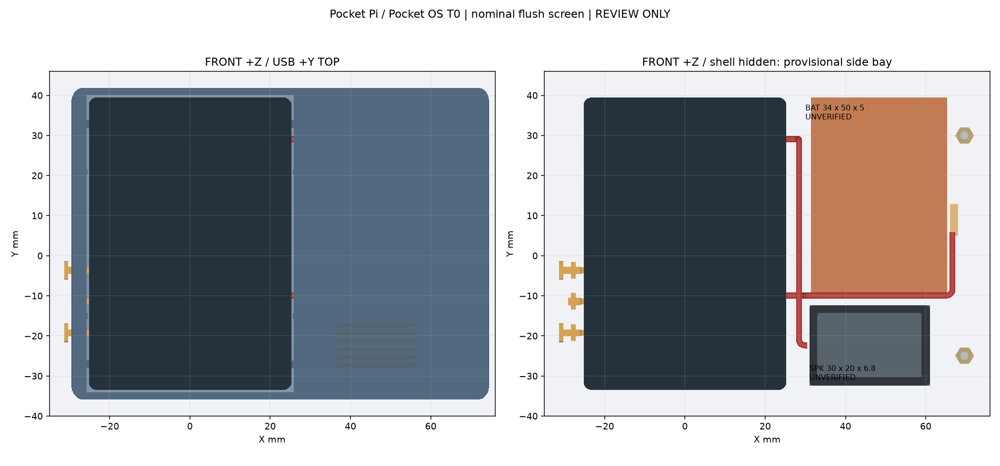
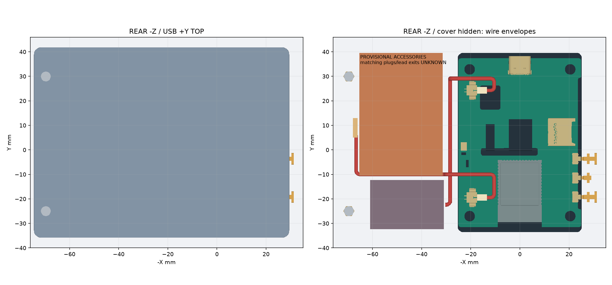
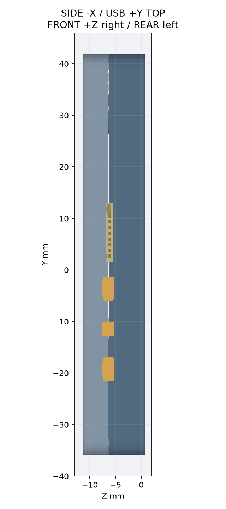
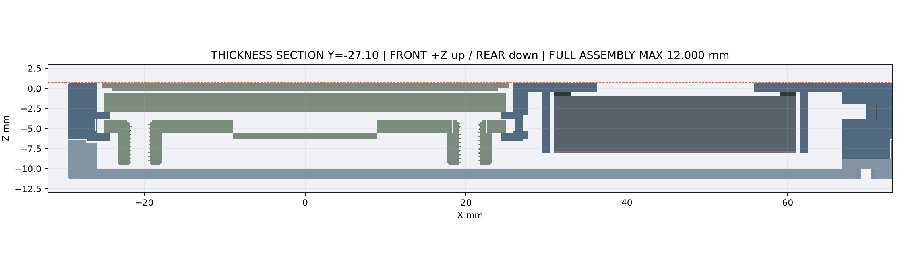
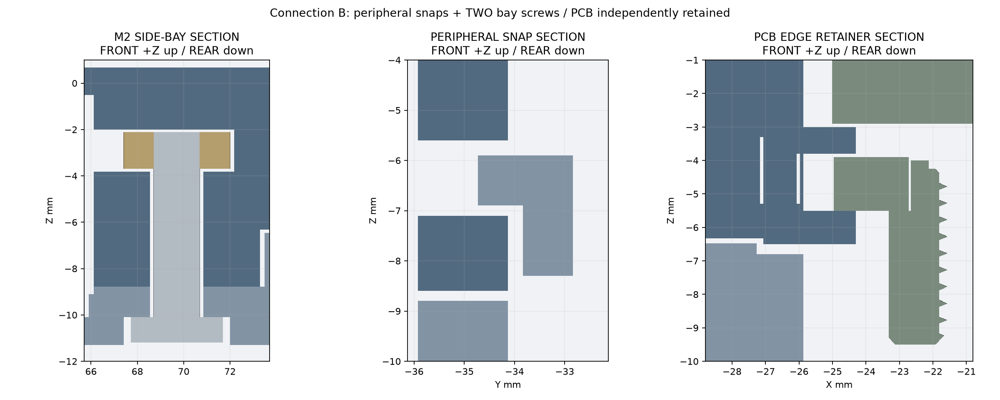
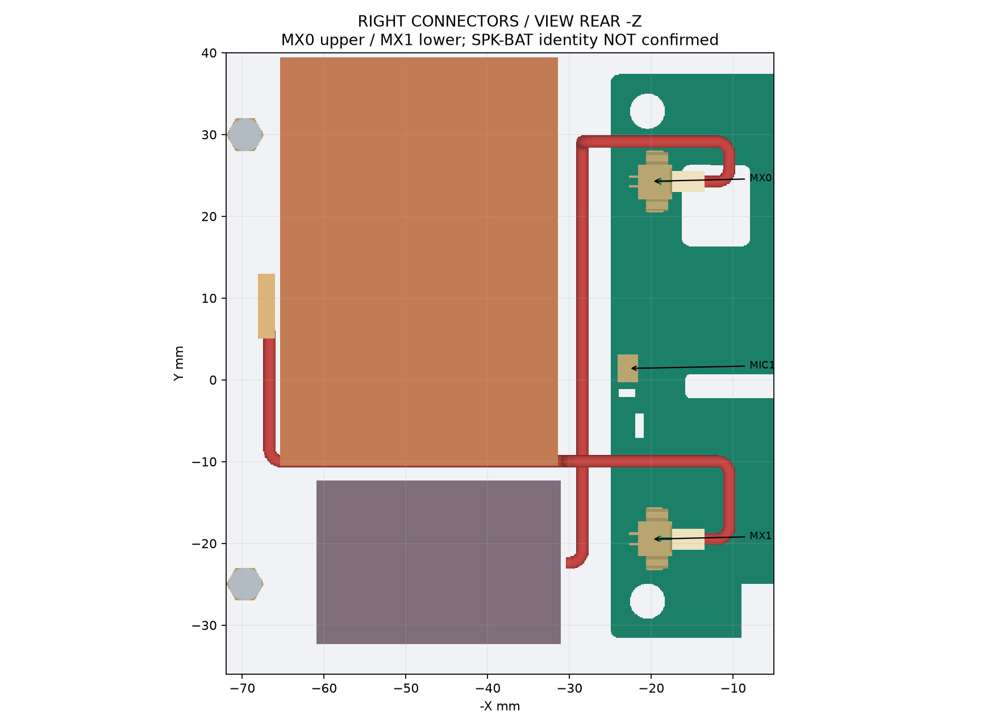
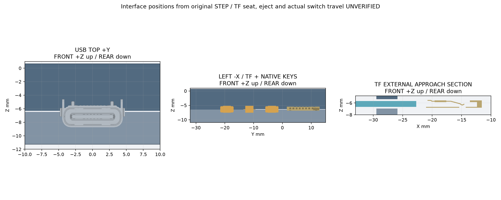

# T0 Ultra-Thin V1：完整几何与未关闭的工程门槛

本方案在 `codex/cad-t0` 独立分支开发，基于 main `f004e4a`，不合并/变基 PR #1/#2。复用 P1 `106742a` 的 STEP 装配变换、按键尺寸、几何检测与无界面渲染方法；没有改原 P0/P1 分支或官方参考文件。main 的 Pocket OS 软件架构原文和 S-001～S-007 保留。**Review only，不批准打印，不合并。**

## 结论应如何阅读

12mm 是主候选的**完整 CAD 名义最大厚度**，不是已保证能生产/接线/录音的成品厚度。检查包括所有官方实体、两壳、原生键帽、两颗 M2 螺钉及螺母，以及临时电池、保护板、扬声器、泡棉/胶、阻尼、插头与线束包络；没有扣除局部凸起。

完整装配中的 `UNVERIFIED` 件是临时包络。配件尚未到货，匹配插头/引线/扬声器端子没有精确模型，所以不能据此认定“真实配件已连上”。`geometry_status` 与实际连接、制造、录音的 `evidence_gates` 分开；后者未关闭。

既有资料的约 10.22mm 整板厚度保留为参考；本次 OCP 紧包围盒约 10.20mm，与记录最大差约 0.0145mm，落在原有 0.05mm 对照阈值内。此差值不是制造公差，也不作为可消费的打印余量。

11.5mm 的原板到 1.2mm 后盖内面只有约 0.10mm，低于本方案 0.15mm 下限，先按必要条件失败停止该厚度细化。这不是说原板本体已穿壳，也不是全局不可能性证明。

12mm 的保守 USB 包胶开口下方仅约 **0.48mm** 塑料。当前完整工艺筛查不能通过；若坚持该 7.3mm 高开口，局部保留 0.8mm 材料的厚度下界约 **12.32mm**，**12.4mm 对照版也已重建并检查**，该薄边增至约 0.880mm，但仍未取得工艺或实物放行。另有 PCB 限位片与 LCD/PCB 各约 0.10mm 的名义间隙，单纯增加后盖深度不能消除这些配合风险。**不能把几何 PASS 写成 T0 已完成实物验收。**

## 最终名义检查结果

| 厚度方案 | 完整 STEP 回读最大厚度 | solids | 几何检查 | USB 下边材料 | 工程结论 |
| --- | ---: | ---: | --- | ---: | --- |
| 主候选 12.0 | 12.000mm | 742/742 有效 | 242 项通过 | 0.480mm | 名义装得下，当前薄边/工艺与实物门槛未通过 |
| 对照 12.4 | 12.400mm | 742/742 有效 | 242 项通过 | 0.880mm | 改善 USB 薄边，仍未获制造/真实连接/录音放行 |
| 探索 11.5 | 必要净空条件先失败 | 不伪造完整装配通过 | 板后约 0.10 < 0.15mm | 不继续外观细化 | 放弃本轮极限探索 |

两版均包含全部 723 原厂 solids，另 19 个已建模结构/配件/线束 solids；参考非 solid 曲面另外披露。各自五组零件 STEP/STL 回读有效、闭合检查通过。原有键帽制造性负向测试五项与 T0 的 USB 封堵、电池侵板、隐藏外凸和扣位丢失四项均被检测。完整 STEP 的最大厚度是导出后重新导入量测，不只来自参数或两壳面距离。

## 可复现运行

Linux Python 3.13；build123d/OCP 等依赖锁定于 `requirements.lock.txt`。与官方仓库保持并列，官方仓库只读，浅克隆及 sparse checkout 由脚本完成。不安装 FreeCAD MCP，不使用 Computer Use、Text2CAD 或文件 SHA 校验。

```bash
./scripts/setup-t0-reference.sh
python3.13 -m venv .venv
.venv/bin/python -m pip install -r requirements.lock.txt
./scripts/generate-t0-review.sh  # 一条命令重建两版、报告、图片及附件
# 只重建 12mm 主候选也可单独运行 ./scripts/generate-t0.sh
# 厚度变体使用同一模型和全部检查：
./scripts/generate-t0.sh --thickness 12.4 --output build/t0-12_4
```

生成命令从未修改的官方原始 STEP 生成 `build/t0`，不读开发 BREP 缓存。检查失败非零退出并保留 JSON；检查和导出完整成功后才可打包。正式生成包括原始装配树父级位姿累计、绕 Z 180° 的刚性旋转、原始尺寸对照、干涉、路径范围与导出回读。完整 STEP 因包含整套官方精确几何，不放入 Git 历史；交给 Reviewer 的大文件在 [T0 草稿附件](https://github.com/Gadil123/esp32-design/releases/tag/untagged-4c8e4087aeeff72f3e90) 中（需仓库权限；草稿不是打印批准）。轻量模型、零件 STEP/STL、报告和图片提交 Git。

## 坐标与齐平前框

单位 mm。+Y 为 USB 顶部；+Z 为屏幕 **FRONT**，−Z 为 **REAR**。FRONT 观察原生键/TF 在左，扩展仓在右；REAR 观察左右镜像。原板保持其真实微小转角、螺母和屏幕/PCB 相对位置，不改/切 PCB。

玻璃名义 z=+0.70；前框最高面同为 +0.70，取消 P1 的 0.60 下沉及保护唇。完整触摸玻璃外轮廓周边留 0.60 横向间隙；不以有效像素区裁孔。外轮廓 XY 圆角 3.0，外部前/后边缘圆角 0.20，均在名义包络内。原始 DISPLAY 包含玻璃、背部和排线的复杂形状，干涉检查使用完整实体，而非把 LCD 简化成一块板。

默认壳体 **104.00×77.86×12.00mm**；计入左侧键帽 1.90mm 外伸，完整整机名义包络为 **105.90×77.86×12.00mm**。外框 x=-29.47..74.53，y=-35.93..41.93，z=-11.30..+0.70。宽度允许随参数调节；当前没有增加机身长度。

## 紧凑平面布局与宽度取舍

| 区域 | FRONT 坐标/布置 | 证据状态 |
| --- | --- | --- |
| 官方屏幕/PCB | 左侧，保持官方完整装配 | 原始 STEP |
| 电池 | X/Y 34×50，中心 (48.4,14.5)，厚 5 | 用户临时尺寸，unverified |
| 电池保护/出线 | 电池右侧 2×8×1.5 候选包络 | 未选型的设计余量，unverified |
| 扬声器 | X/Y 30×20，中心 (46,-22.4)，厚 6.8，朝 FRONT | 用户临时尺寸，unverified |
| 两颗外壳 M2 | (69.7,+30)、(69.7,-25) | 参数化候选位置，实际包络/装入需检查 |
| 线束 | 两条 Ø1.50 外接圆束包络，弯曲半径暂按 1.50 | 包含两根 Ø0.70 导线的任意截面旋转；规格/最小弯曲半径未确认 |

97mm 初始宽度下，当前电池、两路转弯线束、可拆 M2 螺母槽及约 1mm 槽周壁不能同时容纳。经过实体干涉修正后把电池稍向右移，给两束线留不同的 X/Z 通道，螺母槽柱半径由初试 2.8 增到 3.6。当前两螺柱自身最右包络要求宽至少约 102.77，再留外围材料取 104mm。**这是当前布局/临时配件下的必要调整，不是所有布局的全局最小宽度**；实际细线、短插头或改用已验证的塑料螺纹柱后可能缩窄。没有因为暂估线束直接把长度增加 10mm。

电池和扬声器分占上/下平面，不在 Z 方向叠放。电池有 1mm 高浅定位环、每侧 0.5 间隙；右侧对保护板/出线开口。电池只用临时 0.2mm 固定胶层贴后盖，不靠闭壳压紧。顶部有超过 1mm 的规划膨胀余量；真实尺寸、保护板、极性、胶材相容性和膨胀仍须测量。后盖打开后可拆电池。

扬声器前面候选 0.5mm 泡棉总成（**含胶层**）、背面 0.3mm 阻尼总成（含胶层）均计入包络。独立外围定位槽和留给引线的缺口；格栅仅在中间约 20×11mm 内开六条 0.9mm 槽，节距 2mm，保留四周材料，不挖空整个 30×20。出声口/磁体/端子真实位置未知，不能把此候选槽群当作最终声孔；泡棉粘接/定位强度亦未验收。

## 方案 B：板卡固定与合壳分离

PCB 固定不使用 P1 的四颗穿后盖螺钉。所有 T0 源码及复制的几何辅助函数放在 `cad/t0/`，与 P0/P1 的 CAD 路径隔离。前壳四处独立侧缘弹性夹位，以原厂孔轴 Y 位置为定位基准，在裸 PCB 边缘提供 REAR 支撑及 FRONT 限位。原厂螺母全部保留，后盖退出不会释放 PCB 的夹位。

四处梁的候选长度 12、厚 1、截面高度 1.2；局部 REAR 托片厚 1.0、FRONT 限位片厚 0.8；限位片不接触玻璃。检查实际支撑与 PCB 的接触、完整原板静态无碰撞，以及释放姿态。约 1.2mm 的侧向释放量对应小挠度梁公式估计约 1.25% 表面应变。该估计没有考虑根部形状、打印各向异性、摩擦和大变形，**不是寿命或材料验收**。FRONT 小间隙需要专门试样；模具注塑经验不能代替单件打印结果。

前后壳有四处周边横向弹性梁、接收窗和可从边缘工具口释放的钩位；初始梁长 12、厚 1、候选释放量 0.8，线性应变估计约 0.83%。分别验证拉出时被捕获、释放后可退出的刚性姿态，不把硬体碰撞测试当作完整弹性仿真。

扩展仓两颗 **M2×8 低头螺钉**，头 Ø4×1.1，参考 NBK SSH-M2-8；两颗 M2 六角螺母 AF4×1.6 的尺寸仅作候选。螺母由后方开放的横向槽装入，螺柱/后盖座接触，闭壳力经螺柱传递，不经过屏幕、PCB 或软包电池。默认头底在 z=-11.20，相对后盖外面 -11.30 凹入 0.10；螺钉实体全部进入最大厚度检查。前面不另留通穿螺孔。

普通高头 M2 不能直接替代：例如头高增至 2.0mm，在同一座面会使最外包络达到约 **12.8mm**。实际头型/长度、螺母、工具、扭矩和打印孔槽必须确认后再采购/替换。无永久胶封结构，不新增电子件。

| 比较项 | P1 共用四螺钉 | T0 当前方案 B | 可研究的简化 B 变体 |
| --- | --- | --- | --- |
| PCB 与后盖 | 拆盖即释放板卡 | 前壳侧夹独立固定 PCB | 保持独立夹位 |
| 外壳连接 | 四原厂 M2.5 螺母共用夹紧链 | 周边钩位 + 右舱两 M2 | 同位置的已验证塑料螺纹柱，取消两金属螺母 |
| 厚度/空间代价 | 局部约 17.6mm | 12mm 名义几何；右舱需加宽 | 可缩小柱径，但螺纹寿命/强度未验证 |
| 主要风险 | 深脚、夹紧链强度 | 弹性梁、公差、USB 薄边、插头/线束 | 塑料螺纹维护性，未建立可放行模型 |

## 真实接口与连接门槛

两个原始连接器均标 `HP1_25MM-2P-SMT-HORIZONTAL`，没有 J1/SPK 的装配身份名。其开口空腔朝 **−X（板内）**，不是天然朝右舱。程序保留 `MX0`（Y≈+24.28）与 `MX1`（Y≈−19.48）这两个真实 occurrence；当前线路关联为上座→扬声器候选、下座→电池候选，**这个关联尚未从实板/官方带位号布局证据确认**，不能接电或声称已确认极性。

临时插头外露体沿 X 长 4、Y/Z=2.6×2.0；未模拟未知插入鼻/端子。两束线先沿 −X 离开，再绕过真实原板元件转向 +X，穿后方可达的侧隔壁缺口入舱。线束按 Ø1.5 的扫掠实体计体积和厚度，不再使用相互重叠的单根线来掩盖交叉。扬声器束与电池束采用不同 X/Z 通道。线端只到达**临时引线等待区**；配件实际端子/引线出口未知，没有伪造导通。

匹配母座的公插头型号、实测长度/高度、出线方向、最小弯曲半径、上/下座功能、极性和线长是关键阻断项。当前通路仅证明这些临时包络在完整 STEP 中可容纳；较长插头或更粗线不能直接套用，需要重跑。官方 #3/#11 说明身份，不能替代两个三维 occurrence 的位号映射证据。

TF1 的精确包络来自 STEP，外部候选通道位于 FRONT 左侧、Y≈7.24、Z≈−6.16。基于壳体开口和接点布局推定 −X 为取卡方向，独立用标准 11×1mm 截面检查外部接近到模型口沿的通道，预留暂定 4mm 弹出预算；**未证明 TF-110 内部座入深度、弹出行程、指甲可达性或插入卡片与触点的运动**，这些必须用实板确认。不能要求拆盖换卡，未确认前接口不验收通过。

USB-C 保留顶部原生接口。开口 13.2×7.3，与独立 12.2×6.3 公开线缆体积探针分开。探针从真实金属口沿向 +Y 连续延伸，保守地不给未知金属鼻/肩台偏移带来的空间优惠；正因如此，12mm 版本 USB 下边材料较薄。要在 12mm 保留更厚边，需确认真实插头鼻和肩台位置后重新开口，不能直接削减 probe 来让检查通过。

## MIC1：最高优先级门槛仍开放

STEP 中 MIC1 是六平面封闭盒状简化实体，没有声孔。检查 PCB 在该区域的建模圆孔边界；没有相应孔的证据不能被解释成必然顶部进声。原理图证实 MIC1 音频输入，与 **ES8311 编解码器**是不同器件，但未给能确认进声方向的精确实装麦克风料号。

本轮**没有盲目开麦克风孔**。MIC1 正后方保留局部空间，检查线束、电池、扬声器和新增结构没有侵入这块内部保留区。若实板证实声口朝 REAR，可研究约 3.5mm 内部短直路径及局部泡棉密封；若为底部进声，需首先确认 PCB 声学通孔。正面路线不能穿过未验证的 PCB/触摸玻璃，不能把右舱做成长声道。

后盖当前仍闭合，内部空间保留不等于拾音已打通。扬声器用外围泡棉并避免刚性直连 PCB，但振动传递/声学串音没有仿真结论。最终必须同一固件、增益、采样率、声源位置和播放音量下比较裸板与装壳的录音电平、底噪、削波、语音识别成功率及边播放边录音；明显退化则不得继续打印放行。保留实录样本和条件，由 Reviewer 确定阈值。

不增加外接/双麦，不把 ES8311 当麦克风，不增加全机屏蔽。新增螺钉在右舱，未把金属电池/扬声器堆在无线模组上。STEP 无线模块子项仍叫 `ESP32-S3-WROOM-1_ASM`，这是模型身份差异，**不推翻官方 C5 规格，也不据此认证天线图形/方向**；实际天线净空与装壳无线表现需核对。侧线靠板走向也须纳入无线实测。

## 制造比较与停止边界

来源查阅于 2026-10-16，索引在 `cad/t0/t0-evidence.json`。

| 工艺 | 本方案的适用性 | 仍需审核 |
| --- | --- | --- |
| SLA 韧性树脂 | 小特征与表面较细，适合先核对局部配合；不把普通脆树脂当弹性材料 | 牌号/后固化、梁疲劳、0.8 限位片、0.6 短键触头、去支撑/翘曲；12mm USB 边低于通用壁厚建议 |
| SLS/MJF PA11/PA12 | 可作为反复拆卸弹性梁的候选，无需 SLA 式支撑 | 表面粗糙/粉末清理、1.2 大平面翘曲、局部 <1mm 特征、孔槽误差；材料并未锁定 |
| FDM PLA/PETG | 单件易获得，较大平面/简单壳形可研究 | 打印方向、层间强度、线宽、0.6/0.8 特征及配合不满足当前通用筛查，不承诺直接打印 |

[JLC 工艺指南](https://jlc3dp.com/blog/how-to-design-3d-models-for-printing)给出 FDM 1.2、SLA 0.8、SLS/MJF 1.0mm 的一般壁厚建议；[尺寸公差说明](https://jlc3dp.com/help/article/3d-printing-design-guideline)列出 SLA ±0.2、尼龙/FDM ±0.3mm（100mm 内，且不含翘曲/喷涂）。本方案宽已超过 100mm，不能把 100mm 内指标直接当整机承诺。

[Xometry MJF 指南](https://xometry.pro/wp-content/uploads/2024/05/EN-EU-MJF-Design-Guide.pdf)建议弹性梁基部至少 1mm、根部半厚度圆角、端部倒角，分件装配至少约 0.4mm 间隙。这里只采用候选梁尺度，没有声称所有细节满足完整指南；根部实际形状/释放力需修改试样验证。参数化名义小间隙 0.10/0.15/0.20 均不能用一般供应商精度保证。

厚度公差示例若给原板变化 0.2、后盖内面 0.2、装配浮动 0.1，合计 0.5，默认约 0.60 名义板后净空只剩 0.10；要维持 0.15，厚度至少约 12.05mm。**这只是显式预算，不是测到的公差或保证的最小可制造厚度**。USB 壁厚下界约 12.32 比它更严格；建议研究 12.4 而不宣称 11.5 有价值。配件或真实插头/声路若另需空间，应重新报告实际最大厚度。

不为装饰增加挂绳孔、正面实体键、复杂音腔或屏蔽层。局部试样应先包含 PCB 夹位、周边扣及原生键帽，然后才研究整壳；本轮连试样打印也未批准。

## 装配/拆卸计划和检查覆盖

1. 前壳 REAR 面朝上，先放入两个螺母。从 REAR 侧插入完整板卡，独立夹位暂释放，让 PCB 后缘经过托片后恢复；检查玻璃齐平、四处夹位无预压。弹性过程、手持可达性待实物/工艺试样，程序在四夹位均保持释放的刚性假设下检查整板沿 20mm 从 REAR 装入的连续保守包围盒；实际弹性根部并非整体平移，该夹具不替代材料/手持验证。
2. 三个原生键帽从 REAR 放入分型导向；RESET 为隐藏维护孔。0.4 候选帽运动仍不是开关行程，偏推/触发/回弹未验证。
3. 前壳定位扬声器及泡棉/阻尼，在后盖浅槽固定临时电池；断电状态按核对后的位号/极性接线。先插两座插头，再排侧束与隔壁槽；实际端子、线长未确认前不实施通电装配。
4. 合拢后盖，临时释放周边钩位，闭合到壳体支承面并恢复，再装两颗 M2 低头螺钉。自动检查只覆盖五个释放扣位的刚性姿态及最终位置，未证明任意中间弹性/带线动作。
5. 拆卸先断电/拔 USB，退出两外壳螺钉，逐个释放周边扣，托住后盖及电池，仅开足够断开线束的缝，再分离。PCB 保持在前壳夹位内；先断开并移开线束才释放 PCB 夹位。禁止牵拉电池线、扬声器线或玻璃。

报告区分完整原板实体有效性、全部新件与原板/彼此干涉、真实外包络最大厚度、名义齐平、独立 USB/TF 外部通道、PCB 支撑/释放、捕获/释放姿态、键帽居中运动及制造负向测试。原板非 solid 曲面单列，不作为体积碰撞通过；采样姿态不叫连续装配证明。导出后回读五组 STEP/STL，检查单实体、闭合网格及尺寸/体积差；完整 STEP 另回读核对 723 个原厂 solids 与全部候选件的总数和实际最大厚度。

**退出点：提交独立 T0 PR。真实插头/端子布线、TF 内部行程、麦克风声口/录音和加工公差依然阻断工程放行，不以当前模型数目或检查数量替代这些验收。**

## 图与模型

[交付索引](../deliverables/t0/README.md)包含轻量装配、单件 STEP/STL、完整报告和大装配附件获取说明。














