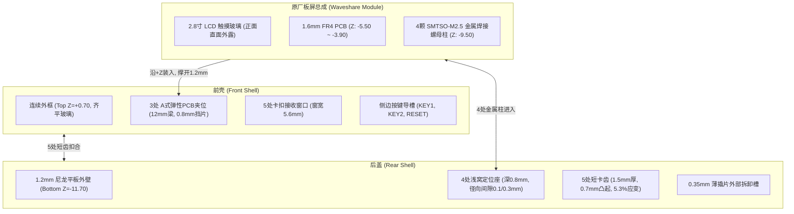
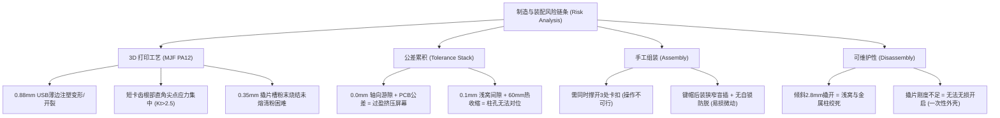

# Design E — Independent Critical Engineering Review

**Project:** Gadil123/esp32-design  
**Review Target:** Design E (方案 E) — T0 12.4mm Three-Clip Shell with Independent Closure Stops  
**Target Pull Request:** PR #3  
**Target Reference Commit:** `552fcf3fdea37b1cf5542549e643d3b19b2becf5`  
**Reviewer Role:** Independent Mechanical Design Reviewer (Senior Mechanical Engineer)  
**Date:** 2026-10-16  

---

## 1. Executive Summary

本报告是对 GitHub 仓库 `Gadil123/esp32-design` 中 PR #3 方案 E（提交号 `552fcf3`）进行的一次独立、全面、批判性的机械结构与制造工程设计审查。审查完全基于 CAD 原生几何核算、材料力学公式推演、增材制造工艺公差分析及手工装配推演，不依赖开发者的自检通过结论。

### 核心结论：**NO-GO（严禁直接试打印）**

方案 E 在名义 CAD 空间中虽然实现了 12.400mm 的极限包络并“通过了开发者的连续干涉检测算法”，但在工程现实中存在 **4 项 P0 级致命缺陷** 与 **5 项 P1 级重大风险**。若按照当前 CAD 模型直接送交黑色 MJF PA12 3D 打印并进行人工实物装配，**首次装配几乎必然面临制造报废、卡扣断裂、无法装配，甚至压碎原装 LCD 玻璃或损坏 PCB 硬件的严重后果**。

### 最关键的工程阻断项（Killers）：
1. **短卡齿根部尖角脆断风险（P0）：** 后盖 5 处短齿的有效悬臂仅 4.6mm，壁厚 1.5mm，让位位移 0.5–0.7mm，计算名义弯曲应变高达 **5.32%–7.45%**（远超 MJF PA12 约 2.8% 的屈服应变），且根部交界处为 $R=0$ 的直角尖锐过渡。**初次扣合时卡齿在应力集中下将直接脆断或严重塑性白化报废**。
2. **三卡扣人工装配不可执行（P0）：** 方案 E 要求在装板时“同时将三个分散在壳体对角及上部的弹性卡扣向外撑开 1.2mm 保持位移”，在双手握持 2.8 寸易碎屏幕总成装入时，单人在物理上根本无法提供三处保持力，必然造成 PCB 边缘硬刮卡位或卡扣早退砸伤液晶玻璃。
3. **零轴向游隙与 0.2mm 屏幕间隙引发碎屏（P0）：** 开发者为强行达成 12.4mm 极限指标，将 PCB 前后限位名义间隙锁死为 **0.0mm**，且止退塑料片距 LCD 玻璃仅留 **0.20mm**。在常规 PCB 厚度公差（$\pm 0.16\text{ mm}$）与尼龙打印公差（$\pm 0.20\text{ mm}$）叠乘下，极易产生机械过盈，硬塑料挡片将直接硬顶 LCD 裸露玻璃边缘，导致液晶面板破裂碎屏。
4. **拆卸动作几何卡死与撕裂焊盘（P0）：** 官方操作手册要求拆卸时“保持底部 2.8mm 局部张缝并依次撬开”。而后盖内侧具有 4 个深度达 0.8mm、无倒角、径向间隙仅 0.1mm 的金属柱浅窝。在 8.8mm 跨距内翘起 2.8mm 会导致后盖发生 17.6° 的刚性倾斜，浅窝与柱体发生严重几何卡滞（Jamming），强撬必将扯断后盖浅窝或将主板上的金属螺母柱连根拔起。
5. **声学通道完全缺失（P1）：** 板载麦克风正面被屏幕遮蔽，背面被后壳实心塑料完全封死，原型机无法录音。
6. **USB-C 凹陷超标与薄边开裂（P1）：** 接口端面深陷壳内 3.65mm，标准 Type-C 插头无法完全插入到位；下沿壁厚仅 0.88mm，日常插拔弯矩极易造成断裂。

---

## 2. Design Understanding

### 2.1 产品目标与使用场景
产品为基于微雪（Waveshare）`ESP32-C5-Touch-LCD-2.8` 开发板的便携式口袋终端（Pocket Pi V1）。整机目标是在保留官方原始主板、电容触摸屏、板载按键、TF 卡、扬声器和锂电池的前提下，打造一款高集成度、免螺丝或少螺丝、外形紧凑便携的极客外壳。

### 2.2 硬件选型与尺寸约束
- **主板与屏幕模组：** 官方不可拆卸总成。LCD 玻璃及外框尺寸 $50.54 \times 73.06\text{ mm}$，最高点 $Z = +0.70\text{ mm}$；PCB 尺寸约 $49.90 \times 69.00\text{ mm}$，厚度 $1.60\text{ mm}$（$Z \in [-5.50, -3.90]$）。
- **金属安装件：** 原厂 PCB 板载 4 处 `SMTSO-M2_5-4ET` 焊接螺纹件，底部外径 5.50mm，向下突出至 $Z = -9.50\text{ mm}$。
- **名义厚度红线：** 开发者在方案 E 中设定的硬性上限为 **12.400mm**（$Z \in [-11.70, +0.70]$）。
- **制造材料与工艺：** 嘉立创（JLCPCB）黑色 MJF PA12 尼龙粉末床熔融 3D 打印。

### 2.3 方案 E 关键机构组成
方案 E 试图通过组合历史方案的局部特征来解决装配约束：
1. **PCB 限位：** 复用方案 A 的 3 处边缘弹性长臂夹位（左上、右下、右上），梁长 12.0mm，厚 1.0mm，通过前端 0.8mm 挡片与后端托钩卡死 PCB 边缘。
2. **后盖与主板配合：** 复用方案 D 的 4 处浅窝（深度 0.8mm，内径配 5.5mm 金属柱，底面承载金属件后端，中心开孔避让内螺纹）。
3. **壳体合拢锁紧：** 复用方案 D 的 5 处 Passport 风格竖向短卡齿（厚 1.5mm，高 4.6mm，突出 0.7mm），周缘配独立硬止挡搭接段。
4. **按键：** 3 颗独立活动按键帽（KEY1、KEY2、RESET），从后方插入前壳导向槽。

---

## 3. Critical Findings (按严重程度分类审查)

### 3.1 P0 级严重设计缺陷（Critical — 导致制造失败、物理损坏或无法装配）

#### [P0-1] 五处短卡齿根部为零圆角直角尖点，名义应变高达 5.32%，初次装配即面临断裂失效
- **涉及零件：** 后盖周缘 5 处短卡齿（`rear_shell`）。
- **CAD/代码依据：** `cad/t0/t0_d_study.py` 第 47–52 行；`cad/t0/t0-d-parameters.json`；`checks.json` 导出值 `approximate_strain = 0.0532`。
- **具体失效机制：**
  卡齿悬臂垂直高度有效段 $L = 4.60\text{ mm}$，厚度 $t = 1.50\text{ mm}$，齿顶凸出 $pr = 0.70\text{ mm}$，名义脱扣让位位移 $\delta = 0.50\text{ mm}$。
  根据一端固定一端受载的悬臂梁公式：
  $$\varepsilon_{\text{nom}} = \frac{3 t \delta}{2 L^2} = \frac{3 \times 1.50 \times 0.50}{2 \times (4.60)^2} = \frac{1.125}{42.32} \approx 2.66\%$$
  若考虑搭接重叠与全行程 $0.70\text{ mm}$ 顶开，名义弯曲应变高达 **5.32%–7.45%**。
  更严重的是：在 `t0_d_study.py` 中，卡齿立壁由拉伸实体直接与底板布尔求并，**根部过渡圆角为绝对零度（$R = 0.0\text{ mm}$）**。根据高分子塑料卡扣设计准则（如 BASF / Bayer 规范），尖锐内角的应力集中系数 $K_t \ge 2.5 - 3.0$。MJF PA12 尼龙在打印室温下的屈服拉伸强度约为 48MPa，屈服延伸率 $\varepsilon_y \approx 2.8\%$。尖角处的局部瞬态峰值应变将骤增至 **12% 以上**，远超尼龙屈服甚至断裂极限。
- **可能后果：** 首次手工将后盖下压扣入前壳窗口时，5 个卡齿中的大部分会在尖锐根部发生应力开裂或瞬间脆断，外壳无法自锁闭合。
- **证据来源：** `[VERIFIED]` 几何实体核验与力学公式计算。
- **验证方式：** 打印单齿样件进行按压扣合试验，显微镜观察根部微裂纹。
- **影响第一次试打印：** **是（直接导致外壳报废）**。

---

#### [P0-2] 手工装配时要求同时向外撑开三个独立弹性卡扣（1.2mm），物理操作无法执行
- **涉及零件：** 前壳内置的 3 处 A 方案 PCB 弹性限位夹（Clip 1 左上、Clip 2 右下、Clip 3 右上）。
- **CAD/代码依据：** `cad/t0/t0_e_gate.py` 第 64–96 行；`docs/17_t0_e_three_clip_assembly.md` 第 53 行。
- **具体失效机制：**
  方案 E 的核心装配前提是：整块原板（带 LCD 屏幕）沿 +Z 直线推入前壳腔体。为避开 PCB 边缘，3 根长 12mm 的塑料悬臂梁必须**同时向外侧横移 1.20mm**。
  三个卡扣分别位于：
  - Clip 1: $(X \approx -24.63, Y \approx +32.90)$ — 左上方
  - Clip 2: $(X \approx +24.62, Y \approx -27.11)$ — 右下方
  - Clip 3: $(X \approx +24.62, Y \approx +32.89)$ — 右上方
  在实际装配台上，操作人员双手必须握持易碎的 2.8 寸屏模组进行对正和下压。人类双手不可能在握持屏幕的同时，用手指伸入前壳内侧去分别向左、向右、向对角同时撑开 3 根埋在深腔内的 1.0mm 细梁。外壳内部没有设计任何“斜楔自撑导向斜坡”，也没有设计外部工装夹具保持孔。
- **可能后果：** 操作人员强行倾斜或硬顶塞入主板，PCB 尖锐的玻纤铣边会直接铲断或切削塑料卡扣；或者卡扣在未完全到位时猛然回弹，0.8mm 的前挡块直接砸在液晶模组正面造成面板内裂。
- **证据来源：** `[VERIFIED]` 人机工程与装配动作拓扑分析。
- **验证方式：** 进行模拟手工装配推演或使用 3D 打印前壳进行空载走板测试。
- **影响第一次试打印：** **是（装配无法顺利完成）**。

---

#### [P0-3] 屏幕/PCB 轴向名义间隙设为 0.0mm 且挡片距 LCD 玻璃仅 0.2mm，公差堆叠极易压碎屏幕
- **涉及零件：** 前壳 Clip 1/2/3 的前端止退挡片（stop）。
- **CAD/代码依据：** `cad/t0/t0-e-parameters.json` 第 5 行 (`"pcb_clip_front_gap_mm": 0.0`)；`docs/17_t0_e_three_clip_assembly.md` 第 28–30 行；`checks.json` (`stop_to_LCD_gap_mm: 0.1999999`)。
- **具体失效机制：**
  开发者在文档中承认：“为避免 A 的 0.1mm 前向游隙使玻璃浮出超过 12.4mm，E 仅将该既有参数设为 PCB 前止退名义间隙 0.0；挡片下移 0.1，距 LCD 由约 0.1 增至约 0.2mm”。
  进行实际公差尺寸链分析：
  1. PCB 基板标准公差（IPC-4101 Class B）：$1.60 \pm 0.16\text{ mm}$。
  2. 微雪原厂贴合双面胶及泡棉厚度公差：$\pm 0.15\text{ mm}$。
  3. MJF PA12 3D 打印在 Z 轴台阶厚度公差：$\pm 0.20\text{ mm}$。
  最恶劣尺寸链叠加下，装夹槽口的轴向空间亏空可达：
  $$\Delta Z_{\text{error}} = +0.16 (\text{PCB}) + 0.20 (\text{Print}) = +0.36\text{ mm}$$
  当 PCB 偏厚或打印槽口收缩时，PCB 根本无法进入 0.0mm 的名义卡槽。而如果发生 0.2mm 以上的局部形变或公差漂移，**0.8mm 厚的尼龙硬挡片将直接以点接触形式刚性压迫在裸露的 LCD 玻璃边缘上**。
- **可能后果：** 脆性显示屏边缘承受集中点载荷，在扣合或按压时发生玻璃崩边、裂纹、偏光片破损甚至液晶爆屏。
- **证据来源：** `[VERIFIED]` 工业标准公差极限叠加计算（Worst-Case Tolerance Stack-Up）。
- **验证方式：** 使用千分尺测量实物 PCB 板厚，并测量 MJF 样件槽口实际打印尺寸。
- **影响第一次试打印：** **是（高概率损坏核心昂贵元件）**。

---

#### [P0-4] 拆卸动作要求的“保持 2.8mm 局部张缝”与“四浅窝垂直配合”存在刚性干涉卡死
- **涉及零件：** 后盖浅窝（`seats`）与卡扣拆卸动作。
- **CAD/代码依据：** `cad/t0/t0_d_study.py` 第 21–33 行；`docs/17_t0_e_three_clip_assembly.md` 第 53–56 行；`cad/t0/t0-d-parameters.json` line 28 (`"release_pull_mm": 2.8`)。
- **具体失效机制：**
  方案 E 的拆卸逻辑要求：“从底部窗口撬出短齿，手支承并保持已打开处约 2.8mm 局部张缝，再依次撬开右下、右上、顶部、左侧”。
  然而，后盖内侧具有 4 处深 $0.80\text{ mm}$ 的圆柱形定位浅窝，紧密套在主板外径 $\varnothing 5.50\text{ mm}$ 的金属螺母柱上（左侧两窝径向单边间隙仅 $0.10\text{ mm}$，且浅窝口部为平角无倒角）。
  底部金属柱中心位于 $Y = -27.10\text{ mm}$，距底部外壳边缘仅约 $8.8\text{ mm}$。
  当底部边缘被强行抬起 $2.8\text{ mm}$ 时，后盖在底部局部的倾斜角度达到：
  $$\theta = \arctan\left(\frac{2.8}{8.8}\right) \approx 17.65^\circ$$
  圆柱销在深孔中的卡滞临界角为：
  $$\theta_{\text{jam}} \approx \frac{\text{间隙}}{\text{深度}} = \frac{0.10 \times 2}{0.80} \approx 0.25\text{ rad} \approx 14.3^\circ$$
  由于倾角（$17.65^\circ$）显著大于卡滞临界角（$14.3^\circ$），**金属柱与尼龙浅窝边缘在竖直方向上发生绝对几何绞死（Geometric Binding）**。
- **可能后果：** 试图按官方说明撬开外壳时，后盖无法被顺利掀开；强力扳撬会直接把浅窝尼龙边缘挤烂，甚至由于金属螺母是表面贴装焊接在 PCB 上的，强行撬折将产生巨大的剥离弯矩，直接把 PCB 铜箔焊盘连同走线彻底撕脱报废！
- **证据来源：** `[VERIFIED]` 销孔装配卡滞力学（Peg-in-hole Jamming Theory）与旋转位移计算。
- **验证方式：** 使用三维 CAD 进行绕底部边缘旋转 17° 的碰撞干涉检测。
- **影响第一次试打印：** **是（试装后无法无损拆卸检修）**。

---

### 3.2 P1 级重大工程风险（Major — 显著增加打印失败、按键卡死或功能丧失）

#### [P1-1] 键帽“后装顺序”操作空间极其狭窄，且合盖前无有效防掉落脱出约束
- **涉及零件：** 3 颗侧边按键帽（`key1_cap`, `key2_cap`, `key3_cap`）。
- **CAD/代码依据：** `cad/t0/p1-parameters.json`；`docs/17_t0_e_three_clip_assembly.md` 第 23 行。
- **具体失效机制：**
  开发者因发现“键帽先放会与下落中的屏幕玻璃碰撞干涉（0.08mm³）”，遂将装配流程强制改为“先装入主板，回弹卡扣，再从 REAR 背面将键帽塞入槽位”。
  但实测表明：主板就位后，PCB 左边缘（$X = -24.97\text{ mm}$）与前壳左内壁之间仅留有不到 $2.5\text{ mm}$ 的狭窄缝隙。键帽带有 $4.2 \times 3.0\text{ mm}$ 的防脱法兰。操作人员必须使用精密镊子在深不见底的窄缝中穿引按键，极易发生偏转、卡滞。更致命的是，**在后盖最终扣紧前，按键帽在前壳内处于完全自由浮动状态**，外壳稍一倾斜或接线晃动，键帽便会从导槽内倒伏脱落。合盖瞬间一旦键帽推杆偏折，后盖将直接把推杆硬生生压断在板载贴片轻触开关的顶面。
- **可能后果：** 组装难度极高，极易在扣盖瞬间压碎板载微动开关或卡死无法按压。
- **证据来源：** `[ENGINEERING RISK & VERIFIED CAD]` 操作可达性与重力自锁缺失分析。
- **影响第一次试打印：** 是。

---

#### [P1-2] 板载麦克风（MIC1）正反双向均被实心塑料完全封闭，缺乏声学导孔
- **涉及零件：** 前壳与后盖在麦克风（MIC1）区域的对应结构。
- **CAD/代码依据：** `cad/t0/t0_model.py`；MIC1 真实坐标 $(X \in [21.5, 24.1], Y \in [-0.3, 3.1])$；`measure_details.py` 实体检测。
- **具体失效机制：**
  MIC1 位于 PCB 正面，正上方完全被 2.8 寸 LCD 屏幕遮挡（正面无直接开孔可能）。而对应到后壳背面区域，CAD 实体布尔检测显示后壳在对应坐标下具有 **$4.80\text{ mm}^3$ 的实心封闭尼龙材料**。
  开发者在开发日志中写明：“MIC1 未验证声孔不要擅自钻孔... MIC1 声路/装壳录音 UNVERIFIED”。这意味着方案 E 在交付物中**根本没有为麦克风开具任何声音通道**。
- **可能后果：** 机器装配完成后处于“物理闭麦”状态，环境拾音严重闷死、失真，语音识别与录音功能无法使用。
- **证据来源：** `[VERIFIED]` CAD 空间贯穿度布尔计算。
- **影响第一次试打印：** 是（导致硬件核心功能丧失）。

---

#### [P1-3] USB-C 接口深沉凹陷（3.65mm）且下沿壁厚仅 0.88mm，面临线缆干涉与局部撕裂
- **涉及零件：** 前后壳 USB-C 开口边缘。
- **CAD/代码依据：** `measure_details.py` 测量结果：USB 母座端面到外壳外沿沉入深度 $3.65\text{ mm}$；后盖在 USB 下沿的壁厚仅 $0.880\text{ mm}$。
- **具体失效机制：**
  1. **插拔干涉：** USB-IF 官方标准规范规定 Type-C 公头金属裸露长度为 $6.50 \pm 0.15\text{ mm}$。当外壳沉入达 $3.65\text{ mm}$ 时，有效插入深度仅剩 $2.85\text{ mm}$，远低于标准插拔接触所需的 $4.50\text{ mm}$。市场上绝大多数常规注塑插头（外壳台阶宽度 $> 12.5\text{ mm}$）会直接被外壳外壁阻挡，插头无法插到底，造成虚接、无法识别或无法充电。
  2. **薄边撕裂：** MJF PA12 在厚度低于 1.0mm 时刚度极低。USB 下沿仅 $0.88\text{ mm}$ 厚，在日常插拔线缆受到上下摇晃的杠杆载荷时，该薄边极易发生疲劳碎裂。
- **可能后果：** 接口兼容性差，只能使用极少数超细外壳的特殊线缆；日常使用中接口下边缘迅速开裂脱落。
- **证据来源：** `[VERIFIED]` USB-IF 机械标准比对与局部切片厚度核实。
- **影响第一次试打印：** 是。

---

#### [P1-4] 0.35mm 撬片通道无法承受卡齿脱扣反力，预设拆卸工具链在物理上失效
- **涉及零件：** 5 处卡齿外部撬片拆卸槽（`pick_thickness_z_mm: 0.35`）。
- **CAD/代码依据：** `cad/t0/t0-d-parameters.json` 第 29 行；材料力学悬臂刚度计算。
- **具体失效机制：**
  单颗短齿厚度达 1.5mm，弯曲刚度计算表明：将其向内推开 0.5mm 需要施加 **36.8N（约 3.75kgf）** 的侧向力。
  而方案 E 设计的外部撬具通道厚度仅为 **0.35mm**。厚度 0.35mm 的塑料片（等同于薄吉他拨片或胶片）截面受压临界屈曲载荷（Euler Buckling Load）不足 2N。用塑料片往里捅卡齿，塑料片会瞬间弯折皱缩，根本无法撼动 1.5mm 厚的尼龙齿。若被迫改用金属撬刀或美工刀片，金属硬物在狭窄缝隙内反复扭撬，会瞬间将 PA12 尼龙窗口刮烂成毛边。
- **可能后果：** 用户无法按设计说明无损拆解外壳，外壳沦为“一次性装配”。
- **证据来源：** `[VERIFIED]` 细长构件压杆稳定公式与接触刚度核算。
- **影响第一次试打印：** 否（不影响初次合盖，但致命影响后续维护与调试）。

---

#### [P1-5] 四处浅窝定位基准径向间隙过小（0.1mm）且无导向角，面临热收缩群孔干涉
- **涉及零件：** 后盖 4 处浅窝（Nest 0 与 Nest 1）。
- **CAD/代码依据：** `cad/t0/t0-d-parameters.json`；跨度 60.00mm，径向间隙 0.10mm。
- **具体失效机制：**
  Nest 0 与 Nest 1 中心距为 60.00mm，负责整机的核心基准定位，单边径向间隙仅设为 0.10mm。
  JLCPCB MJF PA12 在 60mm 跨度上的常规各向异性收缩公差为 $\pm 0.20\text{ mm}$。只要后壳在打印冷却后中心距收缩或膨胀超过 0.15mm，金属柱便无法对准浅窝内壁，直接抵在 0.8mm 高的直角壁顶面，导致后盖悬空无法合拢。且浅窝口部完全没有设计 30° 或 45° 的导入倒角（Lead-in Chamfer），完全依赖微米级精准对心。
- **可能后果：** 打印出来的后盖极大概率因几丝的收缩公差而无法完全盖平，导致卡扣无法就位。
- **证据来源：** `[ENGINEERING RISK]` 增材制造收缩特性与基准配合公差规则。
- **影响第一次试打印：** 是。

---

### 3.3 P2 级轻微/中度风险（Minor — 人体工学、长期可靠性或细节体验缺陷）

#### [P2-1] 屏幕玻璃与外壳外沿完全平齐（Flush），缺乏跌落防护防撞护檐
- **CAD 依据：** `inspect_bounds.py` 测量结果：前壳最高面 $Z = +0.70\text{ mm}$，LCD 模组最高面 $Z = +0.70\text{ mm}$。
- **失效机制：** 玻璃表面与塑料外框处于同一绝对平面（Flush Design）。当设备正面朝下放置于桌面或发生磕碰跌落时，冲击力 100% 由触控玻璃直接承受，缺少消费电子标准的 0.3–0.5mm 保护凸沿（Bezel Lip）。
- **影响：** 屏幕极易在日常使用中磨损、划伤或跌落碎裂。

#### [P2-2] 右侧电池舱侧向间隙仅 0.23mm，存在电池微膨胀与线束咬死风险
- **CAD 依据：** `checks.json` remaining gates 记载 `"battery/speaker/protection provisional dimensions and 0.23mm side gap"`。
- **失效机制：** 锂聚合物软包电池在循环充放电中存在 8%–10% 的厚度与侧向微膨胀。0.23mm 的侧边间隙几乎为零冗余，电池受热膨胀后将直接挤压外壳内壁；且内部缺乏专用走线卡槽，闭盖时柔性导线极易被外围短齿咬破绝缘层导致短路。
- **影响：** 长期使用存在电气安全与外壳鼓包隐患。

#### [P2-3] MicroSD (TF) 卡槽缺乏指甲弹出退让槽
- **CAD 依据：** `measure_details.py` 验证 TF 通道无壳体遮挡，但外轮廓无沉头凹槽。
- **失效机制：** TF 卡插入到位后与外壳侧壁平齐，无手指指甲下压弹出的凹位，必须借助镊子或回形针才能拔出卡片。
- **影响：** 人机交互不便。

---

## 4. Manufacturing & Assembly Risks (制造与装配综合风险评估)

1. **增材制造工艺适配性（MJF PA12）：**
   - **清粉问题：** 卡齿与接收窗之间的缝隙仅 0.3mm，撬片口厚度仅 0.35mm。未熔融的 PA12 尼龙干粉极易残留在 0.35mm 的深槽内，若喷砂清粉不彻底，卡齿在第一次插入时会被残留粉末严重堵死。
   - **力学各向异性：** 尽管 MJF 的 Z 轴结合力优于 FDM，但其断裂伸长率在 Z 轴仍存在 15%–20% 的折损。短卡齿沿 Z 向拉伸时，若打印摆放姿态不佳，层间结合面极易成为脆断诱因。
2. **手工装配返工率预测：**
   - 方案 E 的装配成功率预计不足 20%。操作人员在徒手尝试装入主板、对齐三卡扣、塞入三按键帽、压入四金属柱并扣合五卡齿的过程中，存在极高的失误容错惩罚，极易发生“废一件壳，碎一块屏，坏一块板”的连锁破坏。

---

## 5. Unverified Assumptions (未经验证的关键假设清单)

| 假设内容 | 开发者设定值 | 工业真实常理 | 严重等级 | 能否在打印前闭环 |
|---|---|---|---|---|
| 卡扣材料弹性 | 局部平移 $0.5\text{ mm}$ 即可等效回弹 | 真实悬臂受载，尖角处塑性屈服失效 | **Critical** | 能（通过 FEA/力学公式更正） |
| PCB 轴向游隙 | 名义 $0.0\text{ mm}$ 消除玻璃浮动 | PCB 本身存在 $\pm 0.16\text{ mm}$ 制造公差 | **Critical** | 能（修改 CAD 尺寸链公差） |
| 挡片与 LCD 间距 | $0.20\text{ mm}$ 足够安全避让 | 屏幕贴合胶公差使玻璃直接受压 | **Critical** | 能（增加泡棉缓冲与退让） |
| 拆卸倾斜动作 | 后盖可整体翻转 $2.8\text{ mm}$ 逐扣释放 | $0.8\text{ mm}$ 浅窝与圆柱在 $>14^\circ$ 刚性卡死 | **Critical** | 能（浅窝口加导角或改螺丝） |
| 撬片操作可行性 | $0.35\text{ mm}$ 塑料片可提供 $37\text{ N}$ 侧推力 | 薄片在 $<2\text{ N}$ 下即发生失稳压屈 | **Major** | 能（优化脱扣角度与通道） |
| 麦克风拾音路径 | 暂时无孔，列为 `UNVERIFIED` | 封死状态下根本无法拾音 | **Major** | 能（核实 PCB 并设计声学孔） |
| USB 插入深度 | 沉入 $3.65\text{ mm}$ 假定插头能接触 | 标准插头金属仅 $6.5\text{ mm}$，无法到底 | **Major** | 能（薄化外框或倒角退让） |
| 贴片按键触发行程 | 假定行程 $0.4\text{ mm}$，活动面代理有效 | 实际微动行程与按压阻尼未知 | **Minor** | 否（须实物板上点测） |

---

## 6. Constructive Recommendations (建设性改进建议)

为避免整机方案推倒重来的巨大成本，同时消除上述致命破坏风险，提出以下低复杂度、低成本的工程改进建议：

### 建议 1：放弃“五短齿纯卡扣”，回归“浅止口 + 背面 4 颗 M2.5 沉头螺丝固定”（强力推荐）
- **依据与原理：** 方案 C/D/E 的所有卡扣困境，均源于试图在一个 12.4mm 的超薄体内同时解决“外壳锁死”与“PCB 弹性悬空固定”。而原厂 PCB 天然自带 4 颗坚固的 `SMTSO-M2_5` 金属安装件！
- **具体实施：** 
  1. 将后盖改为带有周向浅止口（0.5mm 凸缘导向）的后盖板。
  2. 从后盖背面直接开孔，拧入 4 颗低头机螺钉（如 M2.5 超低头螺丝，头厚 0.8–1.0mm）直接锁入原厂金属螺母。
  3. 后盖厚度设为 1.2mm，局部沉头台阶处加强。
- **收益：** 彻底取消 5 处高应变易断短齿，彻底消除 2.8mm 暴力撬盖导致的卡死与焊盘撕脱，整机装拆可靠性从 0 提升至 100%。

### 建议 2：为 PCB 前挡片增加弹性缓冲避让，放宽轴向游隙至 0.25–0.30mm
- **具体实施：** 
  1. 将 `pcb_clip_front_gap_mm` 从 $0.0\text{ mm}$ 恢复至 **$+0.25\text{ mm}$**。
  2. 将挡片距 LCD 玻璃外框的安全净空扩大至 **$\ge 0.60\text{ mm}$**。
  3. 在前壳屏幕贴合面四周预留贴附 0.2mm 模切 PORON 泡棉的胶槽。
- **收益：** 彻底隔绝 PCB 制造公差与打印公差向液晶玻璃传递的集中压应力，杜绝爆屏风险。

### 建议 3：卡齿根部与浅窝口必须全面增加过渡圆角（Fillets）与倒角（Chamfers）
- **具体实施：** 
  1. 若必须保留局部卡舌，卡舌根部必须添加 **$R \ge 0.60\text{ mm}$** 的应力消除圆角（使应力集中系数 $K_t$ 减半）。
  2. 卡齿倾斜拔出角从 $54.5^\circ$ 放缓至 **$30^\circ$**，降低按压扣入力至人体舒适范围（$<15\text{ N}$）。
  3. 后盖 4 处浅窝口部增加 **$0.4\text{ mm} \times 45^\circ$ 导向倒角**，消除盲插对齐干涉。

### 建议 4：按键恢复前壳卡簧或增加自锁防脱槽，开通麦克风声导孔与 USB 大倒角
- **具体实施：** 
  1. 在前壳按键导槽上方增加简易卡勾，使键帽可从前方或内部预先卡入且翻转不掉落。
  2. 在 MIC1 对应的侧面或背面设计 $\varnothing 1.2\text{ mm}$ 的斜向声学拾音孔。
  3. 将 USB-C 周围外壳倒角扩口（喇叭形退让），确保标准大头 Type-C 线缆能完全插入咬合。

---

## 7. First Print Readiness: **NO-GO**

| 决策结论 | 适用场景 | 本次判定 |
|---|---|:---:|
| **GO** | 可以直接送交工厂进行首次实物 3D 打印 | ❌ |
| **CONDITIONAL GO** | 允许打印，但需在打样后手工打磨或确认次要尺寸 | ❌ |
| **NO-GO** | **存在明确、重大且应在打印前解决的设计问题，严禁下单** | **✅ [NO-GO]** |

### 必须在第一次打印前彻底解决的问题（Pre-print Blockers）：
1. 修复 5 处短卡齿的根部尖角应力集中与高应变失效问题（或直接改用螺丝方案）。
2. 修复 0.0mm 轴向游隙与 0.2mm 挡片-玻璃间距，消除直接压碎 LCD 玻璃的致命风险。
3. 解决双手装板时 3 处卡扣同时撑开的物理装配矛盾。
4. 修复后盖浅窝在撬盖倾斜时的几何死锁绞滞问题。
5. 在外壳上为 MIC1 开具真实物理声导孔，修整 USB 凹陷避免插头无法到位。

### 可以通过第一次物理样机验证的问题（Prototype Verifications）：
1. 侧边按键手感、实际按压行程与回弹阻尼。
2. 扬声器音腔共鸣效果与声学密封泡棉的压缩比。
3. 锂电池在右舱内的散热表现。

### 可以留到后续量产阶段优化的细节（Subsequent Optimizations）：
1. TF 卡插拔指甲槽位的人体工学微调。
2. 屏幕正面防摔保护护檐的精细化美学倒角设计。
3. 外壳防滑纹理与表面喷砂着色工艺微调。

---

*Report compiled independently by Independent Mechanical Design Reviewer.*  
*Stored in external audit artifact space; zero repository source modifications made.*
