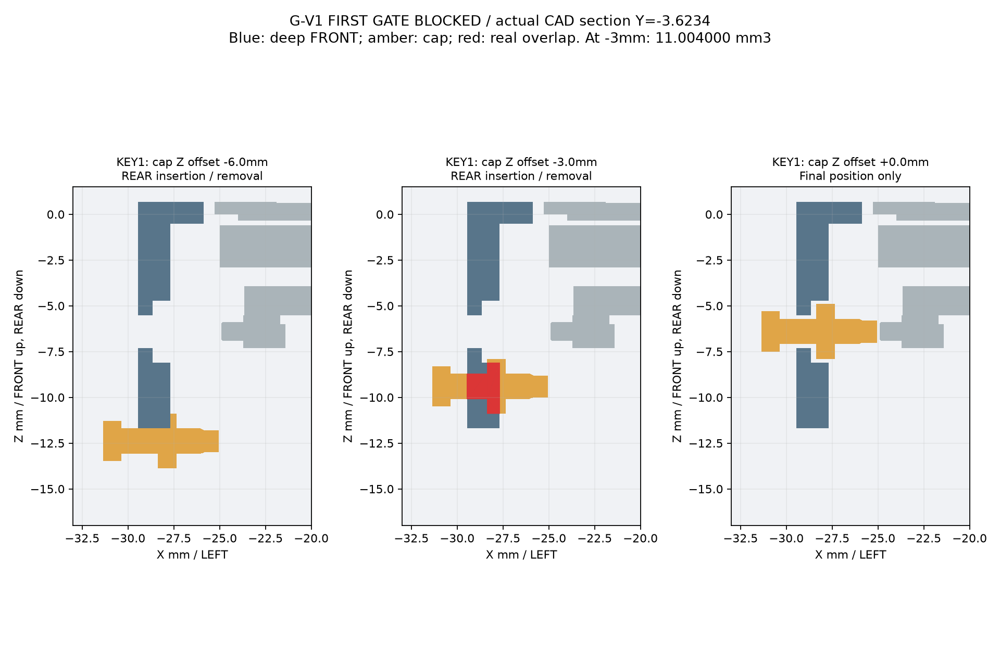

# G-V1 第一装配闸门：BLOCKED / STOP（2026-10-17）

**未完成 G-V1 整壳。** 按 [21 任务书](21_t0_g_v1_flush_easy_assembly_revision_brief.md) 的“若两键后装……或反向拆卸之一失败：STOP”，在真实键帽/深前壳干涉处停止。静态能放下、STEP有效和未完成实体的12.4mm跨度均不等于整机通过。

已读取 [G Reviewer](https://github.com/Gadil123/esp32-design/pull/3#pullrequestreview-5550461898)、[Gemini E 审计](20_design_e_independent_review.md) 和 [旧 G 记录](19_t0_g_recessed_assembly.md)。审计中的断裂概率、材料极限、USB绝对结论未自动采信。旧G/E/A/B/C/D模型及Pocket OS原样保留，本轮另存 `g-v1-gate`。

## 唯一候选与首闸门

沿用G深FRONT和右舱，顶面恢复+0.700、REAR底面−11.700；玻璃外轮廓每侧放宽0.600mm并贯通，取消覆盖玻璃的薄压边。仅保留KEY1/BAT_PWR、KEY2/BOOT两帽；RESET无活动件，侧壁恢复1.8mm后开Ø2.2候选孔，卡针操作和周边细节未验收。未制作新卡扣或PCB前向支承。

使用任务书的M2.5×4、Ø5×0.85头部候选包络：头底−11.700、头座−10.850、杆尖−6.850，到原厂金属背面−9.500的名义座厚约1.350、名义伸入2.650mm。这是初步尺寸链，**不是有效牙深、扭矩、接触环或对孔通过**，没有采购。

官方原始STEP累计全部父级位姿，再Rz180；**FRONT +Z、REAR −Z、USB +Y TOP，FRONT看原生键/TF在LEFT −X**。全部723原厂实体参加检查，轻量代理不参与证明。

| 步骤 | 结果与限制 |
|---|---|
| 完整显示/PCB无帽从REAR沿+Z进入 | 连续保守包络对真实FRONT无碰撞，前壳最终与全部723实体无交叠；**只证明空间路径，不证明临时支承安全或手工可达** |
| 两帽最终名义位置 | 与FRONT和全部原厂实体均无体积交叠，不能推出能装入 |
| 两帽从REAR直线后装 | **均FAIL**：帽距最终位置Z=−3.000mm时，各与真实侧壁相交 **11.004000mm³**，判据0.001mm³ |
| 反向拆帽 | 同一路径同一干涉，FAIL；未斜插、强弯或挤压开关 |
| 后续闸门 | NOT RUN AFTER STOP，不继承旧G结论 |

交叠X=−29.470…−27.670、Z=−10.900…−8.100；KEY1的Y=−5.723397…−1.523397，KEY2的Y=−21.360185…−17.160185。法兰及部分推杆须穿过封闭导槽后方仍存在的深侧壁。外部帽头不穿过侧壁，不把宽帽头整盒包络当成必须挖掉的材料。这与旧G“帽先装碰LCD”是不同反例；旧反例继续保留。E的浅分体前壳路径不能直接移植为深FRONT的通过依据。



蓝色实际前壳，灰色完整原厂装配剖面，黄色帽，红色实际Boolean交叠；[KEY2剖面](../deliverables/t0-g-v1-gate/key2_rear_insertion_section.png)同样失败。

## 仅提出一项最小让步，未实施

**两处日常键导槽向REAR开放，由最终后盖补足轴向防脱。** 不改开关、不增电子件、不加精密销、不斜插原板。真实帽在侧壁XY柱内的交集投影宽4.200mm，加每侧0.200候选余量后开槽宽 **4.600mm**；从REAR Z=−11.700通至约−4.700。KEY1槽Y≈[−5.923397,−1.323397]，KEY2≈[−21.560185,−16.960185]。**主体新增宽度0mm、厚度0mm**，不是通过加宽绕开问题。

代价：开盖期间帽防脱依赖装配姿态/手工保持。帽抓取可达性、开盖掉落、后盖封槽间隙、侧壁强度和最坏PCB偏移下触发均须重新验证。没有生成第二套结构并宣称通过；是否接受这个局部开放导槽，交用户/Reviewer决定。

## STOP后未关闭的门槛

| 项目 | 状态 |
|---|---|
| 未锁螺丝、拆盖/翻转时PCB独立前向支承 | 未验证；软垫不替代永久止退，玻璃不承受夹紧力 |
| 后盖先扣、四孔对中、外侧逐颗咬合/退出 | 未运行；不能靠拧紧拉板找孔 |
| PCB XY游隙/打印公差下触头重叠及固定框避让 | 未运行，原0.15径向螺孔游隙仍存在；实际行程/回弹未知 |
| 两浅扣、正间隙止口、单卡片顺序释放 | 未建造，不继承四薄片同步释放结论 |
| USB真实肩台、TF弹出、RESET卡针及PA12局部最薄壁清单 | 未复验，不升级为本版PASS |
| 电池/扬声器、泡棉/保护板、真实插头/线束及拆卸余量 | 仍unverified，未以省略它们宣称整机厚度成立 |
| MIC1 | **MIC_AUDIO_PATH_BLOCKED_UNTIL_HARDWARE**；声孔方向和装壳录音未知，未盲开孔 |
| PA12圆角/清粉、扭矩/蠕变及重复装拆 | 未验收，几何有效不等于制造合格 |

## 复现与交付

沿用独立`.venv`：Python3.13.2、build123d0.13.0及 `requirements.lock.txt`；安装见[19](19_t0_g_recessed_assembly.md)。官方只读STEP位于并列仓库，路径不变：

```bash
./scripts/generate-t0-g-v1-gate.sh
```

从原始STEP重新生成闸门/反例/图及 `BLOCKED` 报告；退出0代表成功复现诊断，**不是装配PASS**。无SHA校验。

- [参数](../cad/t0/t0-g-v1-gate-parameters.json)、[源码](../cad/t0/generate_t0_g_v1_gate.py)、[checks.json](../deliverables/t0-g-v1-gate/checks.json)、[STEP/STL清单](../deliverables/t0-g-v1-gate/README.md)。四件独立零件各1有效实体，STL无非流形边，尺寸/体积回读通过；是失败诊断件，非可打印整壳。
- [齐平剖面](../deliverables/t0-g-v1-gate/flush_gate_section.png)、[初步螺丝剖面](../deliverables/t0-g-v1-gate/preliminary_screw_section.png)、[E/G-V1同尺度图](../deliverables/t0-g-v1-gate/E_vs_G_V1_gate_same_scale.png)。
- 原板、两帽、两未完成壳、四螺丝的闸门实体Z跨度12.400mm；未包含新卡扣、保持游隙和未验证附件装配，**不得标为G-V1 12.4mm nominal assembly gate PASS**。
- 含完整723原厂实体的两颗帽碰撞STEP通过原私有Draft release独立附件 `t0-g-v1-blocked-gate.zip` 提供；KEY1全量碰撞STEP回读 **725/725有效实体**（原板723+前壳+帽）。旧G/E附件不覆盖，不发布release。此包是碰撞姿态，不是完成装配。

## E/G对照与最短购物状态

| 项目 | E（冻结） | 旧G（保留） | G-V1本轮 |
|---|---|---|---|
| 主体XY | 99.60×77.86 | 相同 | 相同，未加宽 |
| 玻璃/厚度 | 齐平/12.4名义 | 下沉0.5/12.9名义 | 齐平；12.4仅未完成闸门 |
| PCB固定 | 三夹/四浅窝 | 先锁后盖四M2.5 | 计划后盖先扣再锁四M2.5，未通过 |
| 壳连接 | 五短齿 | 四隐藏舌/四工具 | 计划两浅扣，STOP未建造 |
| 装配步骤 | 板→三帽→盖 | 三帽外停靠→板盖整组 | 无帽入板→两帽后装FAIL，后续不推进 |
| 残余风险 | 保留原审计 | 保留原反例 | 新壁干涉及未运行门槛，不作优越性结论 |

购物仅保留 **4×候选M2.5×4粗牙0.45普通机螺丝，头约Ø5×0.85**；实际头型/驱动、末端和可用牙深待确认，**不能标为最终可买**。电池/扬声器、MX公插头/极性/线长待实物，无新增采购项。原PR#3保持Draft，不合并、不下单、不打印，等待复审。
