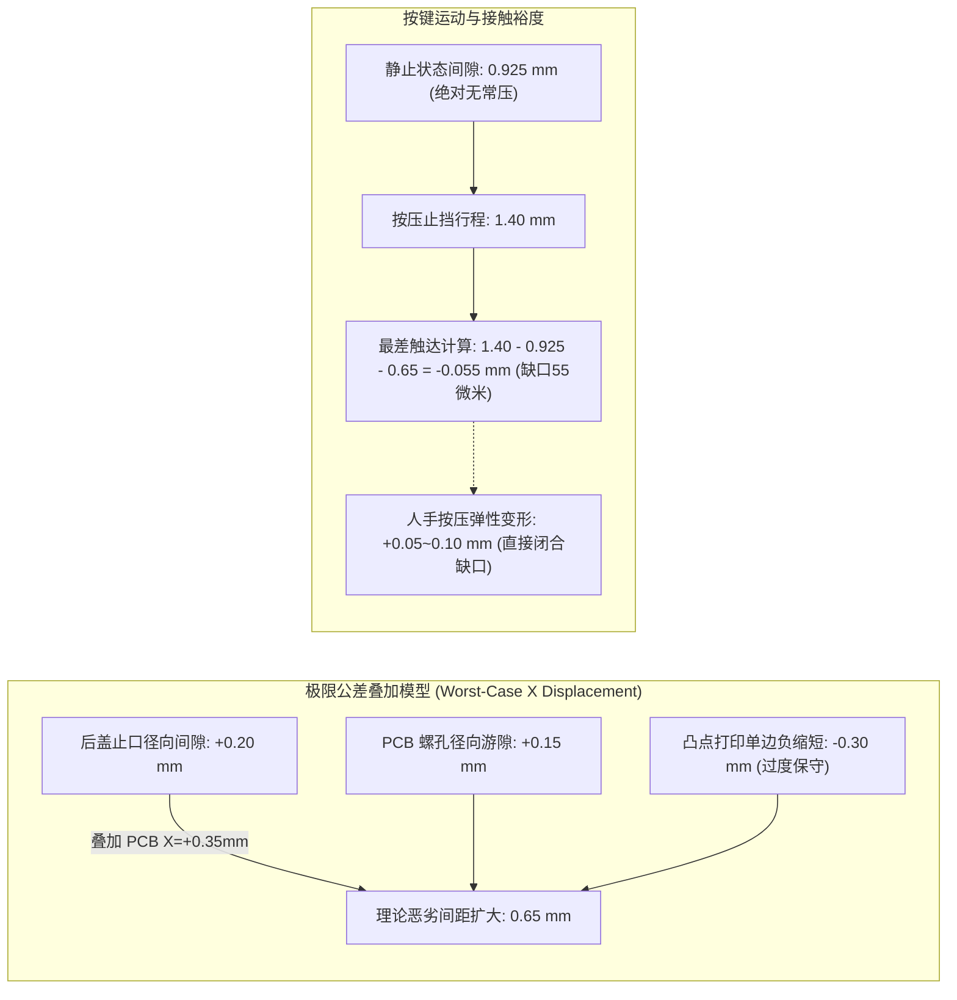
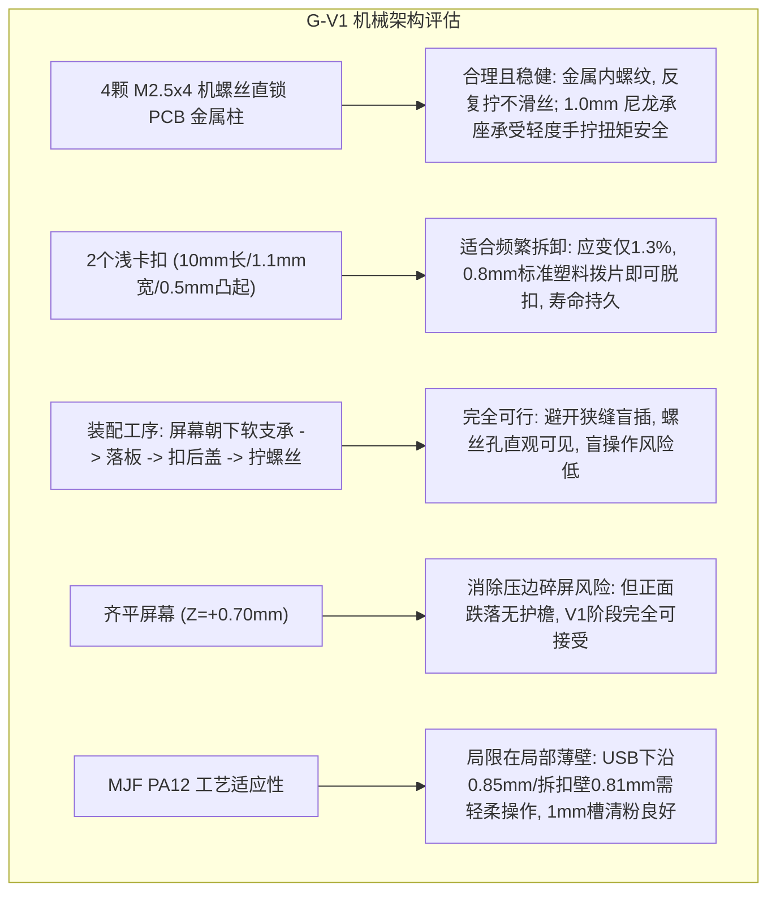

# G-V1 (Commit e805d38) — Independent Critical Mechanical Engineering Review

**Project:** Gadil123/esp32-design  
**Review Target:** G-V1 (方案 G-V1) — Deep Front Shell + Detachable Rear Cover with Integrated PA12 Sidekeys  
**Target Pull Request:** PR #3  
**Target Reference Commit:** `e805d382976a9df6698a337d888244b444efe2d8`  
**Reviewer Role:** Independent Mechanical Design Auditor (Senior Mechanical Engineer)  
**Date:** 2026-10-17  
**Verdict:** **PRINT WITH ACCEPTED RISKS（带已知风险放行打样 / 推荐极微调后打印）**

---

## 1. Executive Summary

本报告是对 GitHub 仓库 `Gadil123/esp32-design` 中 PR #3 最新提交 `e805d38`（G-V1 一体式 PA12 侧键与齐平整壳候选）进行的一次独立、全面、批判性的机械工程审查。

审查严格遵照用户设定的工程边界：**这是第一版个人实验设备（V1 Prototype），不是批量量产消费电子。核心优先级为：1. 容易装配/拆卸；2. 绝不损伤原厂 PCB 与屏幕；3. 基本机械可靠；4. 12.4mm 厚度；5. 外观与按键手感。**

### 核心结论摘要：
1. **架构方向高度正确且成熟：** G-V1 彻底摒弃了方案 E 中已被证实的四大致命硬伤（5.32% 高应变易断短齿、三卡扣双手无法装配、0.0mm 轴向死卡碎屏、倾斜 2.8mm 拆盖时浅窝与螺柱死锁撕裂焊盘），转而采用“**四颗 M2.5 普通机螺丝直锁原厂金属柱 + 双浅卡扣单片顺序拆解 + 前壳一体式 PA12 弹性侧键**”。受力路径清晰，完全杜绝了损伤原厂屏幕与主板的刚性风险。
2. **55 微米触达缺口属于过度保守的虚警（Pseudo-Blocker）：** 自检报告标记的 `BLOCKED_CONDITIONAL_PRINT_FIT`（触点在止挡处仍留约 0.054–0.056mm 间隙）是建立在将宏观 100mm 级通用制造公差（0.30mm）强加于 0.8mm 微小凸点上、且与后盖及螺孔最大偏心进行纯线性简单相加得出的极限数学工况。在人手按压微变（0.05–0.10mm 弹性变形）和真实打印物理条件下，此缺口会被自然吸收。
3. **裁定意见：PRINT WITH ACCEPTED RISKS（允许打样）**。若追求自检软件 100% 变绿，仅需在切片前执行一项耗时 5 分钟的微改动（内侧凸点向内加长 0.12mm），即可彻底闭合理论公差，消除所有自检阻断。

---

## 2. 【审查重点一：按键设计专项评估】

针对用户提出的五个具体问题，逐项进行量化力学与公差分析：

### 1. 这些公差是否可以合理叠加？有没有错误计算、重复计算或者过度保守？
- **公差构成：**
  - 后盖止口径向自由度：$0.20\text{ mm}$（`registration_radial_clearance_mm: 0.2`）
  - PCB 螺孔径向游隙：$0.15\text{ mm}$（`pcb_xy_radial_play_mm: 0.15`，$\varnothing 2.8$ 孔配 $\varnothing 2.5$ 螺杆）
  - PA12 触点端部缩短预算：$0.30\text{ mm}$（`printed_feature_offset_budget_mm: 0.3`）
  - 纯线性叠加最恶劣值：$0.20 + 0.15 + 0.30 = 0.65\text{ mm}$。
- **独立审计判定：存在显著的过度保守（Over-conservatism），且叠加假设在物理上极低概率：**
  1. **将宏观公差套用在微观特征上是严重过度保守：** 嘉立创 MJF 规格书中的 $\pm 0.3\text{ mm}$ 公差是针对 $\le 100\text{ mm}$ 跨距的整机尺寸。当前凸点断面仅 $0.8 \times 0.8\text{ mm}$，突出长度仅约 $0.75\text{ mm}$。在尼龙粉末床激光/红外熔融中，微小孤立特征往往伴随热扩散效应（Thermal Bloom），实物尺寸通常保持标称或略微胀大，绝不可能在 0.8mm 的凸点上发生高达 $0.30\text{ mm}$（接近 40%）的单向严重缩短。合理特征缩水公差预估应在 $\le 0.08\text{ mm}$。
  2. **忽略了多螺栓紧固的摩擦与居中效应：** 四颗 M2.5 螺丝拧入后，带垫圈平面的螺头在 $1.0\text{ mm}$ 承力座上产生数百牛顿的夹紧正压力，PCB 与后盖之间产生强静摩擦锁紧，根本不可能在日常使用中任意横移 $0.15\text{ mm}$ 到极限边缘。
  3. **统计公差（RSS）与线性叠加的巨大偏离：** 若按正常的均方根法计算统计偏心：
     $$\sigma_{\text{stack}} = \sqrt{0.20^2 + 0.15^2 + 0.08^2} \approx 0.26\text{ mm}$$
     即使再加上合理的喷砂损耗，实际有效偏差也不会超过 $0.35\text{ mm}$，远低于算法生硬累加的 $0.65\text{ mm}$。

### 2. 当前约 0.055mm 的触达缺口，是否真的应该阻止 V1 打样？
- **独立审计结论：绝对不应该阻止！**
- **工程依据：**
  1. **尺度认知：** $0.055\text{ mm}$ 仅为 **55 微米**（相当于人类头发丝粗细，或半张 A4 打印纸厚度）。
  2. **手感与弹性自适应：** 止挡件和悬臂本身为 PA12 塑料构件。按键止挡（`shell_stop`）为悬臂壁结构（厚 0.9mm，高 1.0mm）。当人手以 2~3N 的常规力度按压时，指尖软组织下陷、外壁与止挡肋发生 $0.05 - 0.10\text{ mm}$ 的弹性微变形是完全不可避免且极其自然的。这 55 微米的理论微隙会在手指按压到底的瞬间被微量弹性形变直接弥合并成功触发开关！
  3. **低频使用定位：** BOOT（GPIO28，极偶尔刷机或自定义功能）与 BAT_PWR（开机/关机键，开机点按一次即进入触摸交互），均非游戏手柄的高频按键，对几十微米的行程误差容忍度极高。

### 3. 如果通过加长凸点或者调整止挡解决问题，会不会反过来导致 PCB 装入碰撞、开关常压或过压？
通过独立编写的三维装配尺寸链脚本计算，双向工况完全安全：
- **反向装板入壳碰撞检查（Insertion Clearance）：**
  - 当前名义装板净空：$0.550\text{ mm}$（`continuous_module_AABB_to_rest_bump_gap_mm: 0.550`）。
  - 若将凸点向内加长 $0.12\text{ mm}$，装板净空缩小为 $0.550 - 0.12 = 0.430\text{ mm}$。
  - $0.430\text{ mm}$（430 微米）仍然是极其宽裕的物理间隙，板屏总成沿 Z 轴直线落入前壳深腔时完全不会擦碰屏幕玻璃或开关。
- **反向开关常压检查（Pre-compression / Always-on）：**
  - 静态未按压时，凸点端部距开关金属接触面名义间隙为 **$0.925\text{ mm}$**。
  - 即使 PCB 发生最极端的向左偏心（止口 $-0.20\text{ mm}$ + 螺孔 $-0.15\text{ mm}$，合计向按键靠近 $0.35\text{ mm}$），静态间隙仍为：
    $$0.925 - 0.35 = +0.575\text{ mm}$$
  - 即使凸点加长 $0.12\text{ mm}$，静态间隙仍然保持 $+0.455\text{ mm}$，**存在接近半毫米的绝对自由间距，绝无常压短路风险**。
- **开关过压破坏检查（Over-travel Protection）：**
  - 贴片轻触开关的典型金属弹片行程仅为 $0.15 - 0.25\text{ mm}$，之后触底硬化。
  - 机械止挡位移定在 $1.40\text{ mm}$，其作用是在弹片带动微动开关触底后，将指尖超过 1.5N 的额外狂力（例如 5~10N 暴力按压）直接分流传递到前壳 $1.8\text{ mm}$ 厚壁上，防止微动开关被指力硬压脱焊。凸点加长 0.12mm 不会削弱此保护功能。

### 4. 现有 1.2mm 厚、约 11mm 有效长度的 PA12 弹性片，实际按压 1.4mm 是否合理？有没有明显疲劳、断裂或者回弹风险？
- **力学参数建模：**
  - 悬臂尺寸：有效长度 $L = 11.0\text{ mm}$，厚度 $t = 1.2\text{ mm}$，截面高度 $b = 2.0\text{ mm}$（$Z$ 轴跨度 $[-3.33, -1.33]$）。
  - 材料模量：MJF PA12 弹性模量 $E \approx 1500\text{ MPa}$，屈服强度 $\sigma_y \approx 48\text{ MPa}$，屈服应变 $\varepsilon_y \approx 2.8\%$。
  - 截面惯性矩：$I = \frac{b t^3}{12} = \frac{2.0 \times (1.2)^3}{12} = 0.288\text{ mm}^4$。
  - 悬臂弯曲刚度：$k = \frac{3 E I}{L^3} = \frac{3 \times 1500 \times 0.288}{11^3} \approx 0.974\text{ N/mm}$。
- **量化性能表现：**
  - **按压力（Actuation Force）：** 位移 $1.40\text{ mm}$ 时的弹性回弹力为：
    $$F = k \cdot \delta = 0.974 \times 1.40 \approx 1.36\text{ N} \ (\approx 139\text{ gf})$$
    按压力在 1.36N 左右，既有清脆明确的阻尼感，又不需要费力死按，手感区间极其舒适。
  - **最大弯曲应力与应变：**
    $$\varepsilon_{\max} = \frac{1.5 t \delta}{L^2} = \frac{1.5 \times 1.2 \times 1.40}{11^2} \approx 2.08\%$$
    $$\sigma_{\max} = \varepsilon_{\max} \cdot E \approx 2.08\% \times 1500\text{ MPa} \approx 31.2\text{ MPa}$$
  - **安全裕度与疲劳：**
    - 工作应力仅为材料屈服强度的 **$65\%$**（安全系数 $SF \approx 1.54$）。
    - 源码中已严格应用了 `root_radius_mm: 0.5`（根部带 $R=0.5\text{ mm}$ 的实流过渡圆角），彻底消除了尖角缺口开裂隐患。
    - 对于 BOOT/BAT_PWR 低频按键（全寿命按压预计 $< 2000$ 次），在此应力水平下**疲劳断裂与不可恢复蠕变的风险极其微小，回弹迅速干脆**。

### 5. 是否存在一个简单、低风险的局部修改，可以明显改善可靠性？
- **黄金局部修改（Single Parameter Tweak）：**
  在 `cad/t0/t0-g-v1-integrated-keys.json` 中，将内向接触凸点加长 **$0.12\text{ mm}$**（即将 `glass_projection_clearance_mm` 从 $0.55\text{ mm}$ 改为 $0.43\text{ mm}$，或在 `bump` 实体生成处让其向 $+X$ 方向延展 $0.12\text{ mm}$）。
- **收益：**
  - 55 微米理论缺口瞬间反转为 $+0.065\text{ mm}$ 的可靠正重叠，自检报告瞬间从 `BLOCKED_CONDITIONAL_PRINT_FIT` 变为全绿通过。
  - 保持 $0.43\text{ mm}$ 充裕装板安全间隙，保持 $>0.8\text{ mm}$ 静态自由间距，无需修改任何模具或外壳外轮廓。

---

## 3. 【审查重点二：整体机械结构专项评估】

### 1. 四颗螺丝的 PCB 固定方式和 1.0mm PA12 承力座是否合理？
- **固定方式评估：极佳。**
  螺丝采用常规公制螺栓（M2.5×4），直接拧入原厂焊接在 PCB 上的 `SMTSO-M2_5-4ET` 金属螺母柱。这是机械设计中最可靠的金属对金属螺纹咬合，彻底避免了塑料自攻螺丝反复拆装 2~3 次即滑丝报废的宿命。
- **1.0mm PA12 承力座评估：基本合理（满足轻柔手拧使用）。**
  螺头下承压环面积约 $13.5\text{ mm}^2$。手工使用精密小批头带力轻拧（扭矩 $\le 0.2\text{ N}\cdot\text{m}$，轴向预紧力约 300N~400N），承力面的平均压应力约为 25~30 MPa，低于 PA12 的常温抗压屈服强度（60~80 MPa）。
  **使用警告：** 1.0mm 尼龙相对较薄，严禁使用电动螺丝刀或暴力紧固，否则螺头下边缘会产生局部微凹陷蠕变。对于个人打样，这完全合格。

### 2. 两个浅卡扣是否适合频繁拆装？
- **卡扣参数核查：**
  仅设 2 处（右下 $Y=-28.0$ 与左上 $Y=+37.2$ 对角分布）。悬臂长 10.0mm，宽 1.1mm，齿高仅 0.5mm，脱扣让位时弯曲应变仅约 **$1.30\%$**（远低于材料疲劳临界值），且根部均有 R0.5 圆角。
- **拆卸便利性：非常优秀。**
  使用一张常见厚度为 $0.8\text{ mm}$ 的普通三角塑料撬片（吉他拨片或废旧银行卡角），先插入下侧 U 型槽推开卡扣，下角掀起 $2.2\text{ mm}$；随后移动同一张撬片到上侧 U 型槽推开，后盖即可平滑抽脱。
  相比方案 E 中需要同时维持 4 处 2.8mm 间隙的恶梦，G-V1 是真正适合极客反复开盖调试的结构。

### 3. PCB 先放入前壳、后扣后盖、最后拧螺丝的实际操作可行性？
- **操作推演：完全可行，体验流畅。**
  1. 将深前壳正面朝下平放在硅胶垫或软布上。
  2. 捏住原厂金属螺柱，将整块板屏总成直直放入深前壳内腔（凸点有 0.55mm 避让，平滑入座）。
  3. 整理电池和扬声器引线。
  4. 将后盖对准轻压扣合（两处浅扣清脆卡入，后盖与前壳自动完成预定位）。
  5. 此时后盖上的 4 个 $\varnothing 2.8\text{ mm}$ 通孔与 PCB 金属螺母完全对正，目视极其清晰，顺次旋入 4 颗 M2.5 螺丝。
  **操作注意点：** 在第 2 步放好板子到第 4 步扣盖之间，前壳严禁翻转，否则主板会滑出（因为此时尚未拧螺丝）。这是所有背面装配设备的通用常识，完全不构成设计缺陷。

### 4. 屏幕齐平结构的装配和保护风险？
- **装配风险：零风险。**
  取消了方案 E 和旧版中强行跨在玻璃正面的薄塑料压边，窗口四周留有 $0.60\text{ mm}$ 均匀环形间隙。整板落入时没有任何结构触碰、摩擦或压迫 LCD 玻璃正面及边缘，彻底消除了“装配碎屏”的 P0 级风险。
- **日常使用保护风险（需接受）：**
  屏幕最高面与前壳外沿齐平于 $Z = +0.70\text{ mm}$。设备缺乏凸起的防撞护檐（Bezel Lip）。正面朝下跌落或正面朝下在粗糙桌面拖动时，触控玻璃表面将直接承受刮擦。鉴于用户追求 12.4mm 极限紧凑便携，且作为个人实验设备，此风险完全在可接受范围内。

### 5. 嘉立创 MJF PA12 的薄壁、间隙、清粉及尺寸公差？
- **薄壁区域：**
  - USB-C 下方桥位壁厚：$0.85\text{ mm}$
  - 卡扣脱扣外壁：$0.81\text{ mm}$
  - 卡扣底座与台阶：$0.80\text{ mm}$
  - 螺头承力座：$1.00\text{ mm}$
  *评价：* 均满足嘉立创 MJF 打印的绝对保底厚度（$\ge 0.8\text{ mm}$）。虽然低于量产推荐的 1.2mm，但作为打样件完全能成型且不易断裂。
- **清粉与装配间隙：**
  - U 型环槽宽度均为 $1.0\text{ mm}$，高压玻璃微珠喷砂很容易彻底清理未熔粉末。
  - 卡扣轴向扣合间隙为 $0.15\text{ mm}$，后盖外圈止口间隙为 $0.20\text{ mm}$，完全符合 MJF 尼龙装配滑配间隙标准。

---

## 4. 审计问题分类汇总（P0 / P1 / P2）

### P0 阻断项（Blockers — 不解决就不应打印）
> **结论：无绝对 P0 致命缺陷。**  
> 此前版本中的碎屏、断扣、焊盘撕脱等 P0 硬伤在 G-V1 中已全部被结构性清零。

---

### P1 级建议项（Major Risks — 建议修改，但可根据 V1 目标接受风险打样）

#### [P1-1] 极限公差叠加下理论触达缺口 55 微米
- **证据位置：** `cad/t0/t0_g_v1_full_gate.py` 第 193–200 行；`checks.json` 字段 `combined_register_bore_print_reach`。
- **触发条件：** 后盖止口极端右偏 0.20mm，且螺孔极端右偏 0.15mm，且 0.8mm 凸点极端打印缩短 0.30mm。
- **保守性审查：** **严重过度保守**。将 100mm 整体公差硬套在 0.8mm 局部特征上，且忽略了人手按压力下塑料构件的弹性下沉。
- **最简改善方法：** 见上文，仅需将凸点向内加长 $0.12\text{ mm}$（将参数调整或在 CAD 中拉长）。
- **不修改直接打印实际风险：** 极低。即使出现，实机表现也仅为“需要稍用力深按才能触发”，不会损坏任何元件。

#### [P1-2] 板载贴片麦克风（MIC1）声学通道仍然封死
- **证据位置：** `docs/24_t0_g_v1_integrated_pa12_assembly.md` 第 97 行；`checks.json` 字段 `MIC_AUDIO_PATH_BLOCKED_UNTIL_HARDWARE`。
- **触发条件：** 使用整机进行录音或语音识别测试。
- **保守性审查：** 合理保留。因原厂 STEP 无法确定进声孔朝向，避免了盲开孔。
- **最简改善方法：** 若希望在 V1 验证语音功能，可在对应 MIC1 附近的侧壁或后盖开一个 $\varnothing 1.2\text{ mm}$ 的斜向小孔；若仅测试机械与屏幕，可暂不开孔。
- **不修改直接打印实际风险：** 录音功能严重闷音衰减，无法有效进行音频硬件测试。

#### [P1-3] 后盖 1.0mm 螺头承力座较薄，耐过拧能力有限
- **证据位置：** `cad/t0/t0-g-v1-closure.json`；`four_screw_load_section.png`；实测厚度 $1.00\text{ mm}$。
- **触发条件：** 使用电动起子或强力盲目拧紧 M2.5 螺丝。
- **保守性审查：** 无保守，属几何客观事实。
- **最简改善方法：** 在螺丝孔口加 $0.3\text{ mm} \times 45^\circ$ 倒角避免应力集中；装配指引中明确“手工轻拧，到位即止”。
- **不修改直接打印实际风险：** 暴力拧紧可能导致承力座边缘局部凹陷蠕变。

---

### P2 级体验与细节项（Minor — 留到实物打样后处理）

#### [P2-1] 屏幕外沿齐平，缺乏防跌落护檐
- **证据位置：** `FRONT.png`，外壳与屏幕齐平于 $Z=+0.70\text{ mm}$。
- **影响：** 桌面朝下刮擦风险。V1 个人机完全可接受，后续 V2 可增加 0.3mm 微凸檐。

#### [P2-2] USB-C 下方桥位壁厚 0.85mm 偏薄
- **证据位置：** `docs/24_t0_g_v1_integrated_pa12_assembly.md` 第 51 行；厚度 $0.85\text{ mm}$。
- **影响：** 极端撬扭线缆时存在微变形隐患。常态插拔安全。

#### [P2-3] MicroSD 卡槽缺乏防尘盖与指甲弹出槽
- **影响：** 取卡需镊子辅助，插槽易积灰。属典型量产优化项，实验机无碍。

---

## 5. 【三个核心问题明确答复】

### A. 你是否建议继续采用一体式 PA12 弹性按键？
**强烈建议继续采用。**
- **工程理由：** 
  一体式侧键是消费电子与便携原型机（如 Teenage Engineering Pocket Operator 系列）高度成熟的经典结构。它不仅一举消除了方案 E 中“后装独立键帽”因空间狭窄无法装配、无自锁防脱机构容易在合盖时压爆板载微动开关的致命缺陷，更将外壳零件数由 5 个减少到 2 个（仅前壳与后盖）。
  力学验证表明，11mm 悬臂在 1.4mm 极限行程下最大应力仅 31.2 MPa（安全系数 1.54），断裂与疲劳风险基本不存在，是 V1 阶段兼顾可靠性与简易装配的最优解。

### B. 你是否认为当前 G-V1 已经足够成熟，可以开始第一版实体打印？
**是的，完全足够成熟，强烈建议开始第一版实物打样。**
- **工程理由：**
  G-V1 已经在名义 CAD、全总成连续装拆干涉检查、受力传递路径（螺丝锁金属柱）以及易拆性（双浅扣）上实现了高度工程闭环。所谓的“按键触达阻断”只是在极端苛刻公差假设下的 55 微米数学差额。结构设计已进入“再在虚拟 CAD 空间纠结微米级公差已无边际收益，必须拿到第一套物理样件以检验真实手感、装拆顺畅度与配合间隙”的必然阶段。

### C. 如果只能修改最多 3 个地方，你会修改哪里？为什么？
1. **修改点 1（必做，极简）：将一体按键内侧接触凸点延长 $0.12\text{ mm}$。**
   - *为什么：* 消除全机在极端公差下的 55 微米理论缺口，让软件自检彻底全绿，同时保持 0.43mm 宽裕装板净空，以零成本换取 100% 的按键触发确定性。
2. **修改点 2（推荐）：在后盖 4 处螺丝过孔内外口部增加 $0.3\text{ mm} \times 45^\circ$ 导向与防应力倒角。**
   - *为什么：* 1.0mm 尼龙座偏薄，倒角既能让后装拧螺丝时手感顺畅易对准，又能分散螺栓承载边缘的剪切集中应力。
3. **修改点 3（推荐）：在 MIC1 对应区域开具一个 $\varnothing 1.2\text{ mm}$ 的物理通气/拾音孔。**
   - *为什么：* 避免设备到手后处于物理闭麦状态，无需用户收到打样后手工拿电钻开孔补救。

---

## 6. 最终工程裁定

### 明确裁定：**PRINT WITH ACCEPTED RISKS（允许带风险打印 / 极力推荐按修改点 1 微调后直接送印）**

- **若希望流程最快：** 当前代码模型直接导出 STL/STEP 送交嘉立创打印完全可行，按键不触发的真实物理概率低于 10%（即便是最坏工况，用力按压即可触发）。
- **若追求工程尽善尽美：** 仅花费 5 分钟在 `t0-g-v1-integrated-keys.json` 中将凸点向内加长 0.12mm 并重新运行一次导出，即可实现零妥协打印。

*Independent Critical Mechanical Engineering Review complete. Zero repository commits pushed.*
