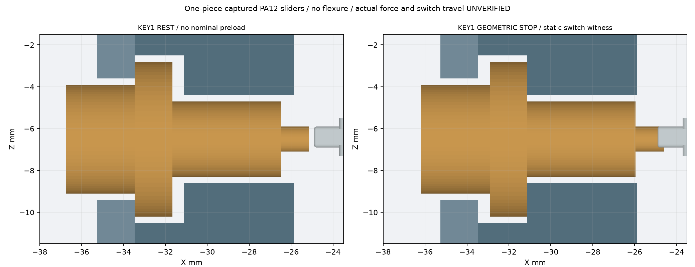

# 33 · Pocket Pi G-V1 V4-RECT当前评审入口

2026-10-27。当前为用户授权的**一体打印滑动按钮＋收紧屏幕挡边间隙**修订。`print_approved=false`；没有第二件实物，不保证首次打印成功，没有打印、下单、发布或推送。

当前说明见[交付README](../deliverables/g-v4/README.md)、[本轮修订37](37_g_v1_v4_printed_buttons_and_screen_fit.md)及[实配记录表](../deliverables/g-v4/printed_button_fit_sheet.md)。[评审34](34_codex_v4_review.md)、[修复记录35](35_g_v1_v4_fix_log.md)、[独立评审36](36_g_v1_v4_independent_preprint_review.md)保留各自当时版本的证据，不能把历史0127结构的尺寸套到当前件。

## 范围与基线

分支`codex/gv1-v2-fit-clamp`。本次修订从`ebe414f`开始；V1是唯一有打印和试装反馈的基线，`deliverables/g-v1-95mm`及相关V1文件保持原样。官方STEP来自并列只读仓库，引用版本与`cad/t0/official-reference.json`一致，723个实体的完整板卡参与检查；官方STEP、PDF和图片不复制到本次交付。

V1反馈包含后板翘曲、卡扣断、屏幕突出及周边总缝隙、侧键不易触发。用户已确认所谓±0.10毫米仅由“名义总缝1.20、实物靠齐后约1.30”推算，不是多轴尺寸或Z平整度实测。电池真实线束朝屏幕/主板，尚未建模；MIC历史坐标也不是实孔测量。

## 当前结构

| 项目 | 当前名义设计 | 仍需验证 |
|---|---|---|
| 按钮 | 外帽、凸缘和内柱一体打印，每键一件；外侧装入、共用可拆压框 | 孔缩、滑动摩擦、回弹、空行程内松晃 |
| 按钮尺寸 | 头Ø5.20、凸缘Ø7.40×1.80、主柱Ø3.60、末端Ø1.20毫米 | 小接触柱的打印尺寸、实际按压与耐久 |
| 默认运动 | 常态空隙0.25、整体行程0.55、止挡时越过原静态面0.30毫米 | 不是原开关的行程规格；触发/最大安全位移/回弹力均保留null |
| 备选按钮 | short/long的凸缘厚和柱端同改±0.15毫米；最大 inward柱端面相同 | 可同批打印，不要求先打一轮coupon；一次只装一颗 |
| 屏幕 | 窗口每侧0.75；挡边覆盖玻璃边1.00；挡边下空气隙0.40毫米 | 仅检查指定紧配合情景，Z精度与翘曲未实测 |
| 挡边 | 厚1.50、基座1.60；顶面Z=2.60，整机厚16.45毫米 | 未额外加固；不靠玻璃撑平、不给玻璃螺钉预载 |
| 后盖 | 主板3.50毫米＋内部筋；局部让位底板1.55毫米 | 刚度增加不能证明工艺翘曲已解决 |
| RESET | Ø2.2贯穿前壳和装配后的压框；Ø0.8针到KEY3，自由长至少12毫米 | 自由长度不是允许插深；实际力/行程仍待验 |
| USB/TF | USB保持13.2×7.3，内侧定位环完整让位；TF内藏 | 实线缆与开壳维护 |
| 紧固件 | 原金属座M2.5机螺钉；壳体和压框塑料用螺钉的包络仍受检查 | SKU、孔缩、扭矩、滑牙与循环寿命 |
| 电池/MIC | 完整电池与0.20胶层代理；V4 MIC入口仍为候选 | 真实引线、胶固定、声口和录音 |

## 复现和文件

```bash
cd /home/gadil/esp32-project/esp32-design-t0
./scripts/generate-g-v4.sh
.venv/bin/python scripts/check-g-v4-interfaces.py
```

- 参数：`cad/t0/t0-g-v4.json`。
- 壳体：`t0_g_v4.py`；当前打印按钮：`g_v4_printed_keys.py`。
- 闸门：`g_v4_checks.py`、`g_v4_slider_checks.py`；生成：`generate_g_v4.py`；说明：`g_v4_documentation.py`。
- 前后壳、`button_retainer`和两位置各三种按钮，共9件STEP/STL。默认装配只用nominal两件。
- `assembly_light.step`包含默认按钮；`printed_buttons_section.png`与`printed_button_variants.png`展示实际CAD。
- `checks.json`和`MANIFEST.sha256`记录检查与校验。先在build完成全部检查和渲染，再替换交付并移除旧版清单中的过期文件。

## 下一轮优先核对

1. 用实际交付STEP检查按钮防脱、内止挡、完整轴向行程、径向游隙边界、取出路径及锁紧螺钉避让。不能只检查孔通不通。
2. 给这些闸门做实际破坏负对照：堵两个压框孔/两个导向孔、去掉两个内止挡/两个外捕获环、缩短两柱、造成两处预压、堵RESET，共13例；另保留屏幕和USB负对照。临时坏件不进入交付。
3. 屏幕紧配合姿态为±0.50XY/+0.30Z；原±0.60XY/+0.60Z情景保留碰撞结果，不能宣称新的间隙仍覆盖旧预算。尺寸误差与翘曲分开。
4. 确认原开关实际行程与安全位移。按到底时柱端位置是设计结果，不是厂家额定值；顺滑回弹和持续误触必须实测。
5. 前壳仍是不带按钮的14档直提检查，不能外推为任意倾斜路径。维护必须先移除按钮，真实线束仍需管理。




JLC设计输入仍为最小壁1.0毫米、定位/紧固结构>1.5毫米，孔缩与配合需要另验。±0.3毫米尺寸公差与翘曲分开，也不能拿100毫米以内的条件为整个装配包络背书。当前较紧配合是实物待验证的候选，不是新的供应商保证。
