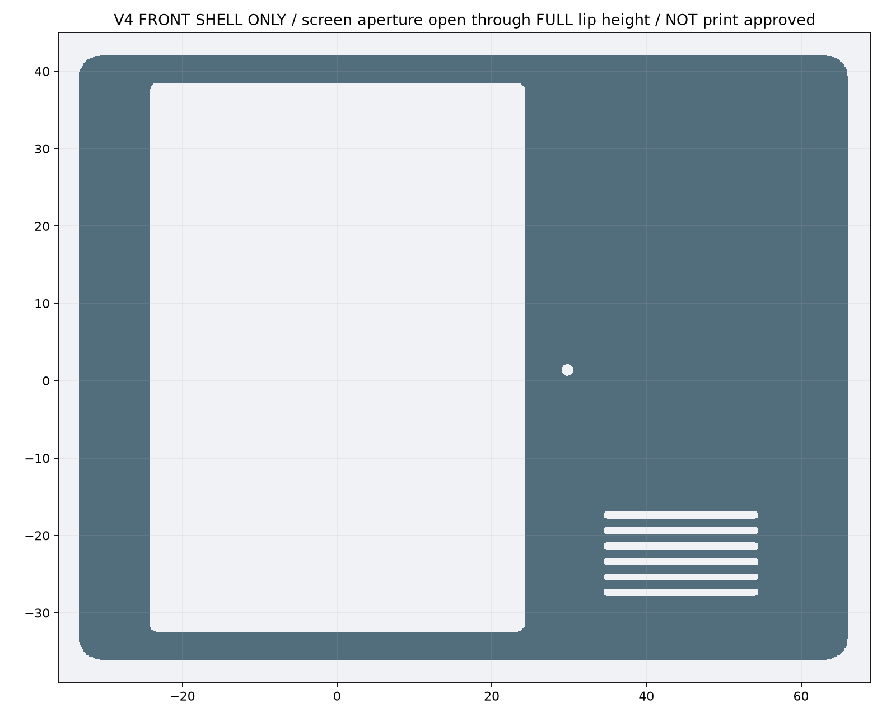
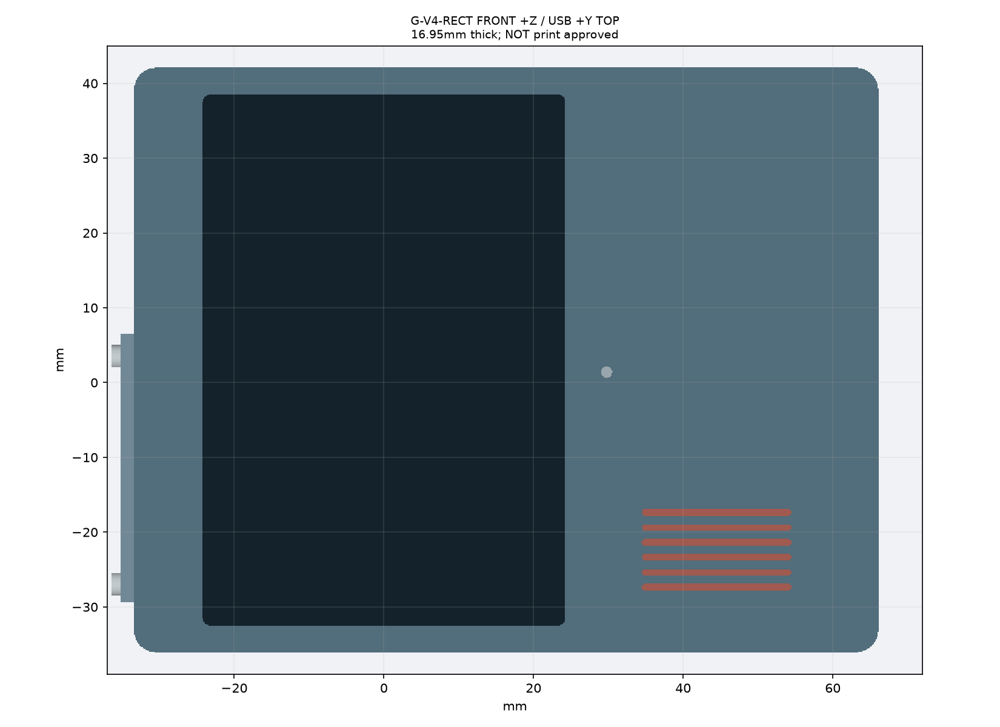
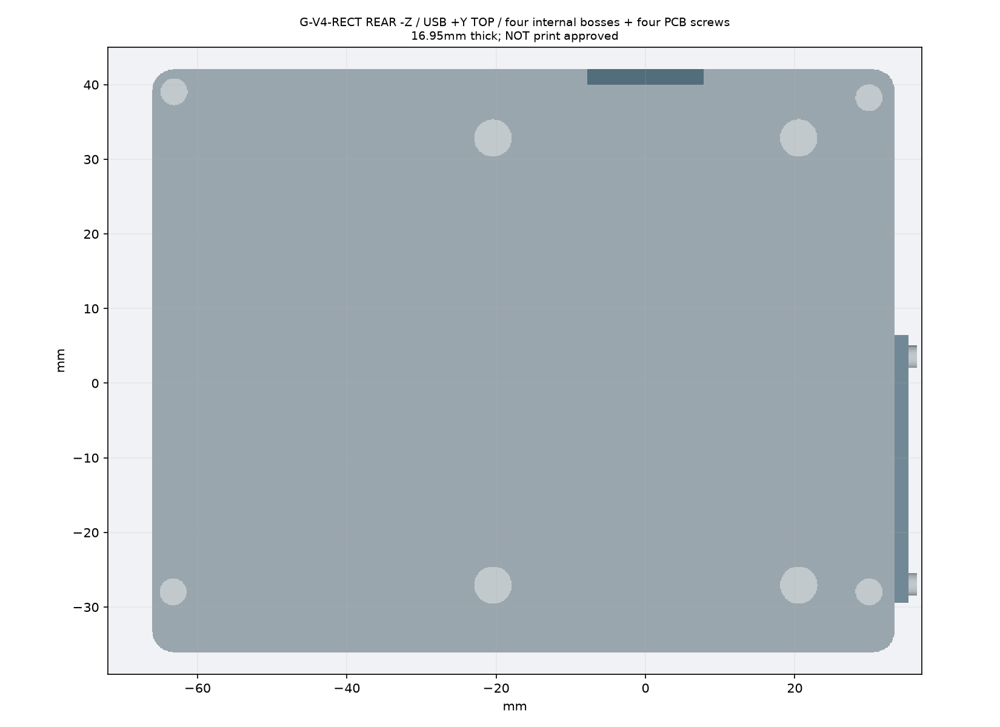
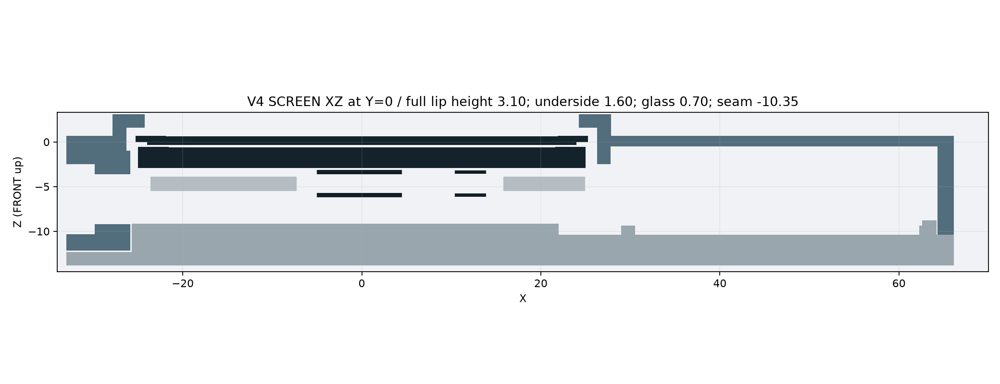
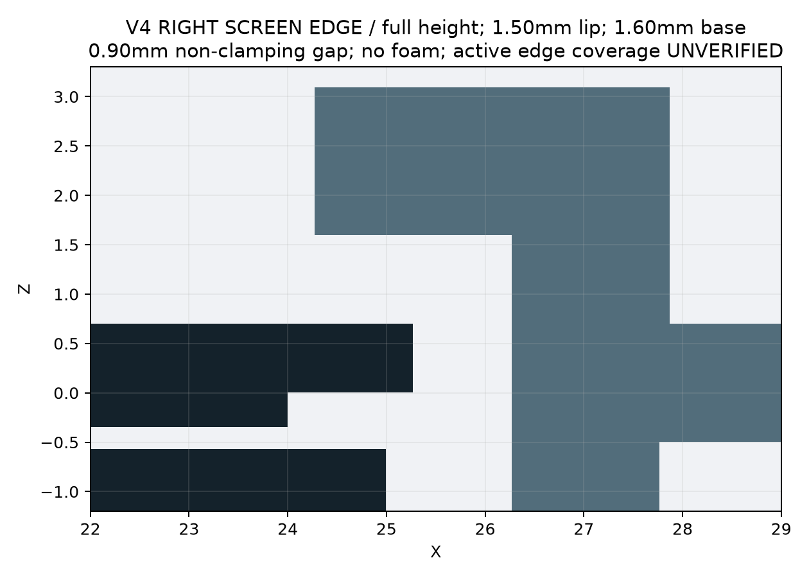
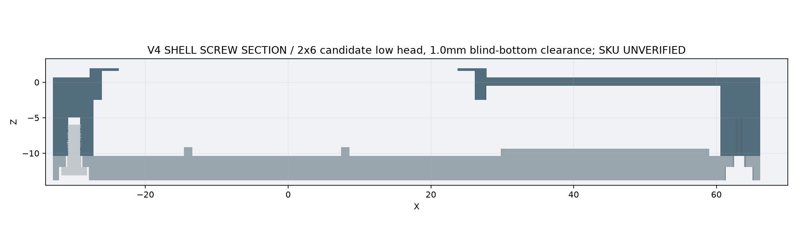

# 33 · Pocket Pi G-V1 V4-RECT reviewer package

2026-10-26，本轮几何修复候选。**未批准打印；`print_approved=false`；没有第二件实物。不保证第一件能装配或正常触发。**

独立评审原文：[34_codex_v4_review.md](34_codex_v4_review.md)，保留为历史评审，不改写其结论。逐项修复和仍待实物的 S2：[35_g_v1_v4_fix_log.md](35_g_v1_v4_fix_log.md)。当前生产参数、STL/STEP/图片、报告与测量表以 [V4 README](../deliverables/g-v4/README.md) 为准。

## 基线与范围

分支 `codex/gv1-v2-fit-clamp`。V1 是用户已打印和试装的 PA12 基线，文件 `deliverables/g-v1-95mm`，本轮不改。用户反馈：后板翘、卡扣断、屏突出及总缝、SD槽无用、扬声器线原缺口折线；V1 装壳录音和喇叭正常。PCB 四螺钉只压 PCB 到后盖，不压前壳。电池线方向已由用户确认朝屏幕/主板；旧 MX0 右上环线不适用。

V1 将屏推至对角后另一侧约1.29 mm，是总缝；相对1.20 mm名义只说明该次观察的差值，不得外推所有表面/批次或Z平面度。V1 MIC 孔是打印后加孔，CAD 没有孔；(27.3,1.395) 只是历史 CAD 候选，不是实孔实测。

为容纳XY公差预算与1.6唇基，主体Y高度由77.86增加0.40至78.26。V4 继续圆角矩形、内嵌四角柱、两颗外购0127和独立 RESET 孔、TF隐藏、USB原口13.2×7.3、扬声器+Y缺口。增加可拆侧压框和独立试样。没有打印、采购、发布或推送。

## 复现与交付

```bash
cd /home/gadil/esp32-project/esp32-design-t0
./scripts/generate-g-v4.sh
```

使用现有 `.venv`/build123d/OCP。依赖官方 STEP：`../ESP32-C5-Touch-LCD-2.8/dimensions/ESP32-C5-Touch-LCD-2.8.stp`。生成与验收先在 `build/g-v4`，全部硬几何检查通过后复制到 `deliverables/g-v4`；失败报告在 build，交付不替换。

- 配置：`cad/t0/t0-g-v4.json`。
- 模型：`cad/t0/t0_g_v4.py`，统一接口表/试样 `g_v4_interfaces.py`。
- 闸门：`cad/t0/g_v4_checks.py`；编排 `generate_g_v4.py`；生成说明 `g_v4_documentation.py`。
- 前/后壳、0127可拆压框、三档试样及各自压框：均提供 STEP/STL。
- `assembly_light.step`、`checks.json`、`MANIFEST.sha256` 和 `0127_measurement_sheet.md`。

本地交付是当前审阅对象；旧远程 draft/release 不是本轮更新，未推送、未发布。不要用历史 ZIP 的检查或图片代替本轮文件。

## 本轮几何变化

| 项目 | 当前候选（名义 CAD） | 验证边界 |
|---|---|---|
| 屏口 | 完整圆角内口48.54×71.06 R1贯通，顶面为环 | 有效显示/边缘触控轮廓未给，不能宣称无遮挡有效区 |
| 窗口 | 52.54×75.06 R3，1.00/side | 壳面±0.3、定位与PCB游隙候选预算；翘曲/偏斜待实物 |
| 屏唇 | 下表面1.60、上表面3.10，厚1.50，径向基座1.60 | 非夹屏，玻璃顶0.70，间隙0.90；不贴屏唇泡棉，不用屏校平 |
| seam | 普通-10.35，独立硬止挡；定位环厚/高1.6 | 实际止挡高度链/平面度未测 |
| 后板 | 3.50，外表面-13.85，局部键接口 relief 地板1.55 | 接受厚度增加以保留真实桥与地板；刚度/翘曲待实测 |
| 主体尺寸 | 99.60×78.26×16.95，含压框螺头宽102.60 | 包络来自最终几何 |
| 0127轴 | base 9.2Y×7.2Z；X为帽轴，+X朝TS24CA，wall depth7.6X | 总高5.5含高内柱、壁1.3、闭顶是资料值；未知轴向段保持null |
| 0127默认 | B：9.8Y×7.8Z，座深3.6X；8.0Y×5.6Z tunnel，实际X长4.0 | UNVERIFIED；深度为设计参数，非flange/post测值 |
| 0127保持 | 独立1.8X厚外压框，内座/外框夹住已知base投影；两颗可拆紧固件 | 真帽top/body/flange需实测；不能把投影检查当真实捕获验收 |
| 键孔后桥 | 局部 seam=-12.15，生产桥1.85 | 实体材料检查；不留0.45旧桥 |
| 壳螺钉 | 2.0×6塑料用低头候选，头≤3.6×1.2，长度≤6.2；柱5.4/pilot1.7 | 无DIN7981/ISO7049声明；SKU/牙型/扭矩未定 |
| 盲孔 | 尖端-5.95、底-4.95；名义底余1.00 | 最大长+0.2/孔浅0.3后余0.50，再叠头座前移0.3后余0.20；真实全牙/扭矩仍待验证 |
| 后面孔 | 4×Ø4.2 + 4×Ø5.8，背面9环 | 全腔/轴孔/工具和导出回读检查 |
| 电池 | 胶0.20：-10.35…-10.15；完整电池-10.15…-2.54 | 胶厚±0.10、组件Z+0.30、候选膨胀+1.0纳入预算；不是实测膨胀 |
| 右上角 | 柱移到(63.2,39.1)，远离电池；托盘1.6壁有意终止右上角两轨 | 对实际tray与预算电池检查；真实屏侧线UNMODELED |
| MIC | V1 CAD候选(27.3,1.395)会落在加宽唇基边；V4入口候选Ø1.5移至(29.8,1.395)，保持1.18材料并检查全高空气柱 | 新入口与V1候选均非实测；量实孔/声口，不声称声学等效 |
| RESET | Ø2.2，轴心Z=-6.40；Ø0.8针名义触KEY3 | 外壁至触点约8.58，针自由长≥10；不等于允许插深10，行程/力待测 |

[0127测量表与试样选择](../deliverables/g-v4/0127_measurement_sheet.md)给出A/B/C三档(.15/.30/.45单边游隙)、座到实际开关面的CAD距离、必须实测的base/top/body/post、实际间隙与行程公式。不能从5.5总高推导柱伸出，不能盲目加垫片预压开关。

## 检查证据与限制

以 `checks.json` 记录的成功结果为准，状态名刻意保留 S2 未验证，不用笼统“功能通过”盖住未知件。

1. 屏中央**整个圆角内口**全唇高实交，含角、中心/四边九条射线；STEP回读及STL射线复核；注入旧封板的负对照必须报错。
2. 两帽的完整counterbore/tunnel、正向保持投影、真实材料桥、直达TS24CA的诊断轴线。真实硅胶帽缺尺寸，触发/插入/保持均UNVERIFIED。
3. 壳螺钉底余量/实料底、头孔、工具；PCB头孔和工具；后面9环；独立seam材料止挡。
4. 0.20胶层独立实体、完整电池及XY/Z/胶厚/膨胀预算，对前后壳/实际托盘/右上柱；保留托盘轨的完整截面。
5. 723原厂实体、扬声器、电池和胶层，前后壳互交；MX1候选静态与直提均恢复硬失败。真实电池线明确UNMODELED，无“0碰撞”结果。
6. MIC全厚与RESET全长针到KEY3；实际工具行程及声学未验证。
7. 前壳不带帽，+Z=0.05/0.1/0.3/0.5/0.8/1/1.5/2/3/5/8/12/20/40十四档反向直提。**不是连续或任意偏斜证明。** 真帽在合壳后从-X装入，拆壳先卸压框/帽；实际路径仍需试样和实物。
8. 所有壳/压框/试样各1有效solid；STEP/STL闭合、包络、体积回读。有效网格不代替物理功能。

## 更新图片













## Reviewer下一轮应优先攻击

- 用实测0127替换null，证明top/body能过框、flange捕获、常态不预压、足够触发且不过行程、回弹/装拆可服务。A/B/C不能掩盖错误的轴向结构。
- 固定两个塑料螺钉SKU与PCB机螺钉来源，核对头/长/尖端/有效牙、孔收缩、PA12自攻与重复维护；不允许按DIN7981误采购。
- 测实际seam至唇底、PCB座至玻璃顶、定位与PCB游隙、前后框平面度；验证非夹屏状态、屏唇强度和边缘触控，禁止用玻璃承受壳螺钉预载。
- 量完整电池、胶厚、屏侧线束的实际走向/长度/弯折与防夹；验局部敞角托盘及粘接保持。
- 量V1后钻MIC孔与主板声口；实际录音和RESET针操作需单独验收。

JLC PA12约束按本任务给定值作为设计条件：最小壁1.0、定位/紧固>1.5、±0.3与翘曲分开；唇1.5配1.6基座只增加几何余量，不构成强度/工艺认证。历史规范链接见独立评审F05/F07的来源讨论，本轮没有新的供应商认证。
