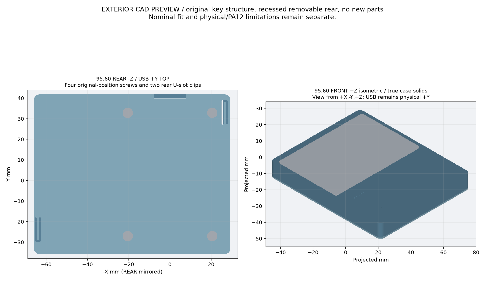
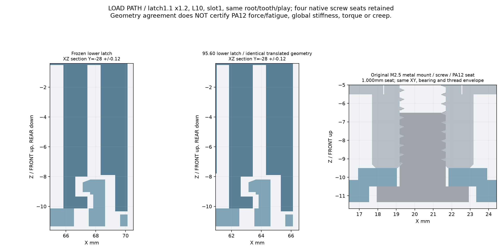
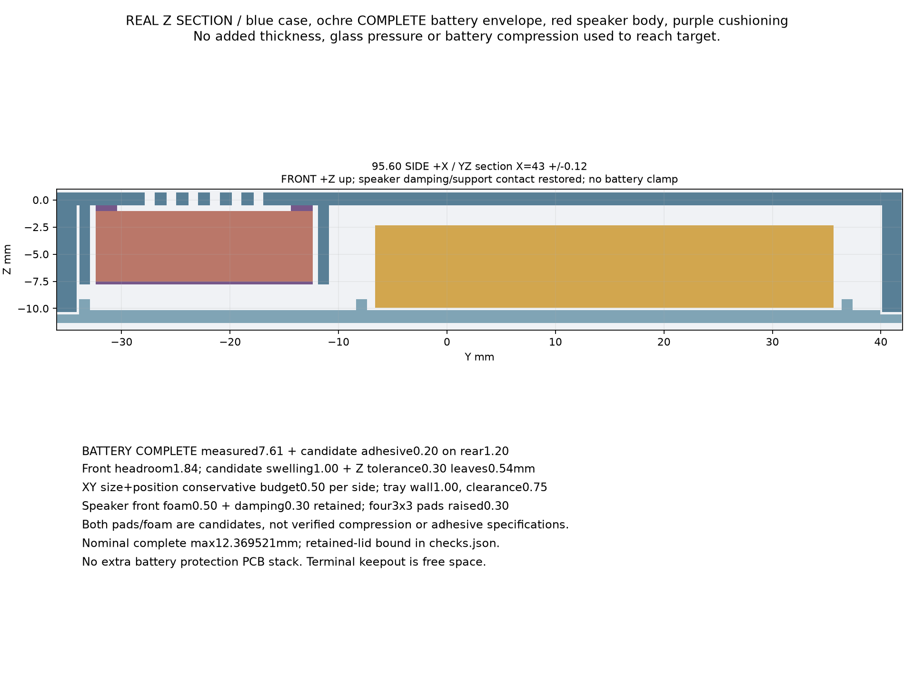
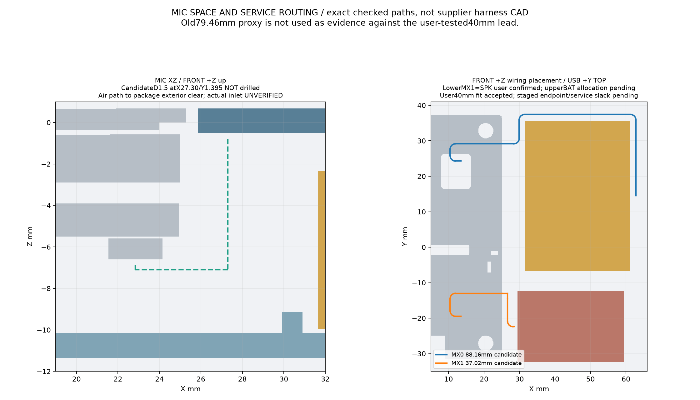
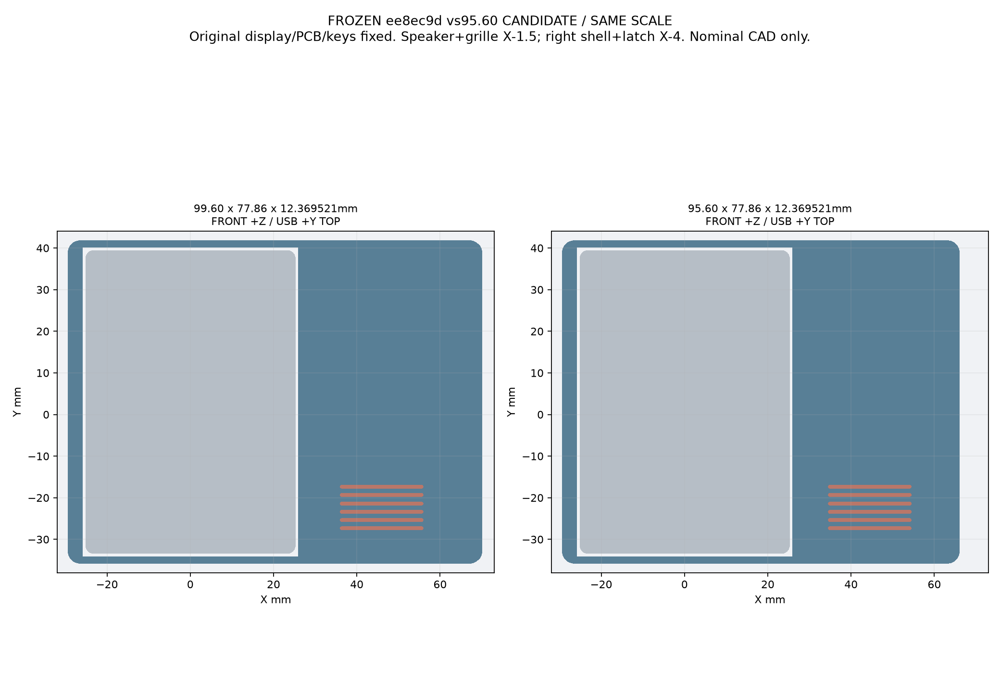
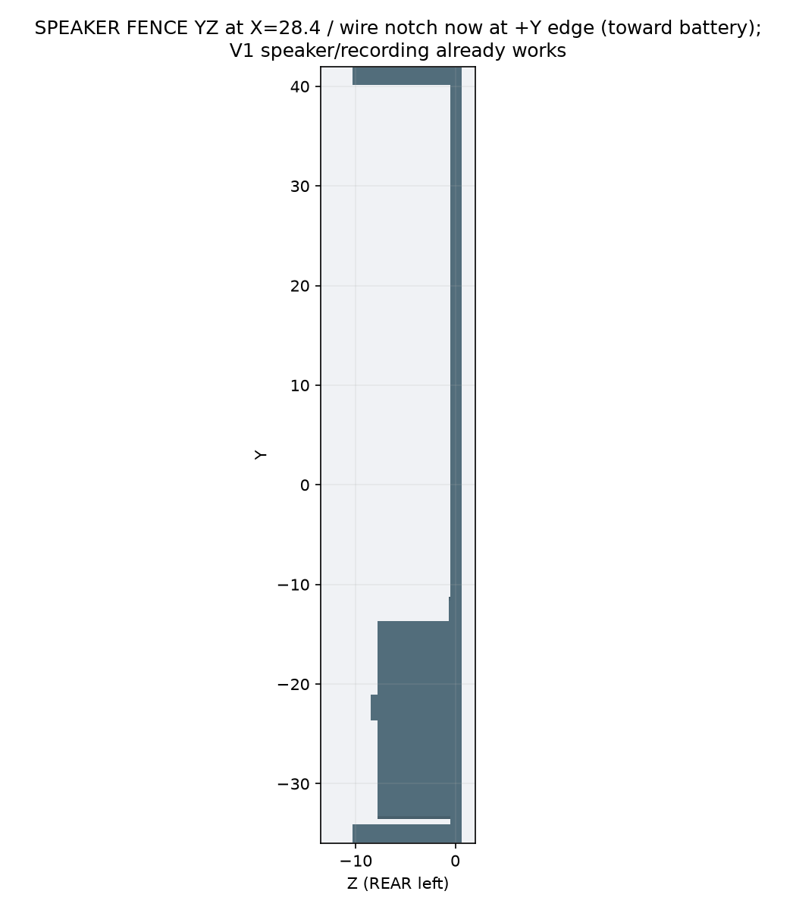

# 33 · G-V1 V4-RECT Reviewer Package

2026-10-26。**状态：CONDITIONAL / 名义几何与本轮装配路径通过 / 未批准打印 / 未做第二件实物。**
本文是给 Reviewer 的独立审阅包说明。目的不是“证明设计没问题”，而是**把 V1 的实物事实、用户反馈、V4 的取舍和所有已知薄弱点摊开，让 Reviewer 优先攻击**。

---

## 0. 先看结论

- V1（95.60mm）**已经由用户打印、装壳、试装**：PA12；卡扣断、后板翘、屏缝大、屏突出、SD 槽无用、音箱出线折线；但**装壳后录音和扬声器都正常**，侧键也能触发。
- V4 是**第二轮候选**：长方形外壳 + 四角内嵌角柱 + 两颗 0127 硅胶键 + RESET 圆孔；屏唇加厚、屏窗收紧、后板加厚带筋；没有卡扣、没有独立打印键帽、没有外置耳。
- V4 目前 `checks.json` = `CONDITIONAL_NOMINAL_GEOMETRY_PASS_PHYSICAL_PENDING`，`print_approved=false`。
- **请 Reviewer 重点质疑**：1.0mm 屏唇、0127 的孔/内底柱、四角角柱与电池/扬声器/托盘的间隙、左侧 7.6mm 板与显示/PCB 的间隙、0.30mm 屏窗和 JLC 的 ±0.3mm 公差、前装拆顺序、后板 2.0mm 的翘曲、MIC 孔位。
- **不要把 V4 当成“已完成”**：没有第二件实物；0127 是外购件，实际尺寸/硬度/内底柱长度未测；PA12 螺纹/扭矩未测；屏唇/玻璃受力未测。

---

## 1. 包内容与复现

### 1.1 目录

```text
docs/
  33_g_v1_v4_reviewer_package.md   ← 本文
  32_g_v1_v2_physical_feedback_and_screen_clamp.md
  31_g_v1_95mm_layout_optimization.md
  09_cad_p1.md / 10_p1_manufacturability_review.md
deliverables/
  g-v1-95mm/    ← V1 实际打印基线：STEP/STL、图、checks
  g-v4/         ← V4 当前候选：STEP/STL、图、checks
cad/t0/
  t0-g-v4.json, t0_g_v4.py, generate_g_v4.py, ...
scripts/generate-g-v4.sh
```

### 1.2 V4 复现

```bash
cd esp32-design-t0
./scripts/generate-g-v4.sh
# 输出 build/g-v4、deliverables/g-v4
```

### 1.3 GitHub

- 分支：`codex/gv1-v2-fit-clamp`
- V4 目录：<https://github.com/Gadil123/esp32-design/tree/codex/gv1-v2-fit-clamp/deliverables/g-v4>
- 本包 Release：见 §11。

---

## 2. V1 实际打印件（基线）

V1 文件：`deliverables/g-v1-95mm/`。

| 项目 | V1 实际 |
|---|---|
| 外形 | 95.60 × 77.86 × 12.3695mm |
| 打印 | PA12；单件；用户实拍照片在会话/Issue，不在本包 |
| 后板 | 1.20mm 均匀板，无筋；外圈 0.8mm 止口 |
| 壳连接 | 右侧 2 个浅卡扣（1.1×1.2mm 梁，U 槽）；无壳螺丝 |
| PCB 固定 | 4×M2.5×4 进原厂金属嵌件；**只压 PCB 到后板，不压前壳** |
| 屏窗 | 玻璃包络 + 0.60mm/side；**直角**；无屏唇；屏与前面齐平 |
| 侧键 | 前壳一体 PA12 弹片（BAT_PWR L 形、BOOT 直条、RESET 针孔） |
| TF | 左侧壁直通开槽；BAT_PWR 的 L 形为避让 TF |
| 扬声器 | 前腔围框；出线缺口在 Y 中部；用户装壳出声正常 |
| MIC | V1 CAD 前面板**没有** MIC 孔；第一件的小孔是打印后加的；用户装壳录音正常 |
| USB | 13.2×7.3mm 开口；用户插线后认为可用 |
| 已知风险 | 键帽公差、PA12 薄壁、卡扣强度、后板翘曲、MIC 声路 |

V1 checks：`status=CONDITIONAL_NOMINAL_GEOMETRY_PASS_PHYSICAL_PENDING`，`print_approved=false`；完整 723 原厂实体名义通过，但卡扣/键帽的物理风险没有关闭。

---

## 3. V1 图纸（Reviewer 先看这些）











V1 STEP/STL：

- `deliverables/g-v1-95mm/front_shell.step/.stl`
- `deliverables/g-v1-95mm/rear_shell.step/.stl`
- `deliverables/g-v1-95mm/assembly_light_PROXIES.step`

---

## 4. 用户第一件反馈（原始要点）

以下按用户口述整理，保留“用户观察”和“工程判断”的区别。用户照片未打进本包，Reviewer 可向用户索取。

1. 后盖放到桌面不平，整体翘板；怀疑 1.2mm 太薄 + 打印。
2. 主板四颗螺丝配合很好、卡得紧；这部分不用改。
3. 屏幕装进前框后，整体比机身略微突出；一侧较齐、一侧更高。用户怀疑是前框/后框没有压紧，不能靠打印自由变形，应该让前框包住屏幕，借用屏幕+主板刚度校形。
4. 屏推到左上角后，右侧、底侧各约 **1.29mm** 缝；用户后确认这是**另一侧的总缝**，不是单边。
5. 屏幕是圆角矩形，V1 直角挖槽不匹配。
6. USB 开口太大；但插线后用户撤回，认为需要空间，V1 开口可接受。
7. SD 卡装入后不超过屏幕边缘，装壳后碰不到；不需要单独 SD 槽；原来的 L 形 BAT_PWR 可改直条。
8. 后壳右下卡扣已断；右上角拿到手就是空壳；卡扣设计不合理。
9. 音箱线从音箱底部出，V1 缺口在音箱中部，硬折线；音箱卡位本身刚好。
10. 右侧只靠卡扣不合理，应至少 1–2 颗螺丝，哪怕加宽。
11. 整体尺寸可接受；为了“一次搞定”，厚度/宽度可以增加；两颗新增螺丝应放在电池/音箱以外。
12. 第一件是 PA12；装壳后**录音和喇叭都正常**。
13. 用户后来确认：只做右侧两耳时，**左侧 PCB 螺丝不压前壳**；PCB 螺丝只压 PCB 到后盖。
14. 用户喜欢 0127 的长方形硅胶键；RESET 保留圆孔；只做两颗键。
15. 用户要求 V4 四角保持**圆角矩形**，不要外置半圆耳。

### 4.1 V1 缝的数值对照

| 项 | 数值 |
|---|---:|
| V1 窗名义总游隙 | 1.20mm（0.60/side） |
| 用户实测另一侧总缝 | 1.29mm |
| 差值 | **+0.09mm 总**（+0.045/side） |
| 相对玻璃宽 50.54 | 约 **0.09%** |

结论：**PA12 的尺寸精度很高**；1.29 不是打印失败，是 V1 设计给了 1.2mm。V1 的屏突出/翘曲是**平面度/压紧**问题，不是这个 0.09。

---

## 5. 设计演化与选型

### 5.1 为什么不继续 V1

- 右侧 2 个薄卡扣已断；PA12 单件不适合 1.1×1.2mm 梁反复开合。
- 后板 1.2mm 无筋、无边缘压紧，会翘。
- 前壳只靠卡扣，屏窗 0.6/side，无轴向压紧，屏会自由游走。
- TF 槽没有实际价值；L 形 BAT_PWR 是为槽绕路。
- 扬声器出线口在围栏中部，线要折。

### 5.2 被考虑但未采用的方案

| 方案 | 结论 |
|---|---|
| V2：四角外置耳 + 4×M2×6 | 几何通过，但外耳不美观、左侧耳可能挡按键；作为对比保留 |
| V2b：右侧两耳 + 左侧滑入法兰 + 2 螺丝 | 2 螺丝方案；左侧法兰只是止挡，不压紧；不主推 |
| V3-CLIP：右侧 2 卡扣 + 左侧滑入法兰 | 单边卡扣方案；卡扣仍是 PA12 薄梁，风险高；未出图 |
| V3-SCREW：四角外凸 R3.5 半圆耳 | 外观对称，但宽度约 102.6mm；未出图 |
| V4-RECT：长方形 + 四角内嵌角柱 + 0127 | **当前候选**：无外耳，四角螺钉从后盖进内柱；左侧加宽 4mm 放 0127 |

### 5.3 V4 的关键取舍

- **四角内嵌角柱**：Ø5.0，M2×6 自攻，单边壁 1.65mm（JLC >1.5）。后盖只看到 4 个 Ø4.2 沉孔，轮廓保持长方形。
- **4 颗壳螺丝 + 4 颗 PCB 螺丝**：壳螺丝只压前后壳；PCB 螺丝进原厂金属嵌件。V1 的 PCB 螺丝不压前壳，所以不能拿它替代壳螺丝。
- **左侧 4mm**：把 0127 的 7.2mm 壁深和 9.2mm 手指面放进侧壁；总宽 99.7mm。
- **0127**：现货、长方形、闭顶、高内底柱；旋转 90°：9.2 沿 Y、7.2 沿 X；沉孔 9.4Y×7.4Z×1.3X；通孔 9.2Y×6.0Z。BAT/BOOT 各一颗；RESET 仍是硬件复位圆孔。
- **屏唇**：1.0mm 厚、包玻璃 1.0mm、到玻璃 0.30mm 间隙；seam 先顶死，屏唇只做前向限位，不夹屏；总厚 14.35mm。
- **后板**：2.0mm + 1.2mm 筋；四角壳螺丝 + 四颗 PCB 螺丝形成 8 点压紧。
- **TF 隐藏、扬声器 +Y、USB 13.2×7.3 保持、前面板不猜 MIC 孔。**
- **JLC PA12**：最小壁厚 1.0mm、推荐 2.0mm；紧固/定位 >1.5mm；尼龙 ±0.3mm；自攻 boss ≥1.5× 螺钉/嵌件外径。

---

## 6. V4 最终方案（当前交付）

V4 目录：`deliverables/g-v4/`。

| 项目 | V4 |
|---|---|
| 外形 | **99.7 × 77.86 × 14.35mm**，圆角矩形 R3，无外耳 |
| 前面板 | 中央真开口：前脸 53.54×76.06，唇内 48.54×71.06；MIC Ø1.5 (27.3,1.395)；RESET Ø2.2 |
| 屏 | 玻璃 50.54×73.06 R2.0；窗 51.14×73.66 R2.3；单边 0.30mm |
| 屏唇 | 包边 1.00mm；唇底 1.00 / 玻璃 0.70（0.30 间隙）；唇顶 2.00；屏凹 1.30 |
| 后板 | 2.0mm + 1.2mm 筋；seam −10.35；后外面 −12.35 |
| 四角 | 内嵌 Ø5.0 角柱 ×4；M2×6 自攻，壁 1.65mm；后盖 4×Ø4.2 |
| PCB | 4×M2.5×5 机螺丝；后盖 4×Ø5.8 |
| 侧键 | 0127 ×2（BAT/BOOT），旋转 90°；RESET 圆孔 |
| TF | 完全不外露 |
| 扬声器 | +Y 底边出线；腔/格栅不变 |
| 装配 | 后板/PCB/屏/电池/扬声器先装；前壳最后盖；0127 从外侧压入 |

### 6.1 V4 图纸




---

## 7. V4 检查结果（名义）

`deliverables/g-v4/checks.json`：

| 检查 | 结果 |
|---|---|
| 前/后壳有效实体 | 各 1 个，STL 闭合；前 7756、后 9676 三角形，非流形边 0 |
| 723 原厂实体碰撞 | **0** |
| 完整电池/扬声器碰撞 | **0** |
| 前壳 +2…+40mm 六档直提 | **0** |
| 0127 两沉孔/通孔探针 | **0** |
| MIC/RESET 探针 | **0** |
| 四角壳螺丝头孔 | **4×Ø4.2** |
| PCB 螺丝头孔 | **4×Ø5.8** |
| 四角角柱 | 4 个，Ø5.0/预钻1.7/壁1.65 |
| 电池线 | 用户确认朝屏幕/主板出线；旧“绕右侧到右上角”候选 MX0 环线不适用，已从硬检查移除 |
| 屏幕中央空气柱 | **0**（Codex S1 修复：唇基全高开孔） |

**状态**：`CONDITIONAL_NOMINAL_GEOMETRY_PASS_PHYSICAL_PENDING`，`print_approved=false`。

### 7.1 本轮修过的错误（Reviewer 可复核）

1. **V4 背板四角沉孔曾被 rear boss 填住**：STEP 背板面原先只有 4 个 PCB Ø5.8；现在移除 rear boss，回读 9 条环 = 外轮廓 + 4×Ø5.8 + 4×Ø4.2。
2. **V4 漏画 MIC 孔**：现在前面板有 Ø1.5 @ (27.3,1.395)，探针 0；这是 V1 CAD 候选，不是 V1 实物孔的测量值。
3. **V4 的电池线 BLOCKED 是旧 worst-case**：用户确认电池线朝屏幕/主板侧；旧 MX0 环线已从 V4 硬检查移除，状态从 BLOCKED 改为 CONDITIONAL。
4. **S1（Codex 评审发现，已修）**：`lip_base` 原来只减到 z=1.5，而唇顶到 z=2.0，屏幕上方实际留下 **0.5mm 整片封板**；用户最早说“屏幕这边是一整块”是对的。已把唇基全高开孔；顶面 z=2.0 现在是环（外 53.54×76.06 / 内 48.54×71.06），中央空气柱探针 **0**；V4 已重新生成。此前“屏不是实心”的结论作废。

---

## 8. Reviewer 攻击清单（请优先打这些）

| 编号 | 严重度 | 需要质疑/验证 | 当前证据 | 如果被证明有问题 |
|---|---|---|---|---|
| R1 | **高** | 1.0mm 屏唇在 PA12 上够不够？JLC 对紧固/定位建议 >1.5mm。 | V4 唇厚 1.0；唇底 1.0；前板 1.2；环宽 1.2；唇顶 2.0 | 加到 1.2–1.5mm，或改局部加强筋/独立压边；接受厚度 +0.2–0.5 |
| R2 | **高** | 0.30mm 唇-玻璃间隙 vs JLC ±0.3mm 打印公差：会不会先顶玻璃？ | seam 先顶死；唇 0.30 间隙；V1 实测 +0.09 | 加到 0.4–0.5mm；或加 0.2mm 泡棉；或改 seam 硬限位 |
| R3 | **高** | 0127 沉孔 9.4Y×7.4Z×1.3X + 通孔 9.2Y×6.0Z 是否真的能装入 0127？ | 0127 底座 9.2×7.2；高内底柱；1.3 壁 | 按实物重画 pocket；可能需要 9.6×7.6 沉孔/7.0Z 通孔 |
| R4 | **高** | 0127 高内底柱长度/硬度是否真的压到 TS24CA？ | 通孔 X 6.0；原厂开关接触面 1.8×0.8 | 加 0.5–1.0mm 垫片，或改 pocket 深度；先买 0127 实测 |
| R5 | **高** | 左侧 7.6mm 板/0127 通孔到显示/PCB 只有 0.6/0.9mm，前装时会不会顶？ | V4 名义碰撞 0；display x −25.27；PCB x −24.97；slab 到 −25.87 | 减小 slab/改 pocket；或加宽 5mm；或减小 0127 孔 |
| R6 | **高** | 四角内柱是否真的避开电池/托盘/扬声器围栏？ | 右上 (63.3,38.3) 与电池 (61.15,35.63) 名义 0.2；右下 (63.3,−28) 与围栏 61.0 | 内移右上柱/开托盘让位；右下与围栏融合需确认 |
| R7 | **高** | 电池实际线束从屏幕/主板侧出，是否真的不碰右上柱？ | 旧 MX0 环线已移除；实物线未建模 | 按实物线重排；若碰，右上柱内移 |
| R8 | **中** | 2.0mm 后板 + 1.2mm 筋在 PA12 MJF/FDM 下够不够平？ | V1 1.2mm 翘；V4 2.0+筋+8 点压紧 | 提高后板到 2.2/2.4；或要求打印厂平面度 ≤0.2 |
| R9 | **中** | 前装拆时 0127 是从外侧压入，还是前壳带帽一起下降？帽会不会掉/卡？ | 0127 底座 9.2×7.2，沉孔 9.4×7.4 | 改从外侧压入 + 内侧挡边；或做帽的临时固定 |
| R10 | **中** | 0.30mm 窗隙 + 后板定位 0.15 + PCB 0.15 的最不利组合是否够？ | V4 名义 0.30；V1 实测 +0.09 | 0.4/0.5 窗隙；或前装对中工装 |
| R11 | **中** | MIC Ø1.5 @ (27.3,1.395) 是否与 V1 实物孔一致？ | V1 CAD 前面无孔；V1 打印孔是后加；V4 用 CAD 候选 | 按 V1 实物孔坐标改；或 V4 留实心由用户钻 |
| R12 | **中** | RESET 圆孔 Ø2.2 在 7.6mm 左壁内能否用针触到 TS24CA？ | V4 通孔 X −33.57…−24.8；switch x −24.89 | 加长孔/改针孔入口；确认针长 |
| R13 | **中** | 4×M2×6 自攻进 PA12 5.0 boss 的扭矩/反复拆装寿命 | 壁 1.65；JLC >1.5；无金属嵌件 | 改 M2 热熔嵌件或 M2.5 金属嵌件；降扭矩 |
| R14 | **中** | 4 颗壳螺丝 + 4 颗 PCB 螺丝是否真的让按键可触及/不挡手？ | 四角内柱；左侧 0127；无外耳 | 改柱位置/加宽；或改 2 颗壳螺丝 + 左舌片 |
| R15 | **中** | 0127 是外购件，底座/高度/硬度批次差异 | 用户选定 0127；未实测 | 买 3–5 颗不同批次；做键孔试样 |
| R16 | **中** | 前壳 1.2mm 前板 + 1.0mm 唇，装壳后是否会被屏/螺丝顶变形？ | V4 名义 0；V1 前壳薄；无 FEA | 加前板筋/唇基；或 1.5mm 前板；实物测屏缝 |
| R17 | **中** | 扬声器 +Y 缺口是否真的对应 0127/照片中的出线边？ | V1 出声正常；V4 +Y；用户照片 | 镜像缺口；重跑 speaker checks |
| R18 | **低** | TF 完全隐藏，维护要开后盖 + 拆 PCB 螺丝；用户接受？ | V4 无 TF 外槽 | 加维护说明；或后盖局部开窗 |
| R19 | **低** | USB 13.2×7.3 在 V4 左加宽后是否仍够？ | V4 未改 USB；V1 插线可用 | 保留；若换线再测 |
| R20 | **低** | 四角内柱在后盖只留 Ø4.2 沉孔，外观是否真的“长方形”？ | V4 REAR 图；无外耳 | 接受；或做浅半圆凹饰 |

### 8.1 特别请 Reviewer 检查的两个“可能被忽略”的点

1. **前壳左侧 slab 与显示/PCB 的相对运动**：V4 的 7.6mm slab 名义到显示 0.6、到 PCB 0.9；但前装时 0127 帽/通孔、屏唇、键帽都在同一侧，任何横向公差都可能让 slab 顶到显示。V4 的 `front` vs 723 名义 0 不代表装配路径已全证明。
2. **右上角柱与电池托盘**：V4 checks 对“完整电池”是 0，但电池托盘是后盖的一部分；V4 用 rear 的 boss 让位切了托盘。Reviewer 应看 `rear_shell.step` 的右上角，确认托盘缺口没有削弱电池保持/线束通道。

---

## 9. 未验证 / 必须实物

- PA12 MJF/SLS 的螺纹、扭矩、蠕变、反复拆装。
- 0127 的实际底座/总高/内底柱长度/硬度；0127 与 TS24CA 的触发行程/回弹。
- 屏唇 1.0 的实际强度；屏/玻璃在 0.30 间隙下的受力；seam 是否真的先顶死。
- 前装拆中 0127、屏唇、键帽、slab 的实际干涉。
- 电池实际出线方向/线长/弯折；右上角柱。
- MIC 实际孔位/录音；RESET 针的实际触达。
- 打印机平面度、后板翘曲、前壳翘曲。
- 扬声器腔/格栅音质；USB 插拔；TF 维护。

---

## 10. V1 与 V4 的差异总表

| 项目 | V1 | V4 |
|---|---|---|
| 外形 | 95.60×77.86×12.37 | **99.7×77.86×14.35** |
| 后板 | 1.20，无筋 | **2.00 + 1.2 筋** |
| 壳连接 | 2 右侧浅卡扣 | **4 角内柱 + 4×M2×6** |
| 屏窗 | 0.60/side，直角 | **0.30/side，R2.3** |
| 屏唇 | 无 | **1.00 包边，0.30 间隙** |
| 侧键 | 一体 PA12 弹片 | **0127 ×2 + RESET 圆孔** |
| TF | 外露槽 | **完全隐藏** |
| 音箱出线 | Y 中部 | **+Y 底边** |
| PCB 螺丝 | 4×M2.5×4 | **4×M2.5×5** |
| MIC | CAD 无孔；实物后加 | **Ø1.5 @27.3,1.395（候选）** |
| 装配 | 前壳先放，主板从后 | **后板先装，前壳最后盖** |

---

## 11. Release / 下载

- 分支：`codex/gv1-v2-fit-clamp`
- 最新提交：`c666ed9`
- Release tag：`g-v4-rect-review-20261026`（Draft；Reviewer 需有仓库权限）
- 下载：

```bash
gh release download g-v4-rect-review-20261026 \
  --repo Gadil123/esp32-design \
  --pattern 'g-v4-rect-review-20261026.zip' \
  --dir ./g-v4-review
```

- ZIP 内含：本文、V1/V4 的 STEP/STL/图/checks、V4 生成代码、MANIFEST/SHA256。
- Release 的 Draft 状态是为了避免把“未验证候选”当成正式发布；Reviewer 通过仓库权限或用户共享访问。

---

## 12. JLC 依据

- 嘉立创 3D 打印设计规范：<https://www.jlc-3dp.cn/technicalColumnsDetails/27832.html>
- JLC3DP 3D printing design guideline：<https://jlc3dp.com/help/article/3d-printing-design-guideline>

要点：

- 推荐壁厚 2mm；凸起/定位/卡扣/紧固件推荐最小 >1.5mm。
- 尼龙 SLS/MJF 最小壁厚约 1.0mm；精度 100mm 内 ±0.3mm；孔公差 ±0.3mm。
- 直接打印螺纹最小 M6；自攻/嵌件 boss 建议 ≥1.5× 螺钉/嵌件外径。
- V4 的 1.0mm 屏唇只达到“最小”，没有达到“紧固/定位 >1.5”；这是 R1/R2 的核心争议。
- V4 的四角角柱 5.0/1.7 = 1.65mm，达到 >1.5。
- V4 的 0127 壁 1.3mm，接近最小 1.0；不是结构承力件，可接受但需实物。

**结论：V4 是供 Reviewer 攻击的候选，不是打印放行。**
