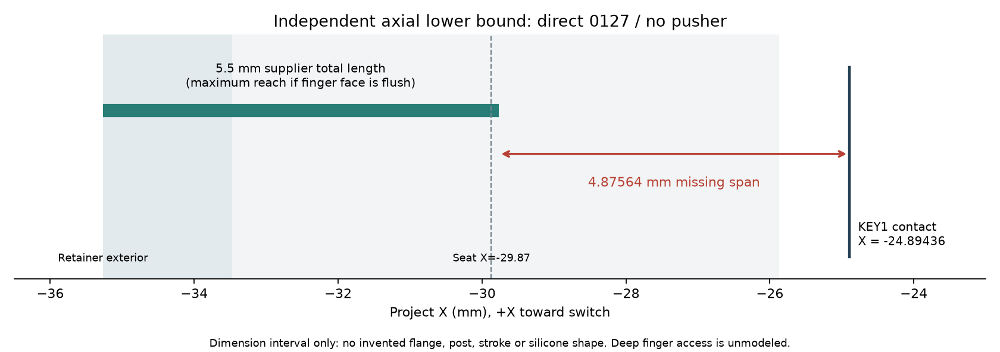

# 36 · G-V1 V4-RECT 独立打印前评审

评审日期：2026-10-27（Asia/Shanghai）。起点：`d20ac78`，分支 `codex/gv1-v2-fit-clamp`，起始工作区干净。没有继承实现者上下文。docs/33、34、35 仅作为待核对声明，以下结论由文件、原厂实体、布尔实交及负对照取得。

## 结论与处置范围

**不能将当前版本作为已闭合的整壳功能样机送打样。** 没有 P0；发现四项 P1：接口闸门漏检、压框挡住 RESET、后盖定位环挡 USB 插头、0127 直接触发的轴向布局未闭合。前三项已修；第四项只修复了漏报及放行状态，**按键机械布局没有修好，仍阻断整壳打样**。不能把这项改名为普通 P2，或把新几何闸门通过当成它已解决。

用户已明确：0127 应直接触发原开关，不加额外推杆；RESET 应在压框安装后直接可用；定位环是先前 agent 自主设计，没有用户实配依据；用户没有小规模测试设备，每次打印需约七天。本次没有执行打印、采购、发布或推送；`print_approved=false`。不将“先小样再等七天”当作已经获准的执行流程。

修改限于 V4 源码、配置、生成说明、交付件、回归脚本及本报告/评审证据。V1 和仓库外官方资料没有修改。所有尺寸/体积均为 CAD 或文件数值，**不是新增实物测量**。

## 证据链与复算方法

- 原厂本地仓库 HEAD：`77a7dceac38a1bd491173b3906205217a382c08c`，与 `cad/t0/official-reference.json` 相符。官方 STEP SHA256：`73c84092e7d6b55574125d2bf0885a61688514762b796ca43c98dfed1bc18c5c`。
- 用 build123d/OCP 直接读入官方 STEP，另写 occurrence 遍历，逐层累积 parent placement，再做 Rz180（保持 Z，不作镜像）。完整装配 **723 solids**；DISPLAY、PCB、TF、MIC、USB、KEY1/2/3 八组包围盒与 `data/t0_interface_bounds.csv` 最大差均为 **0 mm**。同时阅读原始 `data/step_component_bounds.csv`；其早期包围盒/舍入方式不同，不把两张表当成两个独立实测来源。
- 单独回读交付的九组 STEP/STL；起始 MANIFEST 全部通过。九个零件均为一个有效 solid，STL 无非流形边，包络/体积回读通过。此项只验证文件，不代表功能。
- 起始前壳/后壳/压框对 723 实体的实交体积均 **0 mm³**，前后壳互交 **0 mm³**。另从 light 装配读出电池、胶层、扬声器、螺钉和金属座的实际坐标，没有用旧 V1 的 Z 位置代替。
- 原始复算值、起始交付件哈希、破坏前后结果保存在 [独立基线证据](../data/g-v4-independent-review-baseline.json)。临时破坏实体只存在于内存/忽略的 `build/review36`，没有覆盖正常交付或修改 V1。
- 本轮快速回归入口：`.venv/bin/python scripts/check-g-v4-interfaces.py`，从交付 STEP 回读生产压框和三档试样，验证正常实体，再实际破坏实体验证拒绝路径。

### 对历史声明的独立裁定

| 声明 | 本轮复算结果 | 边界 |
|---|---|---|
| 屏口没有封板 | 成立；整个圆角内口空气柱为 0；旧封板注入后命中 **1078.0 mm³** 并 FAIL | 不等于电容触控实测 |
| 唇底/厚/玻璃间隙 | 实体剖切得到 Z=**1.60…3.10**，厚 **1.50**；官方玻璃顶 **0.70**，隙 **0.90** | 不包含翘曲、外按或螺钉拉平变形 |
| 主体/压框包络 | 主体 **99.60×78.26**，装配含候选螺头宽 **102.60**，厚 **16.95** | 帽未建模；不能代表最终成品包络 |
| 电池胶层 | light 中胶 **-10.35…-10.15**，电池 **-10.15…-2.54**，厚 **7.61** | 电池尺寸沿用已有用户输入，不是本轮复测 |
| 四个后盖壳孔及四个 PCB 孔 | 实际圆柱面/头座检查保留，并随最终构建复验 | SKU、孔缩、扭矩、有效全牙仍未定 |
| KEY 名称与功能仍全不明 | 原理图原件可读到 **Key1→ECJ23001 电源 KEY、Key2→GPIO28/BOOT、Key3→CHIP_PU/RESET** | 不能推出开关行程、料号后缀或寿命 |
| 有效显示/触摸可视区完全无图纸 | 不成立；官方 dimensions PDF 有 LCD AA **43.20×57.60**、TP VA **43.80±0.10×58.20±0.10** | TP VA 不是电气触摸验收；见 R36-10 |

## Findings

### R36-01 · P1 · 生产压框/试样的功能阻断可以通过旧闸门

**证据。** `g_v4_checks.py::interfaces` 原来检查压框上的小块捕获材料和螺钉，没有检查两个完整窗口；`generate_g_v4.py` 对 A/B/C 只做有效实体及 STEP/STL 回读，没有试样功能检查。

实际向 `0127_retainer.step` 第一键窗口补入 **80.64 mm³** PA12，完整调用起点版本 `interfaces()`，仍全部 PASS。另向 B 试样通道填入 **179.648 mm³**，起点的全部试样验收 `verify_exports()` 仍 PASS：1 solid、716 triangles、非流形边 0、包络误差约 **0.00000122 mm**、相对体积误差约 **0.00000619**。这不是假想“可能漏检”，而是实际破坏的假阴性。原来的正常压框/试样通道本身没有被本试验指控为已堵塞。

**修复：已修。** `g_v4_checks.py` 新增完整窗口空气体、全周捕获投影、三档沉孔/通道、全周内座、后桥、pilot/底料及压框轴孔检查；生成前和 STEP 回读后均执行。`generate_g_v4.py` 将这些纳入交付前硬失败路径。新增独立回归脚本。

**修复后证据。** 正常三对试样及生产窗口必须先通过；再分别封住两个生产窗口、三档通道、删除三档内座。最终再加 R36-02 的 RESET 封孔负对照，共 **9 个接口负对照**，必须由对应功能检查拒绝，不能用任意异常冒充检测成功。原有屏口封板及四角负对照仍保留。

**是否必须实测。** 闸门漏检的关闭不需要实测；真实胶帽能否通过窗口、捕获、回弹和触发仍需要有效尺寸/实物证据，不能由投影材料检查代替。

### R36-02 · P1 · 安装压框后 RESET 被堵住，10 mm 针也不足

**证据。** `g_v4_interfaces.py::production_bezel` 起点只有两个键窗和固定孔，没有 RESET 孔。RESET 轴为 Y=**-11.44**、Z=**-6.40**，处于两键之间的实料。以实际压框外表面 X=**-35.27** 起算，Ø0.8 直针到 KEY3 的路径与压框实交 **0.904778684 mm³**；与前壳为 **0**。到接触面的必要自由长度为 **10.374632326 mm**，配置却仅要求 **10.0 mm**。原针探针从前壳外壁附近开始且不查压框，因而漏过了这个问题。

**意图确认。** 用户明确要求装配后仍可直接使用 RESET；不是有意先拆压框。

**修复：已修。** 在生产压框补同轴 **Ø2.2** 全孔；单键 coupon 不额外加 RESET 孔。针探针从已安装压框的外表面开始，检查前壳、压框完整路径并命中 KEY3；要求自由针长 **≥12 mm**，仍不把自由长度当作允许插深。增加全孔 STEP 回读及封孔负对照。

**修复后证据。** 见最终 `checks.json/v4_interfaces/reset`、`retainer_RESET_STEP_roundtrip` 和封孔负对照。必须为压框全孔/针交体积 **0**，且 KEY3 命中为正；重新封孔必须 FAIL。

**是否必须实测。** 名义遮挡已由几何修复；针端防滑、实际触发力/行程和过行程上限需实物验证，未编造其值。

### R36-03 · P1 · 新后盖定位环侵入 USB 插头通道

**证据。** 从官方 USB 的 +Y 口端面定位，面包围盒为 X=**-4.469793…4.470206**、Y≈**38.275831**、Z=**-8.749521…-5.589521**。使用项目已有但 V4 未执行的独立 **12.2×6.3 mm** 插头本体代理（`p1_checks.usb_probe`；不用开口 cutter 代替插头），得到前壳交 **0**，后壳交 **27.764823572 mm³**。交区 X≈**-6.099794…6.100206**、Y=**38.58…40.03**、Z=**-10.319521…-8.75**。

`t0_g_v4.py` 重建了 rear/register，USB 后续缺口却仅从 Y=**40.03** 开始，遗漏插座口到外壁之间的定位环。723 原厂实体不含外插线缆；因此板卡碰撞为 0 捕获不了它。V1 插线成功不覆盖这个新定位环。此代理不给窄金属鼻预留信用，不等于断言用户所有实际线材都已插不进。

**修复：已修。** rear 的最终实体重新减去源自官方 USB 口的原 `m['usbcut']`，修内侧遮挡；前壳与 **13.2×7.3** 外口尺寸没有缩小。加入前/后/压框对独立插头本体的硬检查和 STEP 回读；重新加入一段定位环挡块的负对照必须在 USB 检查 FAIL。

**修复后证据。** 见最终 `checks.json/USB_access`、`USB_access_STEP_roundtrip`、`USB_negative_control`。三件对完整代理均须为 **0 mm³**。

**是否必须实测。** 几何通道修复不需要实测；实际包胶外形、插入深度、孔缩、插拔侧载与应力仍需实际线缆验收。

### R36-04 · P1 · 0127 直接触发轴向布局尚未成立

**证据。** 用户本轮提供卖家图，明确标注总轴高 **5.5 mm（含底柱）**；这是卖家名义/手工图值，不是本轮实物测量。用户确认设计原意为直接触开关、不加推杆。

交付压框外表面为 **X=-35.27**，KEY1/2 的目标接触面为 **-24.894360806/-24.896374540**。若按面在压框外表面或外侧，整个帽从按面到触点所需的最小轴向跨度为 **10.375639194/10.373625460 mm**，比整个帽总长多 **4.875639194/4.873625460 mm**。即使忽略所有公差，当前空通道、同轴 Ø0.8 诊断棒及 4.98 mm“座到开关”也不能补上这段跨度。

这是对“外露按面直接触发”的必要静态条件检查；不是对任意硅胶大变形的材料定律。若设计想让按面深凹、用多毫米位移或改变安装方向，必须明确建立那种结构、手指接近和安全行程。当前文件没有这样的实体/行程证据；卖家低分辨率截面也不足以可靠指定承座基准。不能将 4.6、1.3 等图中字样自行拆成确定的“座到柱端”。

**修复状态：机械缺陷未关闭。** 已新增 `direct_key_readiness()`，在检查与生成 README 中明确列入 `preprint_blockers_P1`；最终总状态必须含 `FUNCTIONAL_LAYOUT_BLOCKED`，不得继续只有 S2 待测。没有擅自延长胶柱、加推杆、设定多毫米胶料行程，或把外露键改为深凹键。

**仍需解决。** 获取基准明确的 flange/按面/承座面/柱端尺寸及安全行程，重新布置局部安装与手指入口，使整个轴向链可达，随后重做保持、回弹、防预压、过行程、装拆和所有干涉检查。现有 A/B/C 仅改变周边游隙，不能修复此轴向问题。缺数据时只能明确阻断，不能提交一个猜尺寸的“已修复”壳体。完整重新生成不等于此项通过。

**是否必须实测。** 可先用清晰、基准完整且对应 SKU 的供应商尺寸图解决名义布局；最终胶料、触发及过行程仍需真实件验收。本轮没有设备/数据证明这些值。

### R36-05 · P2 · 定位环 0.15 单边游隙没有打印配合预算

**证据。** `t0_g_v4.py` 的 `gc=.15`；实体在右侧 Y=0、Z≈-9.45 的截面，前壳内面 X=**64.33**、定位环外面 **64.18**，差 **0.15**；左侧 X=-31.67/-31.52，顶部 Y=40.33/40.18，底部 Y=-34.33/-34.18，均相同。

主体内宽名义 **96.0**，环外宽 **95.7**，总差仅 **0.3 mm**。若分别采用尺寸 ±0.3 的不利组合，内宽减0.3、环外宽加0.3，差变为 **-0.3 mm**。这是预算情景，不是预测本批一定卡死，也不是测得打印偏差。完整前后件还受螺孔、局部舌/让位约束，不能将两件任意刚体平移当成单独的环公差模型。

**处置。** 只报告，未改代码。用户未给出打磨配合意图，按“待确认，已按保守假设处理”：不能宣称直接装入已通过，不能以螺钉拉合消除干涉。应明确 PA12 工艺、孔/外形尺寸链和可能的后处理；增隙会增加壳/PCB相对游隙，须同步重算屏隙，不能只把 `.15` 改大。

**是否必须实测。** 最终配合、翘曲和重复装拆需实件/厂商工艺数据；当前几何本身不能保证。

### R36-06 · P2 · 壁厚与独立止挡存在，但强度/平整度/循环寿命未证明

屏唇厚 **1.50**、径向基座 **1.60**、扩展仓前板约 **1.20**；后板 **3.50**，局部键让位地板 **1.55**；生产后桥 **1.85**、C 试样后桥 **1.70**。筋存在不等于消除热翘曲。唇恰好1.50不满足字面上的“>1.5”，虽然其基座1.60；不得宣称全部定位/限位截面都已满足该目标。

seam 的独立实料止挡使名义螺钉载荷可以绕过玻璃；候选 Z 预算只余 **0.30**，没有包含已知上限的翘曲、偏斜或手指外按挠度。当前没有证据表明玻璃已被预压，也没有证据保证实际拧紧后始终不受载。只报告，未修改。需测自由态/锁紧态平面度、止挡高度链、唇挠度和玻璃接触；不得用屏校平或强拧拉合。

### R36-07 · P2 · 螺钉与小孔制造/服务寿命尚未闭合

现有壳螺钉名义底余量 **1.0**、候选组合后余 **0.2**；按 Ø2.0 外牙算 boss 径向剩余 **1.7**，头下承压 **1.6**。这些是实体/候选包络，不是具体 SKU 的全牙、成牙与滑牙扭矩。侧框 Ø1.3、深4.2 的小盲孔和壳 Ø1.7 孔需考虑清粉、收缩和攻入；嘉立创孔径/深度表不能为所有小深孔作自动保证。

不得按 DIN7981 名称采购一个不同头型的螺钉；也不得用“打印螺纹最小 M6”直接否定塑料自攻，两者工艺不同。只报告，未改。须固定两个塑料螺钉 SKU 和 M2.5×5 机螺钉来源，核对最大长/尖端/头型、原金属座不顶底、pilot 及重复维护寿命。

### R36-08 · P2 · 电池保持与真实线束未验证

胶层/电池坐标一致；候选预算包含 XY **0.8/side**、胶厚 **0.1**、电池 Z **0.3**、膨胀 **1.0**。预算是设计输入，不能称为本轮测得膨胀。右上托盘在 X=59/Y=34 有意截断，由源码明示；不将其误报为缺轨或主动恢复。电池屏/主板侧引线没有建模，不能汇总成0碰撞。

只报告，未改。需核对胶材/绝缘、敞角托盘的保持、实际电池和屏侧焊点/弯折/防夹。扬声器 MX1 候选线的静态及离散运动检查保留；它不是实际40 mm引线的接插件、应变释放和开壳余量验收。

### R36-09 · P2 · MIC 声路、RESET 操作及连续维护路径需要实物

V4 MIC 入口是 **(29.8,1.395)、Ø1.5** 候选，非原厂 MEMS inlet 的直接投影，也非 V1 后钻孔实测。空气孔贯通只能关闭封孔问题；需以玻璃边为基准测 V1 实孔、定位声口，比较裸板/装壳录音。RESET 几何修复也不能代替实际针端、力和安全过行程。

空前壳的十四档直提检查不构成连续或任意倾斜路径证明。按当前模型需先去压框/帽再开壳，TF 内藏属于明确需求；维护时实际线束如何断接和承托尚无演练。只报告，未改。不得以“离散0”保证任何角度都可装。

### R36-10 · P2 · 文档未知项有过度表述，构建哈希只覆盖部分依赖

官方 dimensions PDF 已标注 LCD AA 和 TP VA。TP VA 相对玻璃短边名义边框 **3.37**，长边最小 **4.43**；扣当前1.0包边后分别仍有 **2.37/3.43 mm**。因此图纸层面已有“名义唇口未挡住该矩形”的依据，不能继续说完全没有有效区图纸。但 TP VA 可视区不是电极/触摸性能保证，实际边缘操作仍待验。

`checks.json/generator_inputs_sha256` 只列七个 V4 文件，未覆盖实际导入的 V1 foundation、通用建模/布尔/导出模块及 baseline JSON，也未绑定外部 STEP 内容。它可以核对这七个文件，不能单独证明整套构建输入相同；本报告另记了原厂 revision/STEP SHA 和起点提交。只报告，未顺带改写 P2 代码/历史文档。

## 制造资料核对与适用范围

阅读本地必读摘录及官方 dimensions PDF、DXF 文件/STEP 与 schematic PDF。dimensions PDF 是图形页，使用本地临时栅格预览读取标注；没有把厂商 PDF、STEP 或预览图复制进 deliverables 或提交。

2026-10-27 尝试 defuddle 访问四个指定网页失败；随后网页工具成功读取 [PA12 页面](https://www.jlc-3dp.cn/technicalColumnsDetails/59512.html)、[工艺指南](https://jlc3dp.com/blog/how-to-design-3d-models-for-printing) 与 [英文设计规范](https://jlc3dp.com/help/article/3d-printing-design-guideline)。中文27832页面超时，**该页未重新核对上游原文**；其相关条件按用户指定的已采纳设计输入和本地摘录使用。

英文规范将一般装配与运动间隙分开；§2 给尼龙随尺度增加的壁厚建议，以及定位/紧固特征 >1.5 的建议；§10 给100 mm内±0.3、以上±0.4%，明确不包括变形/翘曲，并提示孔缩。本报告不将这些当成对本壳平面度的厂家承诺。[嘉立创设计规范 §2/5/7/10](https://jlc3dp.com/help/article/3d-printing-design-guideline)

含压框螺头的装配宽 **102.6 mm**，不是单一打印件尺寸；前壳本身宽99.6，压框单独打印。因此既不能拿“100 mm内±0.3”保证102.6的整机，也不能直接把整机总宽乘0.4%当成装配误差。应逐件结合尺寸链、位置、孔缩和独立翘曲预算。九个单独打印件是开放壳/通孔/浅盲孔结构，未见封闭的大粉腔；小深孔清粉仍属 R36-07。SLS/MJF 的粉床承托不等于 FDM 的“贴平台且无悬空问题”。

## 最终重生成与验收记录

最终运行记录、交付哈希、正常/负对照数量及只改 V4 的核对结果见 [最终验证记录](../data/g-v4-independent-review-validation.json)。最终构建退出码 **0**；九组导出通过，**15个负对照全部被拒绝**（9接口＋1USB＋5屏口），十四档直提无实交。交付与 build 清单文件逐字节相同，MANIFEST及七个已声明输入哈希吻合；104个受保护V1文件逐字节未变，官方dimensions/schematic受控文件未变。

已执行 `./scripts/generate-g-v4.sh`，由现有 `.venv/bin/python` 和 build123d 完整生成，而非手工替换 STL。第一次构建在发现 RESET/USB 新问题后主动中止；最终修复合入后重新完整执行。最终状态为 **GEOMETRY_GATES_PASS_FUNCTIONAL_LAYOUT_BLOCKED_NOT_PRINT_APPROVED**：表示已建模几何与新增闸门完成，不表示 R36-04 通过。

最终又独立回读STEP，将旧rear减原USB通道、旧压框减RESET孔，与新实体作对称差，分别约 **1.38×10⁻¹⁰ / -4.55×10⁻¹³ mm³**（布尔数值误差，视为0）；实际去料分别 **43.355072479 / 6.842388800 mm³**。前壳STL逐字节未变。完整针路径对前壳/压框均为0，与KEY3命中 **0.009994583 mm³**；USB独立代理与三件均为0。修复的几何范围与所述缺陷一致。

验收要求包括：九组 STEP/STL 回读、生产/试样正常功能探针、9个接口负对照、USB 正常及堵回负对照、屏口封板/四角负对照、完整原厂实体和候选配件碰撞、十四档空前壳直提、交付 MANIFEST 与生成目录一致。未验证项没有改成0或已实测。

## 必须补齐的数据与提问结果

| 已提出的问题 | 用户答复/保守处理 |
|---|---|
| 定位环0.15是否有意打磨配合 | 用户未参与该设计；没有已验证实配依据。按未知直接装配风险列 P2，未猜测其已经可用 |
| 能否先小样再整壳 | 每批约七天，且没有小规模测试设备；没有擅自安排打印。三档试样不能代替轴向设计闭合 |
| 0127是否有尺寸资料 | 提供了本报告记录 SHA256 的卖家图；5.5含柱是名义图值，承座面/柱端/安全行程仍不明确 |
| 是否有额外推杆或深凹设计意图 | 确认直接触开关，无额外推杆；没有已建立的深凹按面安装/手指操作模型，不能把它当作现有设计事实 |
| RESET是否需先拆压框 | 明确要求装配后直接可用；已按该意图补孔和修正针长 |

仍缺的是尺寸和物理性能证据，不是打印/下单许可。优先取得0127对应SKU的基准明确尺寸，解决 R36-04；随后验定位/翘曲/屏载荷、两类自攻与机螺钉、真实电池/胶/线束、USB/MIC/RESET及维护。若今后用户决定某一轮共打壳体与coupon，应明确这是带风险的验证样件安排，不能把本报告改述为“第一次会成功”。
