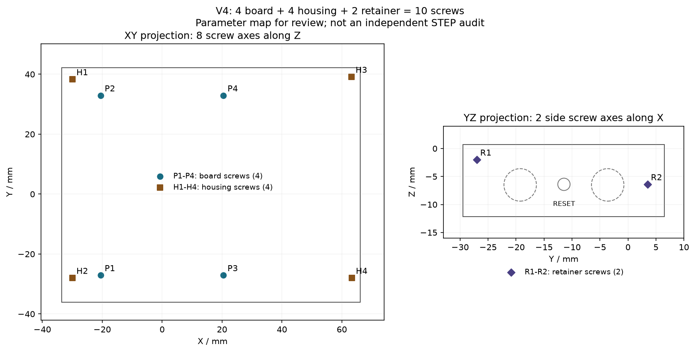

# V4独立结构评审交接包：10颗螺丝、按钮防脱与屏幕固定

2026-10-30。用户要求停止继续想方案或修改结构，先把现状交给另一位独立评审者。**本次只整理资料，不修改CAD、参数、打印文件或检查程序。**

- 仓库：[Gadil123/esp32-design](https://github.com/Gadil123/esp32-design)。开发分支：`codex/gv1-v2-fit-clamp`。
- **本次CAD基准：`d279c1441c8c718b2238da454a96b6ed70d1aaa3`**。该提交含中部出线、用户提供的6.8毫米喇叭厚度及降低后的后盖支撑。
- 当前不是已验收的产品，`print_approved=false`。本轮没有新的V4实物验证。
- [可复制的完整评审prompt](40_g_v4_independent_reviewer_prompt.md)。下面的尺寸和检查结论均须评审者自行验证，不能把本文或docs/33—38当作证明。

## 1. 用户现在要评什么

用户发现设备需要**4颗原板固定螺丝＋4颗合壳螺丝＋2颗侧面压框螺丝＝10颗**，认为为了外侧换按钮又增加压框和螺丝，违背了简单、可靠、方便拆装的目标。

请独立判断：这些紧固件分别承担什么不可替代的作用；是否存在局部解决问题、整体不断增加零件的现象；目前的装配复杂度是否值得；哪些结构真正必要。不要只审查“实体没有碰撞”，也不要预设必须保留10颗，或未经验证承诺减到某个数量。

用户还关注：

- 屏幕周围升高的挡边是否真的不压玻璃，0.4毫米空隙由什么尺寸链保持，能否应对V1出现过的翘曲。
- 两侧小孔、外置压框与按钮凸缘的关系，侧面螺钉和独立压框是否必要。
- 6颗直接在PA12中成牙的螺钉，是否适合试装、换按钮和后续维护；能否采用金属螺纹，代价是什么。
- 如提出更简单方案，必须核对真实装入和拆出路径、屏幕受力和后盖变形约束，不能只删螺丝、缩孔或改成脆弱卡扣。

**本次没有新的简化方案，也没有已经通过的减螺丝CAD。** 先评审，再由用户决定是否修改。

## 2. 用户反馈与证据等级

以下“当前会话口述”来自用户提供的信息，不是实现者的测量记录。

| 来源 | 用户反馈 | 不能据此推断什么 |
|---|---|---|
| 当前会话：V1实物 | 屏幕靠向左上后，下边和右边约有1.3毫米总缝隙；原设计总游隙约1.2毫米 | 差约0.1毫米不等于整件XYZ均为±0.1毫米，更不等于平面度 |
| 当前会话：V1实物 | 屏幕突出前壳，与平整度有关；后盖平整度差、翘起 | 没有新的Z高度或翘曲量实测，不能编造允许压玻璃的载荷 |
| 当前会话：较早候选问题 | 用户描述装上四颗外壳螺丝后侧键按不到 | 不能据此声称当前d279c14版本已打印并试装 |
| 当前会话：新喇叭 | 换成中部出线喇叭，能放入原框，厚度明确为6.8毫米 | 精确XY、新线长、焊点凸起和合盖后的压缩仍未知 |
| 当前会话：打印条件 | 一次打印约7天，没有小规模测试设备 | 不宜默认要求先一轮coupon、再等一轮整壳；同批备件是可选办法，不是已验收的配合 |
| 历史文档转录 | docs/32记录V1后扣断裂、右侧固定不足、曾要求增加1—2颗螺丝 | 文档中的根因判断和“四角必须四颗”是待评审结论，不能当用户原话或实测因果 |

历史反馈全文见[docs/32](32_g_v1_v2_physical_feedback_and_screen_clamp.md)，尤其§1、§7.3、§7.6；原始完整照片、送印文件哈希和独立卡尺记录未附在本包，不应假装已经看到。早期的简单、易拆装目标见[docs/21](21_t0_g_v1_flush_easy_assembly_revision_brief.md)和[docs/23](23_t0_g_v1_integrated_pa12_sidekeys_task.md)，它们的旧几何与旧装配顺序不能直接套到V4。

## 3. 当前零件、螺丝和装配

正常装配用**5个打印零件**：前壳、后壳、共用侧压框、电源按钮、BOOT按钮。打印包有11件，是因为两颗按钮各有四档，另外6颗是备件，不能把八颗按钮全装上。

| 标号 | 数量／用途 | 当前螺钉候选 | 接收螺纹的位置 | 方向 |
|---|---|---|---|---|
| P1—P4 | 4颗，把原板组件固定到后盖 | M2.5×5机牙；候选头Ø5×0.85 | 原板已有M2.5金属安装件；不是PA12自攻 | 后方，沿Z |
| H1—H4 | 4颗，固定前后壳 | 直径2.0×6塑料用成牙；头≤Ø3.6×1.2 | 前壳Ø5.4打印螺柱，底孔Ø1.7 | 后方，沿Z |
| R1—R2 | 2颗，固定侧面共用压框 | 直径1.6×5塑料用成牙；头≤Ø3×1.2 | 前壳Ø1.3盲孔，深4.2；压框通孔Ø1.9 | 侧面，沿X |

螺钉具体SKU、成牙扭矩、孔缩和拆装寿命均未验证。直径2.0／1.6的塑料成牙候选不等于已经采购的M2／M1.6机牙螺丝。**只固定PCB的螺丝是否同时锁住前壳，必须沿接触面和受力路径核对，不能仅凭位置相近判断。**

图是参数坐标投影，不是新的STEP独立验证；P/H是XY投影、R是YZ投影。逐颗坐标和用途见[CSV](../data/g-v4-review-fasteners.csv)，来源及既有检查摘要见[交接快照JSON](../data/g-v4-review-handoff-snapshot.json)。

当前装配顺序：

1. 后盖与原板/显示组件先用4颗P螺丝固定；安置电池、喇叭和线束。
2. 不带按钮和压框，把空前壳从正面降下，装4颗H合壳螺丝。
3. 两颗按钮从外侧插入，再套上共用压框，锁2颗R螺丝。
4. 拆解先卸压框和按钮，再松H螺丝、抬前壳；不能带着长按钮柱直接提壳。

这是当前设计要求的顺序，是否合理正是评审对象。实现者此前优先外侧换按钮、避免带长柱装板，由此引入压框；该取舍并非用户明确要求必须保留的功能。

## 4. 屏幕与按钮的当前名义几何

| 项目 | 当前参数／既有计算值 | 证据入口 |
|---|---|---|
| 整机含默认按钮和螺头 | 102.90×78.26×16.45毫米；壳体本体宽99.60 | checks.json；实际STEP包络 |
| 屏幕挡边 | 下表面离玻璃0.40；厚1.50；顶面高出玻璃1.90；覆盖玻璃边1.00毫米 | `screen_measured`；`t0_g_v4.py`屏口/挡边构造 |
| 玻璃侧向窗口间隙 | 每侧0.75毫米 | `screen_clearance_mm`；窗口截面 |
| 保持屏幕空隙的设想 | 原板金属安装位固定组件；前后壳接缝止挡确定前壳高度；玻璃不作螺钉预载垫块 | 需独立验证刚性接触面、误差、翘曲及夹紧受力链 |
| 后盖 | 主体3.50毫米，有内部筋；局部让位地板1.55；定位环名义单边0.15毫米 | `t0_g_v4.py`；`fasteners`及实际截面 |
| 按钮 | 帽、凸缘、主柱和小触头一体；头Ø5.20、凸缘Ø7.40、主柱Ø3.60、末端Ø1.20 | `g_v4_printed_keys.py`及按钮STEP |
| 按钮防脱 | 压框孔Ø5.80小于凸缘；凸缘在Ø8.00腔室内移动，主柱孔Ø4.20；名义单边游隙0.30 | 需核验真实截面、完整运动与倾斜卡滞，不能只看一条轴线 |
| RESET | 前壳和压框同轴Ø2.20针孔；工具代理Ø0.80，自由针长至少12毫米 | `reset_pinhole`及`v4_interfaces/reset` |
| 喇叭 | XY继承30×20，用户提供厚6.80；中部缺口宽2.60；后支撑降低0.30，留0.30阻尼层；候选路线37.02毫米 | [docs/38](38_g_v4_speaker_center_wire_revision.md)；真实新线长仍未知 |

四档按钮的轴向候选如下。**最后一列不是原开关允许行程**；原开关触发位移、最大安全位移、回弹力、实际打印滑动阻力均保留null。回弹来自原开关，常态空隙内没有额外主动回位机构。

| 每个位置的备件 | 常态空隙 | 几何总行程 | 止挡时越过原静态面 |
|---|---:|---:|---:|
| short | 0.40 | 0.70 | 0.30 |
| nominal（默认） | 0.25 | 0.55 | 0.30 |
| long | 0.10 | 0.40 | 0.30 |
| zero_fit（用户要求的零配备件） | 0 | 0.30 | 0.30 |

单位毫米，零配仅指名义轴向空隙，不指导向孔零间隙，也不保证打印后没有预压。V1原来卡扣断裂，不代表所有卡扣不可用，但不能未经检查就用新脆弱卡扣替掉螺丝。

## 5. 文件入口：看当前快照，不只看PR局部差异

| 内容 | 文件 |
|---|---|
| 当前交付总入口 | [deliverables/g-v4/README.md](../deliverables/g-v4/README.md) |
| 前壳／后盖／压框，STEP＋STL | [front_shell.step](../deliverables/g-v4/front_shell.step)、[front_shell.stl](../deliverables/g-v4/front_shell.stl)、[rear_shell.step](../deliverables/g-v4/rear_shell.step)、[rear_shell.stl](../deliverables/g-v4/rear_shell.stl)、[button_retainer.step](../deliverables/g-v4/button_retainer.step)、[button_retainer.stl](../deliverables/g-v4/button_retainer.stl) |
| 装配与按钮 | [assembly_light.step](../deliverables/g-v4/assembly_light.step)；同目录`button_power_*`、`button_boot_*`共8组STEP/STL，装配仅含nominal两件 |
| 关键图 | [按钮剖面](../deliverables/g-v4/printed_buttons_section.png)、[屏幕剖面](../deliverables/g-v4/screen_lip_section.png)、[挡边局部](../deliverables/g-v4/screen_lip_zoom.png)、[壳螺钉剖面](../deliverables/g-v4/ear_screw_section.png)、[喇叭缺口](../deliverables/g-v4/speaker_notch_section.png) |
| 参数／主体 | [t0-g-v4.json](../cad/t0/t0-g-v4.json)、[t0_g_v4.py](../cad/t0/t0_g_v4.py) |
| 按钮／检查 | [g_v4_printed_keys.py](../cad/t0/g_v4_printed_keys.py)、[g_v4_slider_checks.py](../cad/t0/g_v4_slider_checks.py)、[g_v4_checks.py](../cad/t0/g_v4_checks.py)、[g_v4_interfaces.py](../cad/t0/g_v4_interfaces.py)（含历史0127函数，不能混当当前滑动按钮） |
| 生成器／说明 | [generate_g_v4.py](../cad/t0/generate_g_v4.py)、[g_v4_documentation.py](../cad/t0/g_v4_documentation.py) |
| 构建入口 | [scripts/generate-g-v4.sh](../scripts/generate-g-v4.sh)；本机采用`.venv/bin/python`和build123d，完整构建较耗时 |
| 独立回读入口 | [scripts/check-g-v4-interfaces.py](../scripts/check-g-v4-interfaces.py) |
| 既有输出／记录 | [checks.json](../deliverables/g-v4/checks.json)、[MANIFEST.sha256](../deliverables/g-v4/MANIFEST.sha256)、[实配表](../deliverables/g-v4/printed_button_fit_sheet.md)、[最新几何复算](../data/g-v4-speaker-center-validation.json) |
| 旧评审与修订 | [33](33_g_v1_v4_reviewer_package.md)、[34](34_codex_v4_review.md)、[35](35_g_v1_v4_fix_log.md)、[36](36_g_v1_v4_independent_preprint_review.md)、[37](37_g_v1_v4_printed_buttons_and_screen_fit.md)、[38](38_g_v4_speaker_center_wire_revision.md) |

PR相对main包含较早的V1/95毫米/V2历史。**评审主对象是d279c14的完整V4，不是所有旧目录一起送印。** “不改V1”从上一轮独立评审基准`d20ac78`起执行；不能把PR相对更早main的历史差异误算成本轮整理的修改。现有记录称122个V1相关文件在该阶段保持一致，评审者可自行复核；这不是用户实际送印文件哈希的证明。

## 6. 官方原始参考：从上游读，不在这里重发布

权威板卡参考由[official-reference.json](../cad/t0/official-reference.json)固定到微雪仓库提交`77a7dceac38a1bd491173b3906205217a382c08c`：

- [官方STEP](https://github.com/waveshareteam/ESP32-C5-Touch-LCD-2.8/blob/77a7dceac38a1bd491173b3906205217a382c08c/dimensions/ESP32-C5-Touch-LCD-2.8.stp)：项目展开记录为723个实体；SHA256记录为`73c84092e7d6b55574125d2bf0885a61688514762b796ca43c98dfed1bc18c5c`，应自行校验。
- [官方尺寸PDF](https://github.com/waveshareteam/ESP32-C5-Touch-LCD-2.8/blob/77a7dceac38a1bd491173b3906205217a382c08c/dimensions/ESP32-C5-Touch-LCD-2.8.pdf)、[DXF](https://github.com/waveshareteam/ESP32-C5-Touch-LCD-2.8/blob/77a7dceac38a1bd491173b3906205217a382c08c/dimensions/ESP32-C5-Touch-LCD-2.8.dxf)、[原理图](https://github.com/waveshareteam/ESP32-C5-Touch-LCD-2.8/blob/77a7dceac38a1bd491173b3906205217a382c08c/schematic/ESP32-C5-Touch-LCD-2.8.pdf)。
- 项目索引与坐标：[docs/06](06_official_board_reference.md)、[docs/07](07_cad_measurements.md)、[docs/02](02_hardware_orientation.md)、[data/t0_interface_bounds.csv](../data/t0_interface_bounds.csv)、[data/step_component_bounds.csv](../data/step_component_bounds.csv)。这些同源表不算两次独立物理测量。
- 官方资料不复制到deliverables或提交进仓库。可以临时下载到评审环境，只读使用。若网页版环境无法打开或解析，明确写出哪些几何没有复核。

嘉立创参考：

- [中文设计规范](https://www.jlc-3dp.cn/technicalColumnsDetails/27832.html)、[英文设计规范](https://jlc3dp.com/help/article/3d-printing-design-guideline)、[PA12介绍](https://www.jlc-3dp.cn/technicalColumnsDetails/59512.html)、[工艺指南](https://jlc3dp.com/blog/how-to-design-3d-models-for-printing)。尺寸公差和翘曲必须分开，不能因一次XY观察认定整机±0.1毫米。
- [镶嵌螺母服务](https://jlc3dp.com/help/article/threaded-insert-service)，2026-10-30查阅的页面标注更新于2026-10-21：公开标准服务为M3/M4/M5共8种，孔壁要求3毫米、安装平面≥14×14毫米，不支持自定义规格。请重新核对实际服务，不把它理解成M2小嵌件在业界不存在，也不能给当前模型直接勾选该服务。该页面最小一类M3嵌件外径4毫米、安装孔Ø3.6；现Ø5.4螺柱若直接扩孔，名义径向只余0.9毫米，尚未满足该服务要求。

## 7. 既有检查证明到哪里

现有日志/输出报告：完整生成退出0、11件STEP/STL回读、26个破坏负对照、14个空前壳直线姿态。按钮轴向扫掠与取出路径是连续几何检查；径向仅离散采样；倾斜、摩擦、疲劳、手指操作、热湿变化和真实线束均未因此得到证明。

**这些检查没有评价“10颗螺丝是否合理”“外置压框值不值得”“产品是否过度复杂”。** 输出里的`preprint_blockers_P1=[]`仅是上一轮实现的状态声明，不约束新评审的严重度，也不构成放行。

本次整理只重新核对当前文件哈希和抽取现有参数，没有重跑耗时的完整CAD构建；没有将旧检查计数包装为新的独立评审结果。若评审者运行检查，必须对至少一项关键功能做临时负对照，确认几何改坏会失败，并恢复临时改动。

## 8. 期望评审输出

在本Draft PR提交正式review，总评面向项目所有者，用普通中文说明：当前能否值得打样、哪些复杂度有理由、哪些没有；逐条列P0/P1/P2、文件/行号与几何证据、用户影响、已验证/未验证边界。能在代码位置定位的意见留inline review comment。

如建议简化，给一个优先方向及明确代价，逐项说明能否减少零件/螺钉、如何固定板卡和按钮、如何装入拆出、如何避开玻璃预载、如何应对后盖翘曲。方案须标明“概念”或“已复算”，不要编造已经通过的4/6/8螺丝方案。**本次只评审，不改CAD、不自动修复、不合并、不下单、不打印。**
